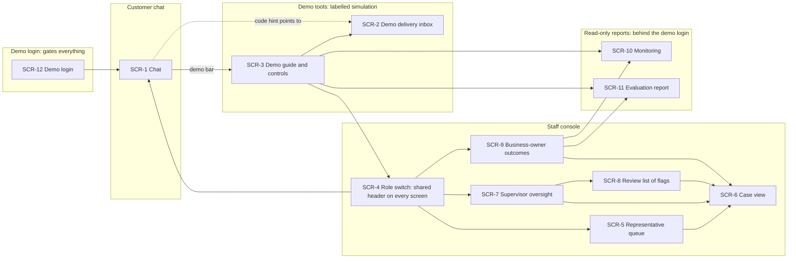

# UX-1 · Sitemap — Meridian AI service agent

> **Status:** DRAFT 2026-10-20 · UX-1 · **PRD v0.4, approved at Stage 4** (drafted on v0.2; re-checked against 0.4). **R-48 pass 2026-10-21:** one demo login (SCR-12) now gates the whole deployment, and SCR-4 becomes the role switch.
> Flows: [`USER_FLOWS.md`](USER_FLOWS.md) · Stories: [`USER_STORIES.md`](USER_STORIES.md).
> **One login, then three surfaces and two report pages** (PRD §6.2: one FastAPI service). Nothing except the login (SCR-12) and `/healthz` answers without the demo login (R-48). Behind it: the **customer chat**, the **demo tools** (inbox, guide and controls, all labelled as simulation), the **staff console** with its own header and look (consolidated §8: "separate entry points … different chrome"), and the **monitoring and evaluation pages**. A **role switch** (SCR-4: customer, representative, supervisor, owner, no passcode) sits in a shared header on every screen, so the reviewer plays both sides without another sign-in.
> **Phone first for the customer chat** (profile §6: one-handed use at the unit); **laptop first for the staff console**, usable at phone width (PRD §5).

## Screens

| Screen | Surface | Reached from | Flows | Notes |
|---|---|---|---|---|
| SCR-1 | Customer chat (`/`, behind the demo login) | SCR-12 after login (the customer role is the default); the role switch; the demo guide | FLOW-1, FLOW-2, FLOW-3, FLOW-4, FLOW-5, FLOW-6, FLOW-7, FLOW-8, FLOW-12 | One conversation screen. A persistent "Talk to a person" control; a thin demo bar (demo date, staffing state, link to the demo guide); a simulated-staffing banner whenever the simulation is on. Reply cards: source chip, safety card, code prompt, account card, slot card, confirmation, change request, handoff card with reference and promise, follow-up chooser, limit notice. The handoff card stays reachable after it is shown. Contracts: CON-1, CON-2, CON-3, CON-4, CON-5 |
| SCR-2 | Demo tools (`/demo/inbox`, behind the demo login) | Demo guide; the code-prompt card's "Open the demo inbox" link | FLOW-3, FLOW-12 | Header: "Simulated messages. Nothing is sent to anyone. This exists only so reviewers can complete verification." Codes only, never follow-ups (OD-5). Contracts: CON-6 |
| SCR-3 | Demo tools (`/demo`, behind the demo login) | Demo bar on SCR-1 and on the staff console | FLOW-8, FLOW-12 | What is real and what is simulated; how to play both roles (the role switch, or two tabs); staffing toggle "Demo: simulate staff on shift"; reset; links to the inbox, console, monitoring and evaluation. Contracts: CON-7, CON-9 (both need the login session) |
| SCR-4 | Role switch (shared header on every screen; optional full page at `/role`, proposed) | Every screen's header; the demo guide | FLOW-8, FLOW-9, FLOW-10, FLOW-11, FLOW-12 | **Replaces the staff sign-in.** A one-click control that shows the current role and switches between customer, representative ("Riley, demo representative"), supervisor and business owner, with no passcode; the optional full page explains what each role sees. Staff data is served only while the role is a staff role. Contracts: CON-10 |
| SCR-5 | Staff console (`/staff/queue`) | Role switch to representative; console nav | FLOW-7, FLOW-8, FLOW-9, FLOW-12 | "Needs my action": P0 and P1 first, then due time, overdue first; the live queue while staffed. Contracts: CON-11 |
| SCR-6 | Staff console (`/staff/cases/{id}`) | Queue, oversight, review list, owner numbers | FLOW-8, FLOW-9, FLOW-10, FLOW-11 | Eight-heading brief; sources (snapshot vs current, changed-since); full conversation; promise with follow-up preference beside it; identity status; actions; live-chat pane when joined; flag. Contracts: CON-12, CON-13, CON-14, CON-15, CON-16 |
| SCR-7 | Staff console (`/staff/oversight`) | Role switch to supervisor; console nav | FLOW-8, FLOW-10 | P0 and P1, unowned, due soon, overdue, stuck waiting; assign and reassign; change priority; start or end the simulated shift; advance simulated time. Contracts: CON-17, CON-13, CON-7, CON-8 |
| SCR-8 | Staff console (`/staff/flags`) | Oversight; console nav | FLOW-9, FLOW-10 | Flags on answers, briefs and escalations, each linked to its case; nothing here edits the KB. Contracts: CON-16 |
| SCR-9 | Staff console (`/staff/owner`) | Role switch to business owner; console nav | FLOW-11 | In-scope correct resolution, promises kept on time, outcomes with denominators, handoffs by reason; every number opens its cases. Contracts: CON-18 |
| SCR-10 | Read-only report (`/monitoring`, behind the demo login) | Owner panel; demo guide | FLOW-11 | Volume, containment, escalations by reason, failures, latency p50 and p95, spend against the daily cap, alerts as decision lines (they live here: no push channel, PRD R-35), when the health check last restarted the service; health kept apart from correctness; redacted; no traces (Langfuse stays on the VPS, R-36). Read-only aggregates, readable in any role once signed in (the earlier proposal to leave it open without sign-in is reversed by R-48). Contracts: CON-19 |
| SCR-11 | Read-only report (`/eval`, behind the demo login) | Owner panel; demo guide | FLOW-11 | Latest run, per split: the headline from the sealed held-out split, dev-split numbers labelled dev (R-38); test-set mix and size, retrieval hit rate, accuracy on handled drivers, escalation recall, false escalation, wrong answers, safety and request gates, promise consistency; each with its denominator, run ID and date. Read-only, readable in any role once signed in (earlier open-access proposal reversed by R-48). Contracts: CON-20 |
| SCR-12 | Demo login (`/login`) | The deployment URL; any screen when there is no session or it has expired | FLOW-12 | The entry to everything. One username and one password (from Railway variables, given to the reviewer in the README), a plain statement that this is a demonstration of Meridian's assistant and not a Meridian account, one error message for every refused login. On success: the page that was asked for, else SCR-1 as the customer. The only screen, with `/healthz`, that answers without a session. Contracts: CON-22 |

## Every flow ends on a screen

| Flow | Ends on |
|---|---|
| FLOW-1 | SCR-1 (answer with source, or the person offer) |
| FLOW-2 | SCR-1 (safety card pinned; P0 or P1 case) |
| FLOW-3 | SCR-1 (verified, or handoff card) |
| FLOW-4 | SCR-1 (account card, or handoff card) |
| FLOW-5 | SCR-1 (confirmation card, alternatives or handoff) |
| FLOW-6 | SCR-1 (new confirmation, or change-request card) |
| FLOW-7 | SCR-1 (handoff card); case visible on SCR-5 |
| FLOW-8 | SCR-1 and SCR-6 (handed back or closed) |
| FLOW-9 | SCR-6 (resolved or closed unresolved) |
| FLOW-10 | SCR-7 and SCR-8 |
| FLOW-11 | SCR-9, SCR-10, SCR-11 |
| FLOW-12 | SCR-3 (with SCR-1 and SCR-5 open side by side: chat routes ignore the role, CON-10) |

## Proposals in this sitemap (settled at UX-3, or earlier if Innocent objects)

- **Monitoring and evaluation are no longer readable without sign-in** (reversed 2026-10-21 by R-48, Innocent: "it should be password-gated in general"). SCR-10 and SCR-11 sit behind the same demo login as everything else; they stay read-only aggregates, redacted, and any role can open them. SCR-9 (owner outcomes) still opens cases.
- **The role switch replaces the staff sign-in.** SCR-4 keeps its ID but is no longer a gate: it is a control in a shared header on every screen (with an optional full page), so switching between customer and staff is one click from anywhere. It is a label, not security; the login is the only gate. **Assumed [A]:** the role is held per browser tab (the login cookie is shared), so a reviewer can still keep the chat in one tab and the console in another.
- **One demo guide page** (SCR-3) holds the staffing toggle and reset; the supervisor view repeats the staffing toggle and adds the clock, because those are supervisor actions in the story (consolidated §6).
- **The handoff reference stays on the chat**, not a separate "my request" page: a returning customer quotes the reference in chat (consolidated §6 transitions).
