# UX-1 · Journeys and flows — Meridian AI service agent

> **Status:** DRAFT 2026-10-20 · UX-1 · **PRD v0.4, approved at Stage 4** (drafted on v0.2 beside the interview; re-checked against 0.4: R-35, R-36, R-38). **R-48 pass 2026-10-21:** every flow now runs behind one demo login (SCR-12, CON-22); "demo staff sign-in" became "switch role" (CON-10).
> Stories: [`USER_STORIES.md`](USER_STORIES.md) · Screens: [`SITEMAP.md`](SITEMAP.md) · Draft contracts: list at the end (one line each; full CON cards and the OpenAPI come at UX-3).
> **All four hard-problem cards are chosen** (Stage 3, Innocent 2026-10-20), so no flow rests on an open card. Each flow names the card it carries out.
> **The clock is fixed:** every flow runs on the dataset's "today", **Fri 2026-10-16** (R-3). Dates below use it.

**What a flow is here.** A flow is the path one person takes through the product to finish one job. It shows the
steps, the decisions, the error branches, the screen each step happens on, the data it reads or writes, and the
draft contract (`CON-N`: the request the screen makes to the backend) that carries that data.

**One thing to know about the chat.** Most customer flows happen on one screen, the chat (SCR-1). The assistant's
replies are not plain text only: a reply can carry a **card** (a safety instruction, a set of time slots, a code
prompt, a handoff card with the reference and promise). Every customer message and every button on a card goes
through the same turn contract, **CON-2**. So a booking flow is several CON-2 turns, not a separate booking API that
the screen calls. The agent's code (System track) decides what the turn does; the screen only shows what comes back.

## Journeys (one per user type)

The scores are the **feeling we aim for** at each step, from 1 (bad) to 5 (good). They are a design proposal, not
measured data.

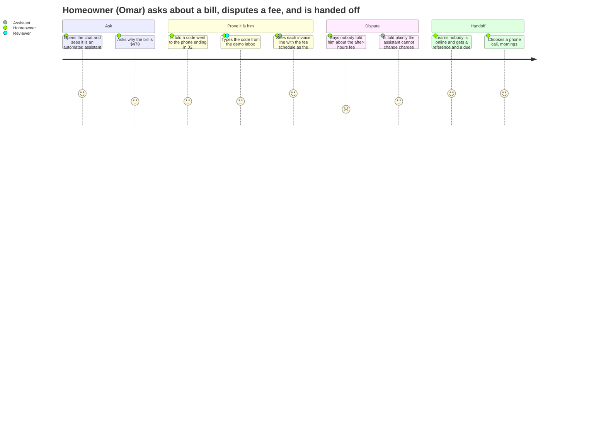

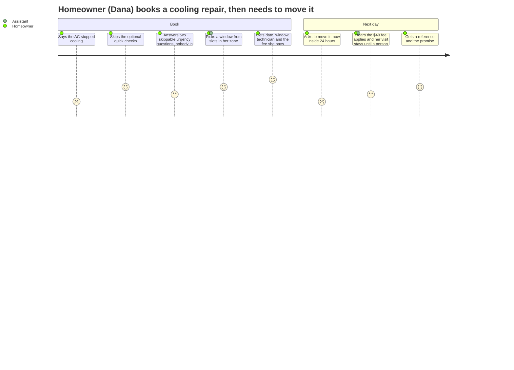

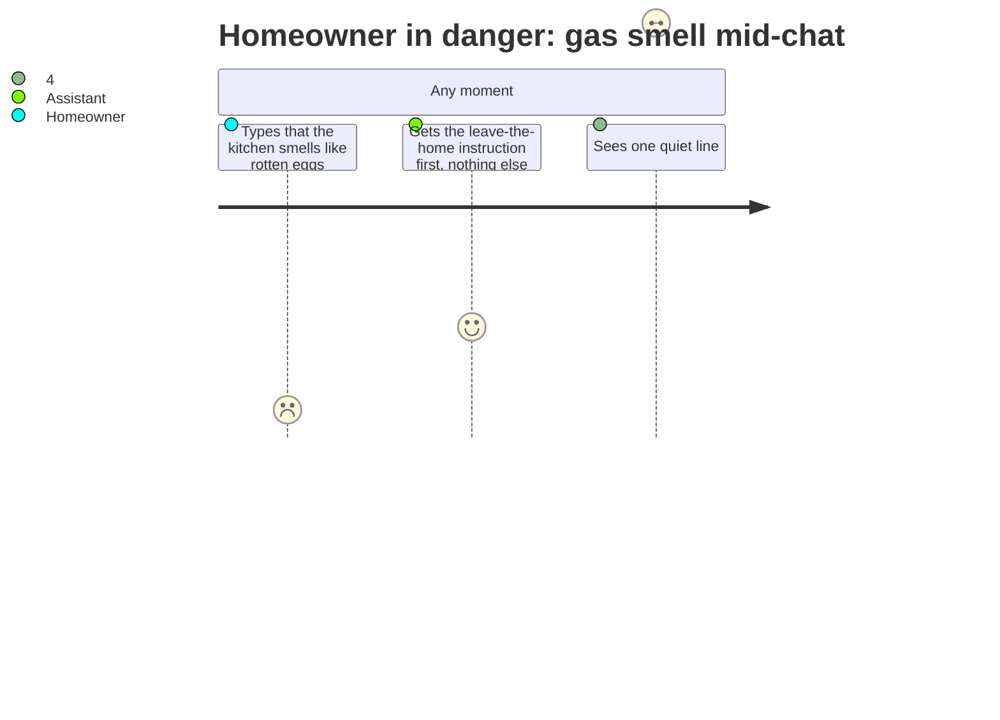

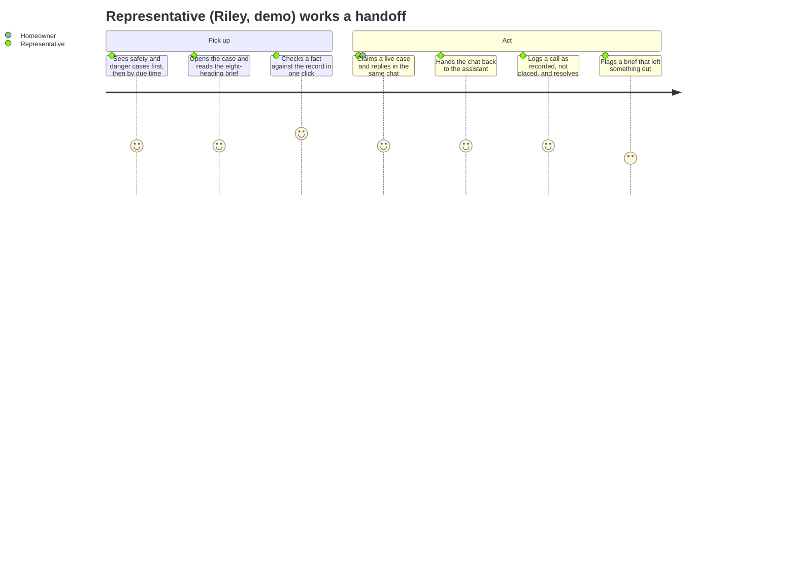

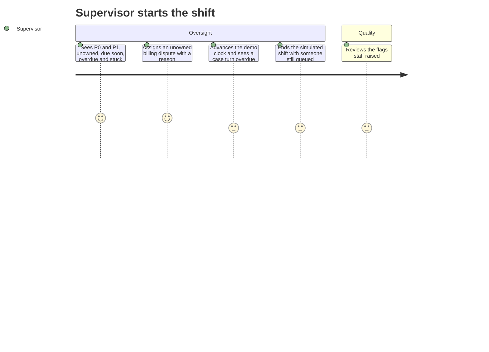

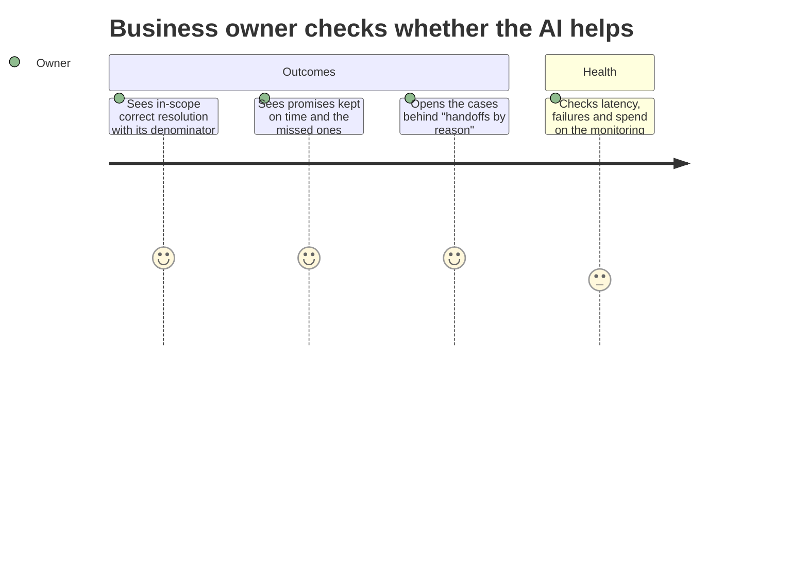

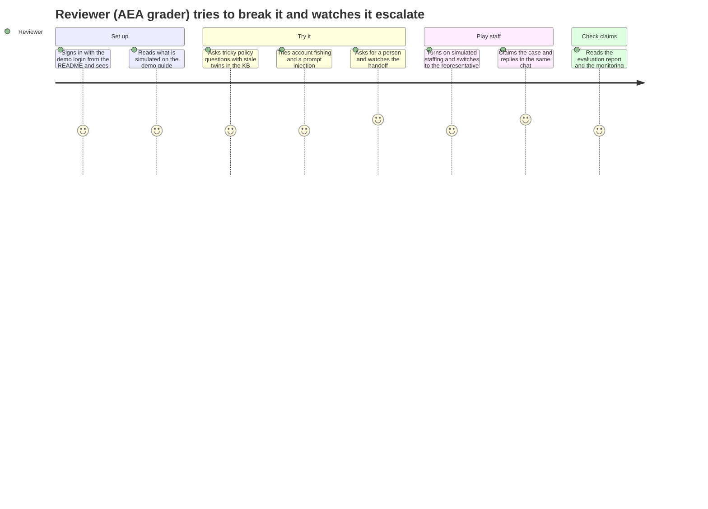

---

## Flows

### FLOW-1 · Ask a question and get a sourced answer (or an honest "I don't know")
- Stories: US-1, US-6, US-7, US-17, US-26
- Hard problem: HP-1 (two-layer orchestration)
- Start: SCR-1 opened after the demo login (SCR-12) · End: SCR-1, answer shown with its source, or the person offer
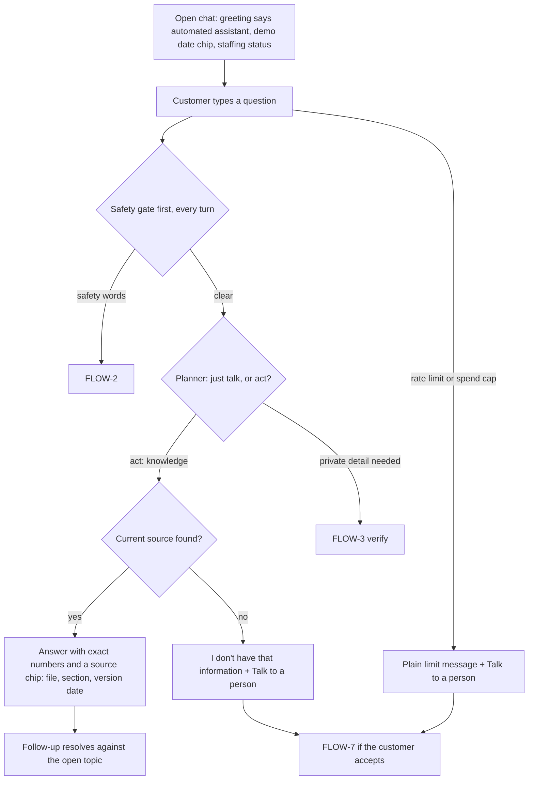
| Step | Actor | Screen | Data read / written | Contract | State after |
|---|---|---|---|---|---|
| 1 | Homeowner | SCR-1 | new conversation; greeting, demo clock, staffing state | CON-1 | conversation open, AI in control |
| 2 | Homeowner | SCR-1 | message sent; reply blocks with source chips | CON-2 | turn stored; lookup log written (System track) |
| 3 | Homeowner | SCR-1 | source chip opens the passage and its version date | CON-2 (sources inside the reply) | — |
| err | Homeowner | SCR-1 | limit reached: limit card with the person option | CON-2 (error block) | handoff offered |

### FLOW-2 · Safety and danger interrupt (any turn)
- Stories: US-3, US-4, US-5
- Hard problem: HP-2 (rules first, a raise-only classifier)
- Start: SCR-1, any message, including mid-booking · End: SCR-1, safety card pinned; P0 or P1 case written
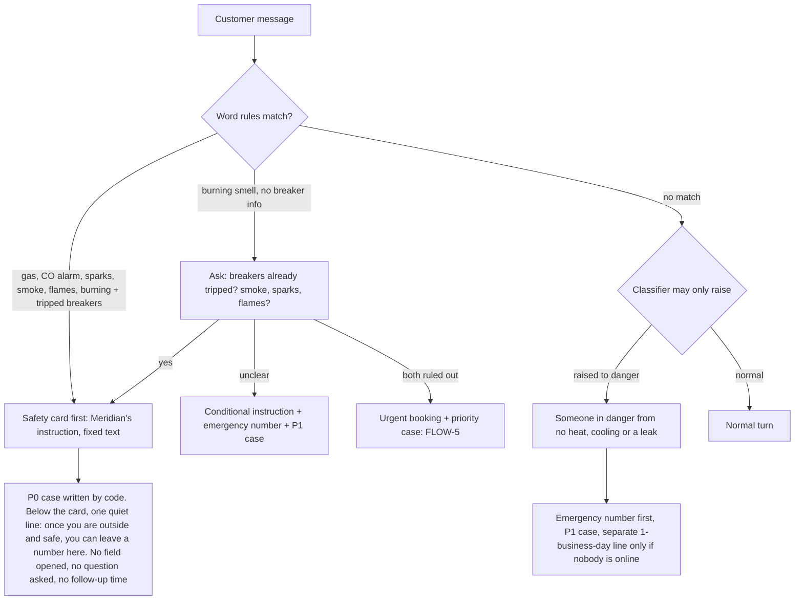
| Step | Actor | Screen | Data read / written | Contract | State after |
|---|---|---|---|---|---|
| 1 | Homeowner | SCR-1 | message; reply is a safety card (fixed text, no model) | CON-2 | P0 or P1 case written by code |
| 2 | Homeowner | SCR-1 | optional contact details (name, phone), only if the customer chooses to give them later | CON-2 | case updated; no account match required |
| 3 | Homeowner | SCR-1 | burning-smell questions answered by tapping yes / no / not sure | CON-2 | path chosen |
| err | System | SCR-1 | classifier fails or times out: the rules' result stands | CON-2 | normal path or rule path |

**Why the contact offer waits (UX-2 finding R2-2, 2026-10-20; proposal).** Meridian's policy says to leave "immediately" and call "from outside" (`policies/escalation_and_safety.md`), and the gas utility's own page says not to use a phone indoors (REFERENCES R2-2). So the card is Meridian's instruction word for word, and nothing on it invites more typing: no field, no question, no prompt. The optional offer (R-6, WP-5) is one line addressed to after they are outside. This changes when the offer appears, not the requirement.

### FLOW-3 · Verify with a one-time code
- Stories: US-8, US-25
- Hard problem: HP-3 (actions with rules attached)
- Start: SCR-1, a question needing private data · End: SCR-1 verified for this customer and session, or a handoff that reveals nothing
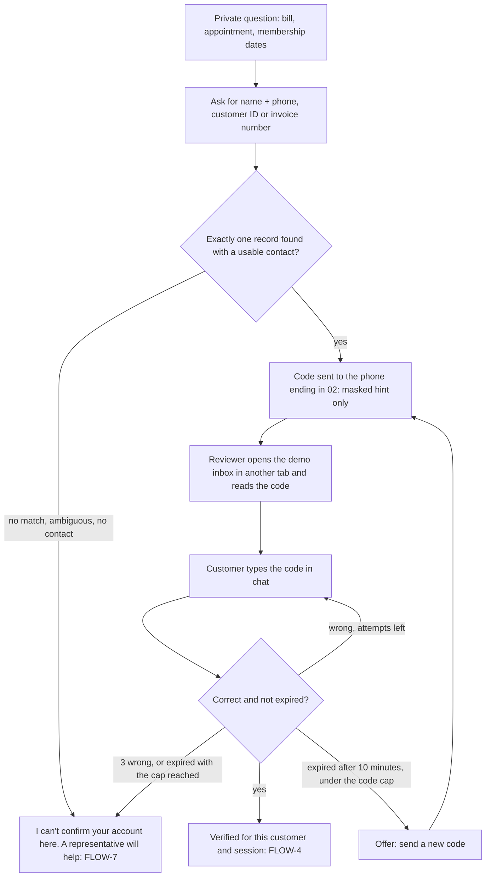
| Step | Actor | Screen | Data read / written | Contract | State after |
|---|---|---|---|---|---|
| 1 | Homeowner | SCR-1 | locator details | CON-2 | record located or not (never revealed) |
| 2 | System | SCR-2 | simulated code delivered to the demo inbox, labelled "Simulated messages" | CON-6 | code stored hashed, 10-minute expiry |
| 3 | Reviewer | SCR-2 | reads the code | CON-6 | — |
| 4 | Homeowner | SCR-1 | code entered in a code field on the prompt card | CON-2 | verified, or attempt counted |
| err | Homeowner | SCR-1 | expired code → "send a new code" while under the per-conversation cap (proposal, cap set at §6) | CON-2 | new code; attempts reset |
| err | Homeowner | SCR-1 | no match / 3 wrong / cap reached → handoff card, no account detail | CON-2 | case created, identity "not verified" |

### FLOW-4 · Account answers after the code (invoice, membership, warranty)
- Stories: US-9, US-16
- Hard problem: HP-3
- Start: SCR-1 verified · End: SCR-1 answer shown, or FLOW-7 when the customer disputes or asks for an action the systems can't do
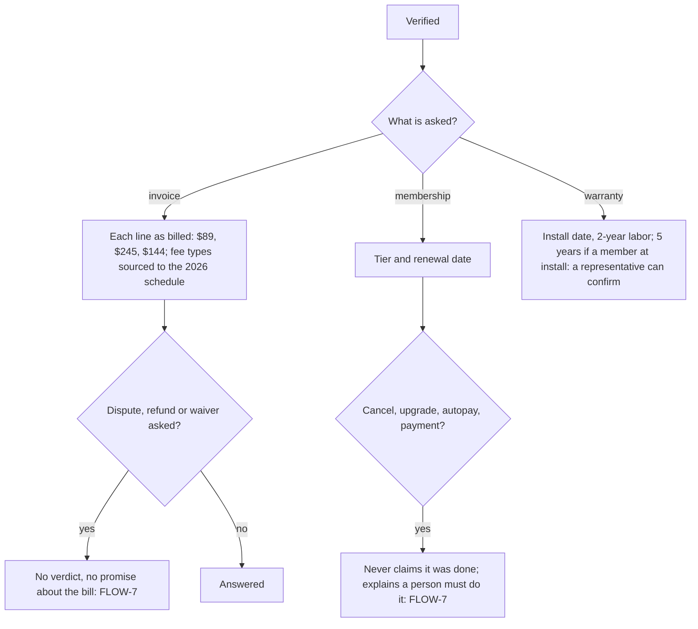
| Step | Actor | Screen | Data read / written | Contract | State after |
|---|---|---|---|---|---|
| 1 | Homeowner | SCR-1 | invoice, membership or warranty fields shown in an account card | CON-2 | lookup log has the record IDs |
| 2 | Homeowner | SCR-1 | dispute or unsupported action → handoff card | CON-2 | case with policy reason |

### FLOW-5 · Book a repair, tune-up or estimate
- Stories: US-5, US-10, US-11, US-17
- Hard problem: HP-3; HP-2 for the danger branch
- Start: SCR-1, "my AC stopped cooling" · End: SCR-1 confirmation card (date, window, technician, fee), or an alternative or handoff
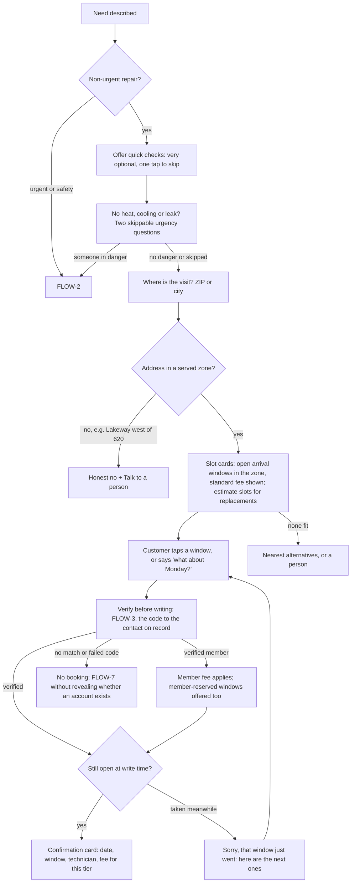
| Step | Actor | Screen | Data read / written | Contract | State after |
|---|---|---|---|---|---|
| 1 | Homeowner | SCR-1 | quick-check offer; skip | CON-2 | open task "booking" in state |
| 2 | Homeowner | SCR-1 | urgency answers (or skip) | CON-2 | booking note holds the answers |
| 3 | Homeowner | SCR-1 | ZIP or city → zone; slot card from availability (zone, service type), standard fee | CON-2 | slots shown, not held; nothing private read |
| 4 | Homeowner | SCR-1 | window chosen → code to the contact on record (FLOW-3) | CON-2, CON-6 | verified for this customer and session |
| 5 | Homeowner | SCR-1 | tier read after the code; member fee and member-reserved windows if a member | CON-2 | fee for this tier known |
| 6 | Homeowner | SCR-1 | slot re-checked and booking written in one transaction | CON-2 | appointment in the working DB copy |
| err | Homeowner | SCR-1 | slot taken → alternatives; out of area → honest no; no match or failed code → no booking, handoff | CON-2 | no double booking; nothing revealed |

**Why the code comes after the windows (UX-2 finding R1-1, 2026-10-20; proposal).** A real Austin HVAC booking widget
asked for name, phone and email before showing any time (REFERENCES R1-1). Showing the arrival windows and the standard
fee first costs nothing private: the zone comes from a ZIP or city the customer types. A booking is an account change,
so the code still comes **before the write** (R-15; consolidated §8 step 2). The member fee and member-reserved windows
need the verified record, so they appear after the code.

### FLOW-6 · Change an appointment: reschedule, confirm, cancel
- Stories: US-12, US-13
- Hard problem: HP-3 (no fee-bearing change by the AI)
- Start: SCR-1, verified, "can I move my Saturday visit?" · End: SCR-1 new confirmation, or a staff change request with "your original appointment stays"
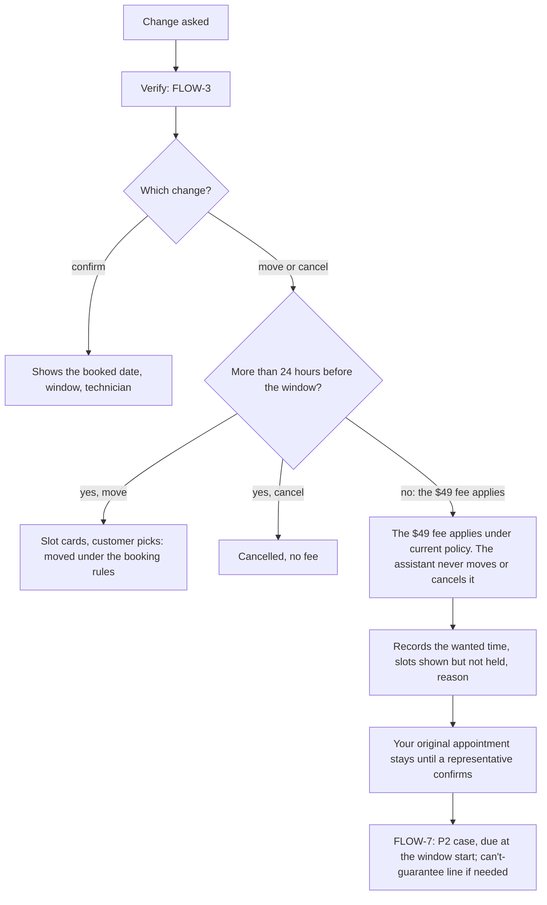
| Step | Actor | Screen | Data read / written | Contract | State after |
|---|---|---|---|---|---|
| 1 | Homeowner | SCR-1 | appointment card (after the code) | CON-2 | — |
| 2 | Homeowner | SCR-1 | fee-free move or cancel written | CON-2 | appointment changed |
| 3 | Homeowner | SCR-1 | fee-bearing: change-request card with fee line and "original stays" line | CON-2 | case P2 with the request; appointment unchanged |

### FLOW-7 · Handoff when nobody is online (the default)
- Stories: US-2, US-14, US-16
- Hard problem: HP-4 (honest handoff, brief with no invented facts)
- Start: SCR-1, "Talk to a person", a policy trigger, a failure signal or an unsupported action · End: SCR-1 handoff card (reference, promise, follow-up choice); case Unassigned on SCR-5
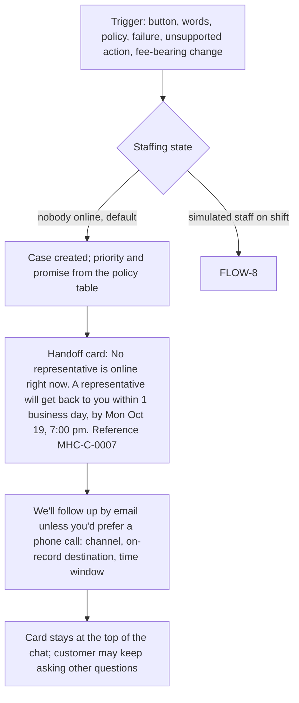
| Step | Actor | Screen | Data read / written | Contract | State after |
|---|---|---|---|---|---|
| 1 | Homeowner | SCR-1 | "Talk to a person" button | CON-4 | case created, Unassigned, brief written |
| 1b | Homeowner | SCR-1 | the same request in words | CON-2 | same |
| 2 | Homeowner | SCR-1 | follow-up choice (email or phone, window) | CON-5 | promise record holds the preference |
| 3 | Homeowner | SCR-1 | nothing claims a message was sent | — | — |

### FLOW-8 · Live handoff when staff are on shift (simulated), and same-chat takeover
- Stories: US-15, US-20, US-25
- Hard problem: HP-4
- Start: SCR-3, reviewer turns on "Demo: simulate staff on shift"; SCR-1 customer asks for a person · End: SCR-1 back with the assistant or closed; case Resolved or In progress
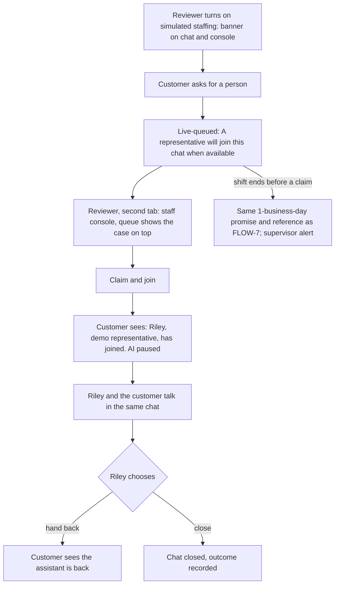
| Step | Actor | Screen | Data read / written | Contract | State after |
|---|---|---|---|---|---|
| 1 | Reviewer | SCR-3 | staffing state on | CON-7 | presence = simulated on shift |
| 2 | Homeowner | SCR-1 | request → live-queued card | CON-4 | case Live-queued |
| 3 | Reviewer | SCR-4 | switch role to representative | CON-10 | role = representative |
| 4 | Reviewer | SCR-5 | live queue | CON-11 | — |
| 5 | Reviewer | SCR-6 | claim + join | CON-13, CON-14 | case In progress; controller = staff |
| 6 | Homeowner | SCR-1 | joined notice; staff messages arrive | CON-3 | AI paused |
| 7 | Reviewer | SCR-6 | send messages; hand back or close | CON-14 | controller = AI, or chat closed |
| err | Reviewer | SCR-3 or SCR-7 | ends the shift with a live-queued case | CON-7 | case → Unassigned with the async promise; alert |

### FLOW-9 · Representative works a case after the chat (async)
- Stories: US-18, US-19, US-21
- Hard problem: HP-4
- Start: SCR-4 switch role to representative → SCR-5 queue · End: SCR-6 case Resolved or Closed unresolved; promise Kept or Missed
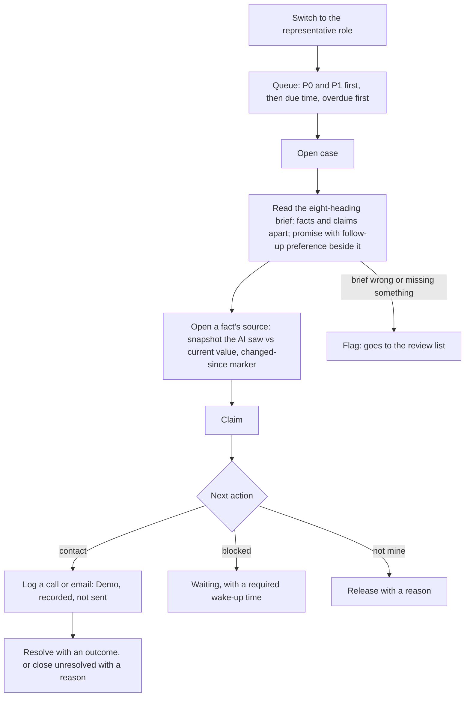
| Step | Actor | Screen | Data read / written | Contract | State after |
|---|---|---|---|---|---|
| 1 | Representative | SCR-4 | switch role to representative | CON-10 | role = representative |
| 2 | Representative | SCR-5 | queue | CON-11 | — |
| 3 | Representative | SCR-6 | case: brief, sources, chat, promise, identity | CON-12 | — |
| 4 | Representative | SCR-6 | claim, waiting, release, resolve, close | CON-13 | lifecycle state; promise status |
| 5 | Representative | SCR-6 | contact activity, labelled recorded not sent | CON-15 | activity on the case |
| 6 | Representative | SCR-6 | flag an answer, brief or escalation | CON-16 | flag on the review list |

### FLOW-10 · Supervisor oversight and the demo clock
- Stories: US-22, US-23
- Hard problem: HP-4
- Start: SCR-4 switch role to supervisor → SCR-7 · End: SCR-7 every P0/P1 and overdue case owned; flags reviewed on SCR-8
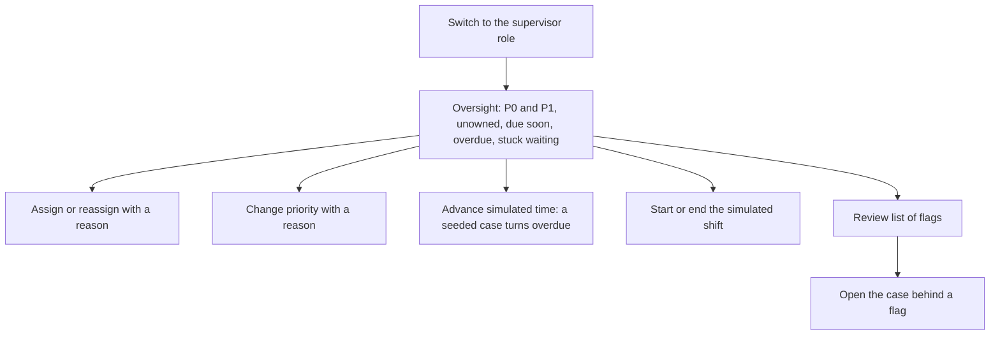
| Step | Actor | Screen | Data read / written | Contract | State after |
|---|---|---|---|---|---|
| 0 | Supervisor | SCR-4 | switch role to supervisor | CON-10 | role = supervisor |
| 1 | Supervisor | SCR-7 | oversight buckets with owner, age, follow-up preference | CON-17 | — |
| 2 | Supervisor | SCR-7 | assign, reassign, change priority | CON-13 | owner or priority changed, reason logged |
| 3 | Supervisor | SCR-7 | advance simulated time | CON-8 | demo clock moved; due states recomputed |
| 4 | Supervisor | SCR-7 | start or end the shift | CON-7 | presence changed |
| 5 | Supervisor | SCR-8 | flags list; open a case | CON-16, CON-12 | flag reviewed |

### FLOW-11 · Business owner and reviewer read outcomes, health and the evaluation
- Stories: US-24, US-27
- Hard problem: none
- Start: SCR-4 switch role to owner (or the reviewer, already signed in) · End: SCR-9 / SCR-10 / SCR-11, any number opened down to its cases or its run
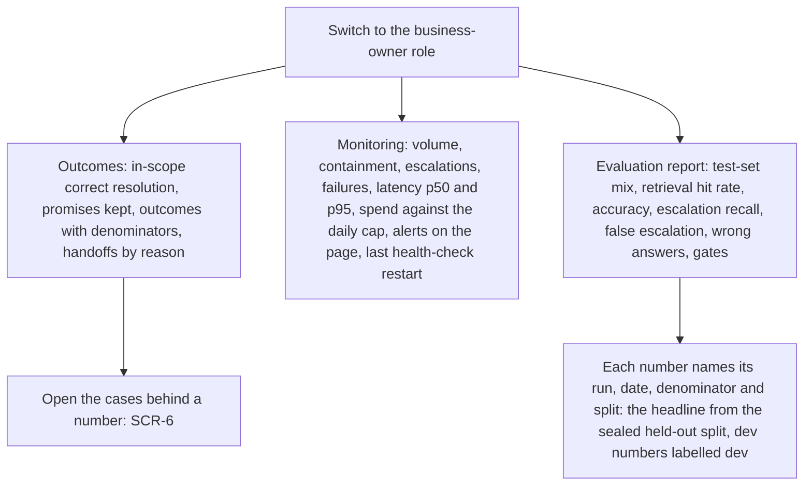
| Step | Actor | Screen | Data read / written | Contract | State after |
|---|---|---|---|---|---|
| 0 | Owner | SCR-4 | switch role to business owner (SCR-10 and SCR-11 open in any role once signed in) | CON-10 | role = owner |
| 1 | Owner | SCR-9 | outcome measures with denominators and case links | CON-18 | — |
| 2 | Owner / Reviewer | SCR-10 | health measures, spend vs cap, alerts as decision lines, last restart; redacted; no traces (they stay in Langfuse on the VPS) | CON-19 | — |
| 3 | Reviewer | SCR-11 | latest eval run, per split (held-out headline, dev labelled) | CON-20 | — |

### FLOW-12 · Reviewer signs in, sets up and resets the demo
- Stories: US-25, US-26, US-28
- Hard problem: HP-4 (never imply real staffing)
- Start: the deployment URL → SCR-12 demo login · End: SCR-1 and SCR-5 open side by side (the chat ignores the role, so a customer tab keeps working while another tab is staff); demo restorable
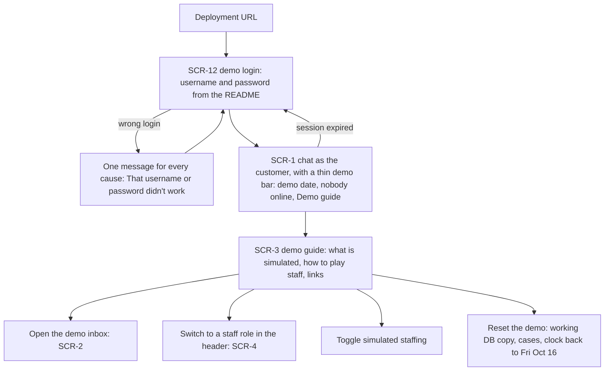
| Step | Actor | Screen | Data read / written | Contract | State after |
|---|---|---|---|---|---|
| 0 | Reviewer | SCR-12 | username and password from the README | CON-22 | login session; role = customer |
| 1 | Reviewer | SCR-1 | demo bar: clock and staffing state | CON-1 | — |
| 2 | Reviewer | SCR-3 | staffing toggle | CON-7 | presence changed |
| 3 | Reviewer | SCR-3 | reset | CON-9 | working copy and case store restored; seeded cases back; login and role kept |
| 4 | Reviewer | SCR-4 | switch role between customer and staff, one click from any screen | CON-10 | role changed |
| err | Reviewer | SCR-12 | wrong username or password: one message for every cause, the password field cleared | CON-22 | still signed out |
| err | Reviewer | any screen → SCR-12 | session expired: the next request answers `UNAUTHENTICATED` and the screen returns to the login, with "Your demo session ended, so please sign in again." | every CON | signed out; the page asked for is remembered |
| err | Reviewer | SCR-3 | reset while a live chat is open → that chat ends with a notice | CON-9 | — |

---

## Error branches covered

The brief asks for "clean failure" and for the agent to recognise when it is out of scope. These are the error
branches, and where each one lives.

| Error branch | Flow |
|---|---|
| No current source supports an answer | FLOW-1 |
| Rate limit, booking cap or spend cap reached | FLOW-1 |
| Safety words mid-task; classifier failure | FLOW-2 |
| No account match, ambiguous match, wrong code three times, expired code | FLOW-3 |
| Dispute, refund, waiver, or an action the systems can't do | FLOW-4, FLOW-7 |
| Slot taken between showing and booking; out of the service area; no slot fits | FLOW-5 |
| Change inside 24 hours ($49 fee) | FLOW-6 |
| Staffing ends while a customer is live-queued | FLOW-8 |
| Representative releases a case; case stuck in waiting | FLOW-9, FLOW-10 |
| Reset during a live chat | FLOW-12 |
| Wrong login: one message for every cause (wrong username, wrong password, too many tries) | FLOW-12 |
| Session expired or missing on any screen: `UNAUTHENTICATED`, back to the login, then on to the page that was asked for | FLOW-12 (applies to every flow) |

---

## Draft contracts (one line each; full cards at UX-3)

These are the requests the screens make. They are **drafts**: names, fields and errors are settled at UX-3 and
signed there, then handed to the System track as the starting set of DO-4 component contracts.

| CON | Draft operation | Carries | Used by |
|---|---|---|---|
| CON-1 | `POST /api/chat/sessions` | new conversation: id, greeting, demo clock, staffing state | FLOW-1, FLOW-12 |
| CON-2 | `POST /api/chat/sessions/{id}/turns` | one customer message or card choice in; reply blocks out (text, sources, safety card, code prompt, slot card, confirmation, account card, change request, handoff card, limit notice) | FLOW-1…FLOW-7 |
| CON-3 | `GET /api/chat/sessions/{id}/events` (stream) | live events: representative joined, staff messages, AI paused or back, chat closed, shift ended | FLOW-8 |
| CON-4 | `POST /api/chat/sessions/{id}/handoff` | "Talk to a person" button: case reference and promise, or live-queued | FLOW-7, FLOW-8 |
| CON-5 | `PUT /api/chat/sessions/{id}/follow-up` | channel, on-record destination, time window | FLOW-7 |
| CON-6 | `GET /api/demo/inbox` | simulated code messages, newest first | FLOW-3 |
| CON-7 | `GET`/`PUT /api/demo/staffing` | presence state: nobody online or simulated on shift | FLOW-8, FLOW-10, FLOW-12 |
| CON-8 | `GET`/`POST /api/demo/clock` | demo clock read and advance | FLOW-10 |
| CON-9 | `POST /api/demo/reset` | restore the working DB copy, case store, seeds and clock | FLOW-12 |
| CON-10 | `PUT /api/session/role`, `GET /api/session` (see UI_CONTRACTS) | **role switch** for a signed-in session: customer, representative, supervisor or owner, no passcode; reads the current role | FLOW-8…FLOW-12 |
| CON-11 | `GET /api/staff/queue` | "needs my action" and the live queue | FLOW-8, FLOW-9 |
| CON-12 | `GET /api/staff/cases/{id}` | brief, promise and follow-up preference, identity status, lifecycle, sources (snapshot vs current), conversation | FLOW-9, FLOW-10 |
| CON-13 | `POST /api/staff/cases/{id}/actions` | claim, release, start, wait, resolve, close unresolved, assign, change priority (each with reason where required) | FLOW-8, FLOW-9, FLOW-10 |
| CON-14 | `POST /api/staff/cases/{id}/live` | join, send a message, hand back, close the chat | FLOW-8 |
| CON-15 | `POST /api/staff/cases/{id}/activities` | contact attempt, labelled recorded not sent | FLOW-9 |
| CON-16 | `POST`/`GET /api/staff/flags` | flag an answer, brief or escalation; the review list | FLOW-9, FLOW-10 |
| CON-17 | `GET /api/staff/oversight` | supervisor buckets | FLOW-10 |
| CON-18 | `GET /api/staff/owner-metrics` | outcome measures with denominators and case links | FLOW-11 |
| CON-19 | `GET /api/monitoring` | health measures, spend vs the daily cap, alerts, last health-check restart | FLOW-11 |
| CON-20 | `GET /api/eval/latest` | the latest evaluation run with denominators, per split (dev, sealed held-out) | FLOW-11 |
| CON-22 | `POST /api/login` (draft: also logout and a session read; path and shape settled in UI_CONTRACTS) | **demo login**: one username and password from Railway variables in; a session cookie out; one error for every refusal; logout | FLOW-12 (and every flow, through the session) |

**Session rule (R-48, UXR-27).** Every CON above except CON-22 needs the login session, and every route except the login and `/healthz` answers `UNAUTHENTICATED` (401) without one. CON-7 (staffing) and CON-9 (reset) need the session like the rest; staff-only reads and writes (CON-11…CON-18) also need a staff role under CON-10.

**Note for UX-3 and the System track.** PRD §6.2 proposes server-rendered pages with light JavaScript and no separate
frontend build, while the ux-pipeline's default prototype is React, Vite and TypeScript. The project's stack wins
(ux-pipeline rule 9 and UX-4), so the contracts above stay JSON endpoints the pages' JavaScript calls (the chat turn,
the event stream, staff actions); whether the staff pages render server-side or from the same JSON is a UX-3 / §6
choice, not a UX-1 one.
