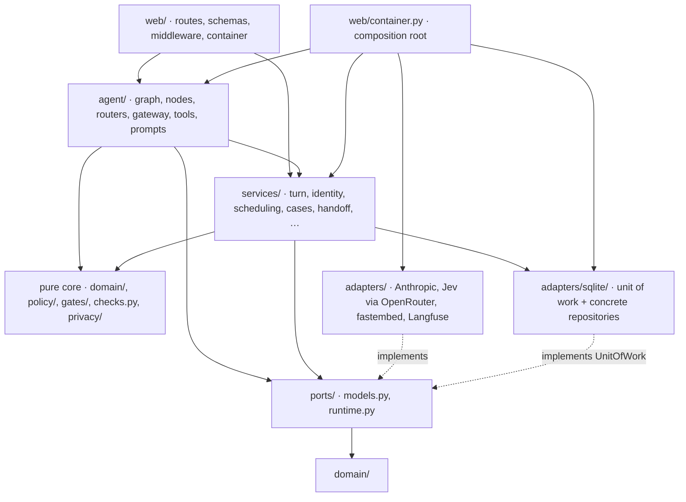
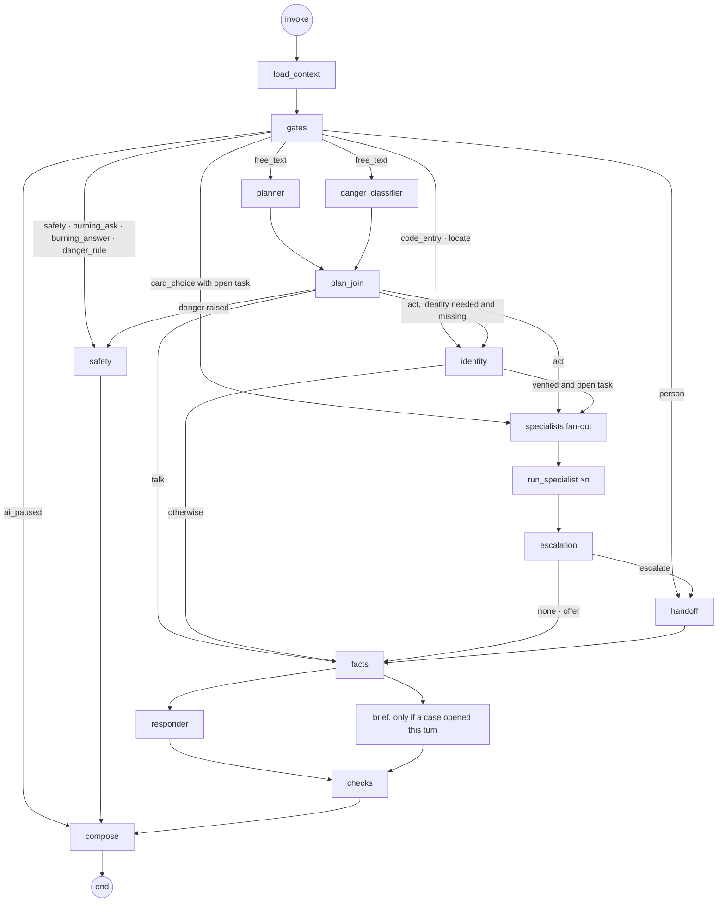

# Code design: Meridian AI service agent (DO-3)

**Date:** 2026-10-21, America/Chicago. **Stage:** zero-to-hero §6, System track, light mode. **Writer:** Claude (Opus 5.5).
**Status:** DRAFT, **revision 3**. Revision 3, 2026-10-21: reconciled with the slice plan and the Stage 7 addenda (AEA-08);
it records their decisions and makes none. Revision 2 followed the `metz-code-design-agent` review
([`reviews/2026-10-21-code-design-review.md`](reviews/2026-10-21-code-design-review.md), verdict FAIL; response in §11).
Awaiting Innocent's review. **Built so far (AEA-01, `893b825`): `pyproject.toml`, the §3 and §9 package markers, `policy/limits.py`, `web/container.py` (stubs), `tests/conftest.py`; AEA-21 (`6df4f4c`): `agent/{graph,routers,context,signals}.py`, `agent/nodes/compose.py`, node stubs; every other path below is planned.** The component contracts (DO-4) are
in [`contracts/`](contracts/README.md).

**What this file owns:** the module map under `src/meridian/`, each module's responsibility, interface, dependencies
and owner area, the seams list (cut or deferred), the typed conversation state for R-45, where each requirement lives,
the build areas and waves for §7 with their collision map, and the test layout. Which ticket builds which file is the
[slice plan](../plans/slice-plan.md) (§1 tickets, §3 collision map); the files below carry their ticket where it
differs from the area. It is mirrored, without detail, in
[`.claude/reference/area-map.md`](../../.claude/reference/area-map.md).

**What it follows and does not repeat:**

| Topic | Owner |
|---|---|
| Architecture: the two-layer turn, components A.1–A.9, stores, failure behaviour, SDQ-1…SDQ-10 | [system-design.md](system-design.md) (DO-1, DO-2) |
| Requirements R-1…R-47, §6 | [PRD 0.4](../prd/inno-aea-callcenter-prd.md) |
| Exact Pydantic sketches and signatures between components; the API per CON | [contracts/internal-components.md](contracts/internal-components.md), [contracts/api-con-mapping.md](contracts/api-con-mapping.md) (DO-4) |
| Records, IDs, trace fields, capture checks CAP-1…CAP-9 | [observability-contract.md](observability-contract.md) (DO-6) |
| Eval suites E-1…E-8, harness rules | [evaluation-plan.md](evaluation-plan.md) (DO-5) |
| Metric formulas M-1…M-29 | [key-metrics-registry.md](key-metrics-registry.md) (DO-7) |

**Labels.** **[A]** an assumption with the check that replaces it · **proposal** a choice no requirement settles, awaiting
Innocent · **[Decided X]** a recorded decision this design only applies. **SDQ-1…SDQ-10 were decided by Innocent on
2026-10-21:** SDQ-1 sets the per-turn deadline at **60 s** (not DO-1's proposed 20 s; the p95 ≤ 12.5 s line is
unchanged); SDQ-2…SDQ-10 were accepted as recommended. **Orchestrator decision 2026-10-21:** the CON-3 event stream
polls the `events` table and replays by last event ID (review S-5); this stays inside SDQ-5 ("async SSE with replay").

---

## 1. What this looks like in practice: one turn through the modules

This is the turn SP-1 got wrong (WP-4F, turn 4). It shows which module does what, and why the bug can no longer happen.

**Input.** Turn 3 moved Linda Foster's (fictional) visit to Monday 8–12 after she picked that window. In turn 4 she
writes "Yes, please." The browser posts CON-2 with a fresh `turn_id`.

**Process, module by module.**

1. `web/routes/chat.py` validates the body against `web/schemas/chat.py` and calls `services/turn.py`
   `TurnService.run_turn(...)`. The route does no logic itself.
2. `TurnService` checks admission (30 in flight [Decided SDQ-9]), the spend guard (`services/ledger.py`), and that this
   `turn_id` is new (the `turns` row). It starts a `TurnBudget` with the 60 s deadline [Decided SDQ-1], redacts the
   message for storage (`privacy/redact.py`), takes one clock reading (the `Clock` port), and calls the graph runner it
   was given.
3. `agent/nodes/load_context.py` reads every completed action of this thread from the `actions` table and puts them in
   `settled`. The `moved` row from turn 3 is there.
4. `gates/gate.py` (pure) sees no safety words, no person request and no code, so the turn is free text.
5. The planner and danger classifier run in parallel (`agent/nodes/plan.py`; Jev through
   `adapters/models/openrouter_jev.py`, behind the `ChoiceModel` port). "Yes, please." gives the planner nothing to act
   on, and `join_plan` continues an open task only if one exists. Turn 3 closed it, so the plan is "talk".
6. `agent/nodes/reply.py` builds the turn facts (nothing happened this turn) and re-reads `settled`.
7. The same module sends the responder (Sonnet, `StructuredModel` port) the clean chat window, **this turn's facts** and
   **`settled`**, labelled apart (`agent/prompts/reply.py`).
8. `checks.py` (pure) finds the claim "moved" in the draft and matches it to the `moved` action in `settled`
   [Decided SDQ-8], so the sentence stays. It also matches "Monday", "8:00" and the technician's name to the evidence.
9. `agent/nodes/compose.py` (pure) turns the checked text, `settled` and the facts into reply blocks.
10. `TurnService` persists the reply, the `turns` row and the clean message, then returns `blocks` and `settled`.

**Output.** "Yes, it's moved: Monday, October 19, 8:00 am to 12:00 pm with Marta." The *What's settled* panel shows
the same visit, because the CON-2 `settled` object is built from the same `actions` rows (N-27). Before this design the
responder saw only turn 4's empty facts and said the move had not happened.

**What made it impossible:** "what has this conversation done" has one authority, a table read at the start of every
turn and again after this turn's writes. Both the words (through the check) and the panel (through the response) read
it. No model holds that memory.

---

## 2. The shape of the code

### 2.1 Layers and the direction of every dependency



**The rules, in plain words.**
- **The pure core imports nothing that does I/O.** `domain/`, `policy/`, `gates/`, `checks.py` and `privacy/` are
  functions and Pydantic models, unit-tested with no database, no network and no clock.
- **External systems sit behind ports the core owns** (`ports/models.py`, `ports/runtime.py`). Nothing in `services/`,
  `agent/` or the core imports `anthropic`, `httpx`, `fastembed` or `langfuse`.
- **Storage is the one deliberate exception, and it is bounded.** The `UnitOfWork` port is the transaction boundary;
  the repositories inside it are concrete SQLite classes with no Protocols of their own (review S-6 merge: one
  implementation, tests use a temp SQLite file). Services may call `tx.<repo>.<method>`; they never write SQL and never
  import `sqlite3`. The Postgres move (DO-1 §7 step 5) rewrites `adapters/sqlite/` and nothing above it. **Trigger to
  cut repository Protocols:** that step starts.
- **Services never import other adapters.** What a service needs from an adapter (restore the working copy, clear or
  prune checkpoints) is injected by the container as a plain callable (review S-3).
- **One composition root.** `web/container.py` builds every adapter once at start-up, injects by constructor, and
  closes everything on shutdown (`async-safety.md` rule 2). No module-level clients or settings singletons.
- **Per-turn values travel in a typed runtime context**, not in globals and not in graph state: the deadline budget,
  the clock reading, the IDs and the run tag (`agent/context.py`; DO-4 §2).
- **Sync on the request path** [Decided DO-1 §11 decision 1]: `def` endpoints, sync `anthropic.Anthropic` and
  `httpx.Client`, sync `SqliteSaver`, `graph.invoke`. The only `async def` endpoints are the event streams [Decided
  SDQ-5] and `/healthz`; neither touches SQLite on the event loop.

### 2.2 How a parallel step runs in a sync graph

The planner ∥ classifier and responder ∥ brief pairs are separate branches of one superstep. LangGraph's sync runner
executes them on its own background executor threads [M: two 1 s branch nodes in one superstep, invoked from a worker thread, took 1.009 s on langgraph 1.2.16;
`tests/graph/test_spine.py::test_two_node_parallel_timing`, AEA-21]. A turn therefore holds one AnyIO pool thread for its life plus up to two short-lived
executor threads during those steps. This refines DO-1 §5.2's "one pool thread" (conflict C-5, §10); it does not change
the pool arithmetic, because executor threads are not drawn from the 40-thread pool.

### 2.3 What a 60 s deadline does to threads and admission [Decided SDQ-1, SDQ-9]

**In practice.** A turn normally takes 4.7 s at p50 and 10.2 s at p95 at 20 at once [M, SP-1]. The 60 s deadline only
matters when something stalls, for example a slow provider. Then a turn can hold its worker thread for up to a minute,
and the design must turn that into an honest "busy" or "taking longer" reply, not a frozen app.

**The arithmetic.**
- **Threads.** AnyIO's pool has 40 threads [M, research §3]. At most **30** turns run at once [Decided SDQ-9], so at most
  30 threads are held for up to 60 s each and **10 always remain** for CON-1, CON-4…CON-20 and pages (each under 1 s
  [A, DO-1 §2.2]).
- **At today's load a stall never trips admission.** A chat customer has one message outstanding at a time, so 20
  conversations means at most 20 turns in flight even if each runs the full 60 s [C]. A resend with the same `turn_id`
  gets `TURN_IN_PROGRESS` and takes no thread.
- **Beyond 30 in flight** (only above ~30 conversations at once [C]) turn 31 gets `BUSY` with the person key, no model.
  In a full stall the process finishes at most 30 turns per 60 s = 30 a minute [C], below the 35 a minute that 20
  conversations generate at normal pace (DO-1 §6.2); the limit, not a queue, absorbs the overflow.
- **Executor threads** add up to 2 per turn [A, §2.2], at most 60 at 30 in flight, outside the pool.

**Rules the code follows because of it.**
1. **No database transaction is open across a model call.** Services open a unit of work, write and commit in
   milliseconds; nodes call models outside any transaction. `code-review-agent` checks that no `gateway.*` call sits
   inside a `uow(...)` block.
2. **Each model call keeps its own role cap** (Jev 3 s, specialist step 8 s, responder 12 s, brief 12 s; proposal,
   DO-1 §8.1). The 60 s bounds the turn; the caps bound each call.
3. **`/healthz` is `async def` and reads an in-memory heartbeat**, never the pool or SQLite, so a pool busy with long
   turns never looks hung to the watchdog (DO-1 §8.2).
4. **Event-stream polling reads run on their own `anyio` `CapacityLimiter(4)`** [A], so many open streams cannot take
   the 10 threads the staff and read endpoints need.
5. **The browser waits 65 s** (deadline + 5 s) before "That didn't send"; "Still working on this…" still appears at
   about 10 s (SCREEN_SPECS SCR-1).
6. **Restart sweep.** At start-up, `turns` rows still `running` and older than 65 s become `degraded_handoff` /
   `timeout` (DO-6 *Missing instrumentation*).
7. **Hosting check.** Railway must keep an HTTP request open for 65 s [A: check its proxy timeout at first deploy; A12].

### 2.4 What changes from the parked code (`src/meridian/`, read for shapes only)

| Parked module | What it did | What changes |
|---|---|---|
| `config.py` | Module-level `SETTINGS`; `now()` reads a DB setting inside config | A typed `Settings` built once by the container. The clock is a port with a demo implementation over `demo_state`; config never touches the DB |
| `agent/graph.py` | One tool-loop agent, untyped `S` dict, sync Anthropic call in an `async def` route | The two-layer graph, typed state (§5), role-typed model gateway, `def` routes |
| `triggers.py` | All word rules plus escalation keywords in one function | `gates/rules.py` (rules, typo-tolerant) and `gates/gate.py` (intake + pure decision). Safety text moves to `policy/texts.py` with the KB's "immediately" wording, pending the UX copy (SCREEN_SPECS note 1) |
| `policy.py` | One `REASONS` dict mixing priority and draft promise texts | Split by consumer: `policy/booking.py` (zones, fees; A5), `policy/handoff.py` (R-26 promises word for word, priorities; A6), `policy/escalation.py` (A7b). The parked draft promise texts are not R-26's and are not carried over |
| `tools.py` | Functions keyed on `thread_id` that open the DB themselves | Tool definitions in `domain/tools.py`, executors per area, one guard and dispatcher (`agent/tools/dispatch.py`), services underneath |
| `identity.py` | Unsalted SHA-256 of a 6-digit code; string compare of ISO times | HMAC-SHA256 with the session secret (a plain hash of a 6-digit code is reversible by trying a million values), `datetime` comparison on the injected clock, the per-conversation code cap, demo-session scoping (N-11) |
| `db.py` | Global lock, `settings` table, `log_metric` | `adapters/sqlite/` with a unit of work and one DDL file per area, all written by A0 (AEA-10); DO-6's records replace `log_metric` |
| `cases.py` | Brief built by heuristics from the log | `services/cases.py` + `services/handoff.py` (typed eight-heading `Brief`; five headings from state) |
| `kb/` | Index under `var/`, built at runtime | `retrieval/` builds the index at image build from the manifest (DO-1 §11 decision 10); the parked `MANIFEST` data seeds `retrieval/manifest.py` |
| `web/app.py` | `async def api_chat`; password staff login | Thin `def` routes per CON group; app-wide demo login (CON-22) and a role switch for the signed-in session (CON-10), per R-48 |

---

## 3. The module map (every path planned)

Owner area and wave in the right-hand columns (§8). Sizes follow `code-structure.md`.

**Built:** `policy/texts.py` (AEA-03, `2689582`); `config.py`, `domain/{common,records,actions,identity,specialists,handoff,blocks,turn,tools,state,staff}.py`, `ports/{models,runtime}.py`, `adapters/sqlite/repos_{core,spend,identity,booking,cases,staff,ops}.py` (shells) (AEA-02, `5c367ad`), `gates/rules.py` (AEA-05, `0d443ab`) · `policy/handoff.py`, `policy/escalation.py` (AEA-14, `af848c9`); `agent/{graph,routers,context,signals}.py`, `agent/nodes/compose.py` and the five node stubs (AEA-21, `6df4f4c`) · `adapters/models/anthropic.py` (AEA-17, `79d29fe`); `adapters/models/openrouter_jev.py` (AEA-18, `64884ef`).
**Built:** `retrieval/{settings,manifest,ingest}.py` (AEA-16, `fe12657`).
**Built:** `adapters/sqlite/{db,migrate,rows,repos_core,repos_core_aux,repos_cases,repos_cases_state}.py`, every `adapters/sqlite/schema/*.sql`, `adapters/checkpointer.py`, `tests/fixtures/sqlite.py` (AEA-10, `ff4b9bd`).
**Built:** `services/ledger.py`, `adapters/sqlite/repos_spend.py` body (AEA-26, `c589914`).
**Built:** `web/{app,middleware,deps,errors,logging}.py`, `web/routes/auth.py`, `web/schemas/auth.py`, `services/reset_gate.py` (AEA-23, branch `aea-23-aea-23-web-shell`).
**Built:** `services/staff.py`, `adapters/sqlite/repos_staff.py` body, `web/routes/staff_session.py`, `web/schemas/staff_session.py` (AEA-44, `1a8fa94`).
**Built:** `web/routes/events.py`, `web/schemas/events.py` (AEA-41, branch `aea-41-aea-41-chat-event-stream`).
**Built:** `services/health.py`, `adapters/sqlite/repos_ops.py` body (AEA-32, `c5d319b`).
**Built:** `policy/booking.py` (AEA-13, `cab183b`).
**Built:** `services/identity.py`, `adapters/sqlite/repos_identity.py` body, `agent/tools/account.py` (AEA-27, `93dfca4`).
**Built:** `eval/cases/` (case files, `case.schema.json`, `FORMAT.md`, `models.py`, `build.py`, `seal.py`, `checks.py`) (AEA-06, branch `aea-06-eval-case-files`).
**Built:** `agent/nodes/front.py` (AEA-36, `712b9e9`).
**Built:** `services/scheduling.py`, `adapters/sqlite/repos_booking.py` (body), `agent/tools/scheduling.py` (AEA-28, `a6d8a68`).
**Built:** `agent/nodes/plan.py`, `agent/prompts/routing.py` (AEA-37, `b760241`).
**Built:** `services/{turn,session}.py`, `web/routes/chat.py`, `web/schemas/chat.py`, the `register_chat` hunk (AEA-40, `e74e3c2`).
**Built:** `agent/nodes/reply.py` (four node bodies), `agent/prompts/reply.py` (AEA-38, `ec94722`).
**Built:** `agent/nodes/load_context.py` (AEA-34, `8d6be78`).
**Built:** `web/routes/staff_cases.py`, `web/schemas/staff_cases.py`, the `register_staff_cases` hunk (AEA-45, `c6cdab6`).
**Built:** `services/cases.py`, `services/handoff.py`, `services/_case_rules.py`, `services/_case_views.py`, `services/_case_actions.py`, the `register_cases` hunk (AEA-29, `d3facfe`).
**Built:** `eval/harness/{__main__,cli,deps,records,cases,freeze,scrub,runlog,client,runner,invariants,scoring,judge,ledger,dbcheck,report,load,retrieval,dryrun}.py`, `eval/run_retrieval.py` (AEA-24, branch `aea-24-eval-harness`).
**Built:** `services/demo.py`, `services/scheduler.py` (AEA-30, `f4aa2cb`; signatures stage7/cases.md §6; the four demo view types are imported from `domain/views.py`, AEA-02b).

```
src/meridian/                                    planned                                                     area  wave
├── config.py                                    Settings; typed per-role model maps, validated at start     A0    0
├── domain/                                      pure types, no I/O
│   ├── common.py                                MeridianModel base, validated IDs, every stable error code  A0    0
│   ├── records.py                               Customer, Technician, Slot, Appointment, Invoice, Passage   A0    0
│   ├── actions.py                               ActionKind, CompletedAction, Settled (R-45)                 A0    0
│   ├── state.py                                 ConversationState and its parts (§5)                        A0    0
│   ├── turn.py                                  gate, plan, danger, facts, responder, R-46 check types      A0    0
│   ├── specialists.py                           SpecialistTask, Knowledge/Account/SchedulingResult          A0    0
│   ├── tools.py                                 ToolDef, ToolCallScope, ToolResult, ToolError, LookupEntry  A0    0
│   ├── handoff.py                               HandoffReason, Priority, Promise, CaseSummary, Brief        A0    0
│   ├── blocks.py                                ReplyBlock union (N-6), SettledView (N-4)                   A0    0
│   ├── staff.py                                 StaffRole, StaffActor, personas, login-session types        A0    0
                                                 (AEA-02; stage7/staff.md §1, MC-2)
│   └── identity.py                              Locator, Located, NotVerified, CodeSent, InboxMessage       A0    0
                                                 (AEA-02; stage7/graph-tools.md §5, GRT-5)
├── policy/
│   ├── texts.py                                 every fixed customer sentence, word for word                A0    0
│   ├── limits.py                                deadline 60 s, admission 30; role caps, brakes, caps        A0    0
│   ├── booking.py                               city/ZIP → zone; 24-hour rule; fee notes by tier            A5    1
│   ├── handoff.py                               R-26 promise table + due rule; reason → P0–P4; D4 rows      A6    1
│   └── escalation.py                            decide_escalation(inputs) (pure; OD-6, D4, R-21)            A7b   3
├── privacy/redact.py                            one redaction function; profiles STORE/SONNET/JEV/TRACE/LOG A0    0   built AEA-04 9145044
├── ports/
│   ├── models.py                                ChoiceModel, StructuredModel, ToolCallingModel; attempts    A0    0
│   └── runtime.py                               UnitOfWork(Factory), RetrievalIndex, Clock, TraceSink       A0    0
├── gates/
│   ├── rules.py                                 typo-tolerant rules: safety, burning, danger, person, policy A1    1
│   └── gate.py                                  parse_intake (text, choice, code, form) + decide_gate       A1    1   built AEA-12 40dd865
├── checks.py                                    R-46: evidence, completion check (lexicon inline), facts    A7c   3   built AEA-15 57883e6
├── adapters/
│   ├── sqlite/db.py                             connections, WAL, busy_timeout, SqliteUnitOfWork            A0    0
│   ├── sqlite/migrate.py                        first-boot copy of the issued DB; applies schema/*.sql;     A0    0
                                                 restore_working_copy()
│   ├── sqlite/schema/00_core.sql                conversations, messages, turns, actions, lookup_log,        A0    0
                                                 check_events, events, (customers: issued)
                                                 written by A0 (AEA-10) from the owning area's field list
│   ├── sqlite/schema/{20_spend,40_identity,50_booking,90_staff,95_ops}.sql  one file per area, applied by number;                       A0    0
                                                 each written by A0 (AEA-10) from the owning area's field list
│   ├── sqlite/schema/60_cases.sql               cases, case_events, promises, followups, activities,        A0    0
                                                 demo_state, job_runs, reset/seed records; written by A0
                                                 (AEA-10) from the owning area's field list
│   ├── sqlite/repos_core.py                     the repositories for 00_core + customers (read); the        A0    0
                                                 cross-ticket reads and reset clearing (§4.3, AEA-10)
│   ├── sqlite/repos_cases.py                    cases, case_events, promises, followups, activities,        A0    0
                                                 demo_state, job_runs, reset/seed records; A0 (AEA-10)
│   ├── sqlite/repos_spend.py                    spend_ledger                                                A2    1
│   ├── sqlite/repos_identity.py                 identity_codes, demo_inbox, invoices (read)                 A4    1   built AEA-27 93dfca4
│   ├── sqlite/repos_booking.py                  appointment_slots, appointments, technicians                A5    1   built AEA-28 a6d8a68
│   ├── sqlite/repos_staff.py                    staff_sessions, flags                                       A9    2
│   ├── sqlite/repos_ops.py                      health_events, deploy_records, eval results (read)          A10a  1
│   ├── checkpointer.py                          SqliteSaver factory; prune(keep=2) [Decided SDQ-10]; clear() A0    0
│   ├── models/anthropic.py                      AnthropicAdapter: all three model ports; own failure mapping A2    1
│   ├── models/openrouter_jev.py                 JevAdapter: ChoiceModel only; own failure mapping           A2    1
│   ├── retrieval_fastembed.py                   FastembedIndex + relevance floor + readiness info           A3    1   built AEA-33 206f802
│   └── tracing_langfuse.py                      LangfuseTraceSink (mask hook, bounded queue), NullTraceSink A10a  1   built AEA-19 2d5b692
├── retrieval/
│   ├── settings.py                              embedder, chunker and floor constants, one place            A3    1
                                                 (AEA-16; stage7/data.md §3, DAT-11)
│   ├── manifest.py                              the 17 files: status, version, parse method, exclusions     A3    1
│   └── ingest.py                                chunk every format; embed; write index + index record       A3    1
├── services/
│   ├── ledger.py                                cost ledger; SpendGuard; provider spend-cap circuit         A2    1
│   ├── identity.py                              locate, issue, deliver to demo inbox, verify; owns its tx   A4    1   built AEA-27 93dfca4
│   ├── scheduling.py                            windows, book, move, cancel, request_change; owns its tx    A5    1   built AEA-28 a6d8a68
│   ├── cases.py                                 CaseService: lifecycle, versions, follow-up, activities     A6    1   built AEA-29 d3facfe
│   ├── handoff.py                               HandoffService (case + promise + action + event in one tx); A6    1   built AEA-29 d3facfe
                                                 BriefAssembler
│   ├── _case_rules.py · _case_views.py · _case_actions.py  private rules, view builders, staff writes of cases.py (AEA-29)  A6    2   built AEA-29 d3facfe
│   ├── demo.py                                  DemoClock (Clock port), staffing, clock advance             A6    1
│   ├── scheduler.py                             60 s tick: due-soon, overdue, stuck, unowned; daily prune   A6    1
│   ├── reset.py                                 all-or-nothing reset; injected restore/clear callables      A6    1   built AEA-31 8192d2b
│   ├── health.py                                health events, heartbeat, watchdog                          A10a  1
│   ├── turn.py                                  run one turn: admission, idempotency, deadline, persist     A8    2
│   ├── session.py                               open a conversation (CON-1)                                 A8    2
│   ├── reset_gate.py                            reset-in-progress gate, injected into ResetService          A8    2
                                                 (AEA-23; stage7/web.md §7)
│   ├── person_request.py                        CON-4 person request, then HandoffService.open              A8    2   built AEA-42 55b5e7c
                                                 (AEA-42; stage7/web.md §8)
│   ├── live_chat.py                             join, send, hand back, close (CON-14)                       A9    2   built AEA-46 0d152ee
│   ├── staff.py                                 StaffSessionStore (login sessions, role check, role switch) A9    2
                                                 and FlagService (AEA-44; stage7/staff.md §2)
│   └── metrics_reader.py                        CON-18…CON-20 reads; never recomputes outcomes              A10b  3
├── agent/
│   ├── gateway.py                               ModelGateway: typed role maps; deadline, retry, ledger, span A2    1   built AEA-20 2bcb8fb
│   ├── tools/knowledge.py                       kb_search executor                                          A3    1   built AEA-33 206f802
│   ├── tools/account.py                         invoice / membership / warranty read executors              A4    1   built AEA-27 93dfca4
│   ├── tools/scheduling.py                      window search, appointments read, book, move, cancel,       A5    1
                                                 request_change executors   built AEA-28 a6d8a68
│   ├── graph.py                                 build_graph(deps): static skeleton, recursion_limit         A7a   2   built AEA-21 6df4f4c
│   ├── routers.py                               pure conditional-edge functions                             A7a   2   built AEA-21 6df4f4c
│   ├── context.py                               GraphDeps (constructor), TurnContext (per turn)             A7a   2   built AEA-21 6df4f4c
│   ├── signals.py                               the `signal` log record for the eight failure signals       A7a   2   built AEA-21 6df4f4c
                                                 (AEA-21; stage7/graph-core.md §4, graph-nodes.md §4)
│   ├── nodes/load_context.py                    settled, controller, identity, chat window from the DB      A7a   2   stub AEA-21 6df4f4c
│   ├── nodes/compose.py                         ReplyComposer: blocks, notices (incl. AI_PAUSED), settled   A7a   2   built AEA-21 6df4f4c
│   ├── nodes/front.py                           gates, safety, identity nodes (stub by A7a)                 A7d   3   built AEA-36 712b9e9
│   ├── nodes/plan.py                            planner, danger classifier, join_plan (stub by A7a)         A7d   3   built AEA-37 b760241
│   ├── nodes/act.py                             specialist fan-out, escalation, handoff nodes (stub by A7a) A7b   3   stub AEA-21 6df4f4c
│   ├── nodes/reply.py                           facts, responder, brief extraction, checks (stub by A7a)    A7c   3   built AEA-38 ec94722
│   ├── specialists/specs.py                     SpecialistSpec per kind: prompt, tools, result builder      A7b   3   built AEA-35 e614508 (ticket wave 2)
│   ├── specialists/runner.py                    the braked tool loop                                        A7b   3   built AEA-35 e614508 (ticket wave 2)
│   ├── tools/dispatch.py                        schemas from ToolDef; guard; every branch; lookup-log rows  A7b   3   built AEA-22 5d0a4e4 (ticket wave 1)
│   ├── prompts/specialists.py                   specialist wording                                          A7b   3   built AEA-35 e614508 (ticket wave 2)
│   ├── prompts/routing.py                       planner and classifier wording, choice fields               A7d   3   built AEA-37 b760241
│   └── prompts/reply.py                         responder and brief wording; trimmed schemas                A7c   3   built AEA-38 ec94722
├── web/
│   ├── container.py                             composition root; one register_<area>() stub per area       A0    0
│   ├── app.py                                   create_app; lifespan; async /healthz (AEA-23; web.md §15)   A8    2
│   ├── middleware.py                            request_id; rate limits; login gate; eval-key tag (AEA-23)  A8    2
│   ├── deps.py                                  every service provider incl. require_staff(*roles)          A8    2
                                                 (AEA-23, sole owner; stage7/web.md §3–§4)
│   ├── errors.py                                one ApiProblem and its handler (AEA-23; stage7/web.md §1)   A8    2
│   ├── logging.py                               LOG-profile allow-list formatter (AEA-23; web.md §10)       A8    2
│   ├── frontend.py                              static mount of apps/web/dist, SPA fallback, public paths   A8    2
                                                 (AEA-49; stage7/web.md §12)   built AEA-49 49ba7ff
│   ├── routes/auth.py · schemas/auth.py         CON-22 login, logout (AEA-23)                             A8    2
│   ├── routes/chat.py · schemas/chat.py         CON-1, CON-2 (AEA-40)                                       A8    2
│   ├── routes/events.py · schemas/events.py     CON-3: async SSE polling `events` (AEA-41)                  A8    2
│   ├── routes/handoff.py · schemas/handoff.py   CON-4, CON-5 (AEA-42)                                       A8    2   built AEA-42 55b5e7c
│   ├── routes/demo.py · schemas/demo.py         CON-6, CON-7, CON-8 read, CON-9 (AEA-43)                    A8    2   built AEA-43 db9ef50
│   ├── routes/staff_session.py · schemas/staff_session.py  CON-10 getSession, listDemoRoles, switchRole (AEA-44)       A9    2
│   ├── routes/staff_cases.py · schemas/staff_cases.py  CON-11…CON-13, CON-15…CON-17 (AEA-45)                       A9    2
│   ├── routes/staff_live.py · schemas/staff_live.py  CON-14, CON-21 (async SSE per case) (AEA-46)                A9    2   built AEA-46 0d152ee
│   ├── routes/staff_clock.py · schemas/staff_clock.py  CON-8 advance, supervisor only (AEA-47)                     A9    2   built AEA-47 0d75351
│   └── routes/reads.py · schemas/reads.py       CON-18…CON-20 (AEA-48; reader: AEA-53)                      A10b  2–3   built AEA-48 cb7df88
                                                 `web/templates/` · `static/` are NOT PLANNED: the screens are the React app apps/web/ (UX-4 built 2026-10-21, gate unsigned);
                                                 AEA-49 serves its dist/ with fallback to index.html (built: web/frontend.py, register_frontend hunk)

eval/harness/{runner,scoring,judge,report,load}.py   frozen per scored run (DO-5); HTTP only                 A11  1
eval/cases/{dev,heldout,retrieval}/ · eval/reports/                                                           A11  1
Dockerfile · .dockerignore · railway.json · scripts/{agent_version,serve,reset,image_check}.py · scripts/log_config.json
                                                 image build (index built here), deploy start-up record, agent version stamp, reset command   A12  2
                                                 (built AEA-50, 05395df; stage7/data.md §7, DAT-22; scripts/ is top level, not under src/meridian/)
tests/                                              §9
```

**Count.** **103** planned Python modules under `src/meridian/`, recounted from the tree above (one per module path,
brace groups expanded, no `__init__.py` counted), plus 5 in `eval/harness/`. The first draft had 113 and revision 2 had 80.
Revision 3 adds 23: `domain/staff.py` and `domain/identity.py` (so `domain/` has 11 files, not 9),
`retrieval/settings.py`, `services/reset_gate.py`, `services/person_request.py`, `agent/signals.py`, and the web shell's
split from 10 files to 27 (`deps.py`, `errors.py`, `logging.py`, `frontend.py`, and one route file plus one schema file per
ticket, slice plan §0 deviation 3). `scripts/` and the test files are outside this count.

---

## 4. Module by module: responsibility, interface, dependencies

Full signatures: [DO-4 internal-components.md](contracts/internal-components.md), cited by section.

### 4.1 Pure core and shared types (A0 unless marked)

| Module | Responsibility (one sentence) | Exposes | Depends on |
|---|---|---|---|
| `domain/common.py` | Give every model the same safety settings and every ID and error code one definition. | `MeridianModel`, `LLMFacing`, `ThreadId`, `TurnId`, `CustomerId`, `InvoiceId`, `CaseRef`, `PassageId`, `ApiErrorCode`, `ToolErrorCode`, `ProviderFailureKind`, `HaltReason`, `SafeError` (DO-4 §0, §11) | pydantic |
| `domain/records.py` | Describe working-copy rows as typed records. | `Customer`, `Technician`, `Slot`, `Appointment`, `Invoice`, `Passage` | common |
| `domain/actions.py` | Describe a completed write and the settled record. | `ActionKind`, `ActionKey`, `CompletedAction`, `Settled` (DO-4 §1) | common |
| `domain/state.py` | Declare the typed per-thread state (R-45). | `ConversationState` (§5) | the other domain files |
| `domain/turn.py` | Declare the hand-offs inside a turn. | DO-4 §3, §4, §6, §8–§10 | common, records, actions |
| `domain/specialists.py` · `tools.py` · `handoff.py` · `blocks.py` | Declare specialist results, tool definitions, handoff types and reply blocks. | DO-4 §5, §7, CON-2 blocks | common, records, actions |
| `domain/staff.py` | Describe the demo roles, the acting identity and the login-session types. | `DemoRole`, `StaffRole`, `StaffPersona`, `StaffActor`, `actor_for`, `LoginSessionId`, `LoginSession`, `IssuedSession`, `SessionMissing`, `SessionExpired`, `RoleRefusal`, `SessionInfoData` (stage7/staff.md §1, MC-2; AEA-02) | common |
| `domain/identity.py` | Describe what the identity service takes and returns. | `Locator`, `Located`, `NotVerified`, `CodeSent`, `CodeCapReached`, `Verified`, `CodeWrong`, `CodeExpired`, `CodeLocked`, `InboxMessage` (stage7/graph-tools.md §5, GRT-5; AEA-02) | common |
| `policy/texts.py` | Hold every fixed customer sentence word for word. | constants, `render(text_id, **values)` | none |
| `policy/limits.py` | Hold every shared numeric limit in one place. | `TurnLimits` (60 s [Decided SDQ-1], role caps), `Admission` (30 [Decided SDQ-9]), `Brakes` (3 tasks, 2 tool rounds, 6 Sonnet calls), `IdentityLimits` (10 min, 3 tries, 3 codes), booking cap 3; the last four are proposals | none |
| `privacy/redact.py` | Replace private values before anything stores them or leaves the process. | `redact(text, profile) -> Redacted` | none |
| `policy/booking.py` (A5) | Map a city or ZIP to a zone, decide fee-bearing changes, quote fees by tier. | `zone_for`, `hours_before`, `fee_bearing`, `fee_note` | records |
| `policy/handoff.py` (A6) | Turn (reason, staffing, clock) into the promise and the priority. | `promise_for(...) -> Promise`, `priority_for(...) -> Priority`, `D4_ROWS` | handoff types, texts |
| `policy/escalation.py` (A7b) | Decide whether a turn becomes a handoff, an offer of a person, or neither. | `decide_escalation(inputs) -> EscalationDecision` (DO-4 §6) | turn types, policy/handoff |
| `gates/rules.py` (A1) | Say which fixed rule a message matches, tolerant of typos. | `match_rules(text) -> RuleMatches` | none |
| `gates/gate.py` (A1) | Recognise codes, card choices and card-like numbers, then decide which turns never reach a model. | `parse_intake(...) -> Intake`, `decide_gate(...) -> GateDecision` | rules, domain, redact |
| `checks.py` (A7c) | Remove claims of actions never completed and numbers no evidence supports (R-46). | `build_evidence`, `check_completion`, `check_facts` (DO-4 §10) | domain |

### 4.2 Ports

| Port | Why it is an interface | Implementations |
|---|---|---|
| `ChoiceModel` | Jev (planner, classifier) and Sonnet (planner fallback [Decided SDQ-6]) both answer typed choices | `JevAdapter`, `AnthropicAdapter`, test fake |
| `StructuredModel` | Responder and brief need schema-valid output; Jev cannot write text, so it must not claim this | `AnthropicAdapter`, test fake |
| `ToolCallingModel` | The specialist loop; `auto` + strict tools, never forced `tool_choice` (research §1) | `AnthropicAdapter`, test fake |
| `RetrievalIndex` | Hides the ONNX embedder and the index format; a hybrid index is the named possible second (PRD §6.2) | `FastembedIndex`, test fake |
| `UnitOfWork`, `UnitOfWorkFactory` | The transaction boundary: booking + action + lookup row commit together (DO-1 §9) | `SqliteUnitOfWork` (concrete repositories inside) |
| `Clock` | R-3 forbids the server clock; tests and evals need a fixed one | `DemoClock` (`services/demo.py`), `FixedClock` (tests) |
| `TraceSink` | Off until the deploy route is live, Langfuse after [Decided SDQ-3], in memory for CAP tests | `NullTraceSink`, `LangfuseTraceSink`, test sink |

### 4.3 Adapters

| Module | Responsibility | Notes |
|---|---|---|
| `adapters/models/anthropic.py` | Make one Sonnet 5.5 request and report it as a typed attempt. | `max_retries=0`; `output_config.format`; `tool_choice` `auto` only; effort per role; checks `stop_reason` (`refusal`, `max_tokens`) first; cache-control on the system prefix; maps SDK exceptions to `ProviderFailureKind` itself (429 without `retry-after` → `provider_spend_cap`, research §2b); never raises |
| `adapters/models/openrouter_jev.py` | Make one Jev decision request and report it as a typed attempt. | `ChoiceModel` only; `provider.data_collection: "deny"` on every request; **checks the body for `error` even on HTTP 200** (readiness SD-6.3); 402 → `provider_spend_cap`; validates each choice against its options |
| `adapters/sqlite/repos_core.py` | Hold the repositories for the shared tables, and the reads and the reset clearing that other tickets need (A0, AEA-10; slice plan §0 deviation 2). | Beside its tables it carries `reads.invoice`, `reads.appointment`, `reads.identity_state`, `reset.clear_demo_tables(tx)` and `settled_for(thread_id, read_at)`; signatures are in [stage7/cases.md](contracts/stage7/cases.md) §1.2–§1.3 (and `settled_for` in [stage7/graph-core.md](contracts/stage7/graph-core.md) §6), not copied here |
| `adapters/sqlite/*` | Store and read rows; one transaction per unit of work. | WAL, `busy_timeout` 5 s [A]; the issued file opened read-only, only by `migrate.restore_working_copy` |
| `adapters/checkpointer.py` | Build the LangGraph checkpointer; prune and clear it. | `checkpoints.sqlite`, its own file and lock (DO-1 §4); `prune(keep=2)` [Decided SDQ-10] and `clear()` are handed to A6's services as callables |
| `adapters/retrieval_fastembed.py` | Load the built index and answer a query with a relevance floor. | Readiness: index present, dimension matches `bge-small-en-v1.5`, 17 manifest files (retrieval rule 7). **Built** AEA-33 `206f802`: `Readiness.reasons` `index_missing`, `dimension_mismatch`, `manifest_not_17`, `record_mismatch` (stage7/data.md §4) |
| `adapters/tracing_langfuse.py` | Export masked spans in the background, dropping when the queue is full. | Startup check that the keys belong to this app's project (DO-6 CAP-9); export goes through the ingestion-only TLS proxy [Decided SDQ-3] |

**The shared promise between the two model adapters lives in a test, not in shared code** (review S-2):
`tests/contract/test_model_ports_contract.py` runs both adapters against recorded fixtures and asserts the same
`ProviderFailureKind` for the same situation (timeout, rate limit, spend cap, error inside a 200, invalid choice).

### 4.4 Services

| Module | Responsibility (one sentence) | Interface (DO-4) | Depends on |
|---|---|---|---|
| `services/turn.py` | Run one customer turn to a checked, persisted response inside the deadline. | `TurnService.run_turn` (§14) | an injected `run_graph` callable, ledger, UoW, clock, redact, limits |
| `services/session.py` | Open a conversation with its fixed greeting. | `SessionService.open` | UoW, clock, `DemoService`, texts |
| `services/identity.py` | Prove a customer by a one-time code that never reaches chat, logs or traces. | `locate`, `send_code`, `verify`, `inbox` — each opens its own transaction and writes its own `actions(verified)` row (review S-6) | UoW, clock, limits, session secret |
| `services/scheduling.py` | Make valid bookings and fee-free changes, or record a fee-bearing request. | `find_windows`, `book`, `move`, `cancel`, `request_change` — each one transaction: slot re-read + write + `actions` + `lookup_log` | UoW, clock, `policy/booking.py` |
| `services/cases.py` | Own the case lifecycle, its version, follow-up and activities. | concrete `CaseService` (§13) | UoW, clock |
| `services/handoff.py` | Turn an escalation into a case with the policy promise, idempotently; assemble the brief. | `HandoffService.open`, `BriefAssembler` | `CaseService`, `policy/handoff.py`, `DemoService`, clock |
| `services/demo.py` | Serve the one demo clock and the staffing state, and advance the clock forward. | `DemoClock`, `DemoService.staffing/set_staffing/advance_clock` | UoW, `CaseService` |
| `services/scheduler.py` | Raise due-soon, overdue, stuck and unowned alerts on the demo clock, and prune checkpoints daily. | `SchedulerJob.tick()` | `CaseService`, clock, injected `prune_checkpoints: Callable[[], int]` |
| `services/reset.py` | Restore the demo all-or-nothing. Also holds the demo seed loader (`seed_demo`, `seed_first_boot`); the seed list is stage7/cases.md §7. Built (AEA-31, `8192d2b`). | `ResetService(uow, restore_working_copy, clear_checkpoints, seed_demo)` | injected callables (review S-3) |
| `services/ledger.py` | Record every model call's cost and stop model use at a cap. | `record`, `SpendGuard.allow_turn`, `trip_provider_cap`, `models_disabled` | UoW (`repos_spend`), limits |
| `services/live_chat.py` | Let a claimed representative join, write, hand back or close a chat. | `join`, `send`, `hand_back`, `close` | UoW (`conversations.controller`, `messages`, `events`), `CaseService` |
| `services/staff.py` | Hold the login sessions, check and switch the role, and record flags. | `StaffSessionStore`: `start`, `resolve`, `end`, `actor_for`, `switch_role`, `session_info`; `FlagService`: `flag`, `review`, `list_flags` (stage7/staff.md §2, STF-26). Built (AEA-44, `1a8fa94`) | UoW (`repos_staff`) |
| `services/metrics_reader.py` | Serve stored measures without recomputing outcomes. | `owner_metrics`, `monitoring`, `latest_eval` | UoW |
| `services/health.py` | Keep the heartbeat, record health events, exit after repeated failures. | `AlertSettings`, `Heartbeat`, `Watchdog`, `AlertWriter`, `AlertEvaluator`, `load_eval_reports` (stage7/cases.md §8; built AEA-32) | UoW (`repos_ops`) |

### 4.5 The graph (`agent/`)

| Module | Responsibility | Depends on |
|---|---|---|
| `agent/graph.py` | Draw the static skeleton of one turn and compile it with the checkpointer and an explicit `recursion_limit`. | nodes, routers, context |
| `agent/routers.py` | Choose each conditional edge from typed state fields only. | domain/state |
| `agent/context.py` | Carry constructor dependencies (`GraphDeps`) and per-turn values (`TurnContext`). **Correction (Stage 7, 2026-10-21, GRC-10):** `TurnContext` (with `TurnIds`, `TurnBudget`, `SpanHandle`) lives in `domain/turn.py`, re-exported by `ports/runtime.py`, so services never import `agent/`; this file holds `GraphDeps` only. | ports, services |
| `agent/gateway.py` | Be the one place every model call goes through: typed role maps, redaction profile, timeout = min(role cap, time left), one bounded retry, ledger row, span. | ports/models, ledger, redact, limits, `TraceSink` |
| `agent/nodes/*` | Each node does one step and writes only the keys §5.3 assigns it. A7a creates all four group files as stubs that raise `NotImplementedError` (`async-safety.md` rule 1); A7b–A7d then own them. | services, core, gateway |
| `agent/specialists/*` | Describe the three specialists as data and run one braked tool loop for each. | gateway, dispatch |
| `agent/tools/dispatch.py` | Generate tool schemas from `ToolDef`; validate, scope-check, execute and log every call. | `domain/tools.py`, executors in `agent/tools/{knowledge,account,scheduling}.py` |
| `agent/prompts/*` | Own each role's wording; inject the trimmed output schema. | domain |

**Every place a model chooses** is DO-2 §A.6. This design adds none.

**About open/closed for specialists (review C-2).** Specialists as data mean a fourth specialist reuses the runner, but
it also edits `PlannerChoices`, `join_plan`, `SpecialistResult`, `TurnFacts`, `nodes/reply.py`, `nodes/compose.py` and
the escalation rules. No fourth is planned, so this is accepted. The runner holds no `if spec.kind == …`; the first such
branch is the signal to inline it.

---

## 5. Conversation state and R-45

### 5.1 The rule, concretely

| Kind | Example | Authority | In the checkpoint? |
|---|---|---|---|
| **What the conversation has done** | turn 3 moved the visit; a case opened with promise X; identity verified | **DB rows**: `actions`, `cases`/`promises`, `identity_codes`, `conversations.controller` | A **copy**, refreshed at the start of every turn and after this turn's writes |
| **What it is in the middle of** | the open booking task still needs a ZIP; windows 56 and 57 were shown | The checkpoint | Yes (authority) |
| **What this turn found** | the specialist's records, the escalation decision | The checkpoint, turn-scoped | Reset by every invocation's input |
| **What was said** | customer text (codes and cards redacted), final replies, staff messages | `messages` table | Only the window copy (~10 turns [A], R-45) |

**Why the DB is the authority for completed actions.** A write and its `actions` row commit in one transaction, and the
checkpoint is written after (DO-1 §9). If the process dies between them, the next turn still sees the action.

### 5.2 The typed state (sketch; field-level contracts in DO-4 §1)

```python
class ConversationState(MeridianModel):           # LangGraph state schema
    thread_id: ThreadId

    # DB-authority copies: refreshed by load_context; `settled` re-read by the facts node after writes
    settled: Settled                               # every CompletedAction + open case and its promise (R-45, N-27)
    controller: Controller                         # "ai" | "human" (+ representative display name)
    identity: IdentityState                        # status, customer_id, masked hint, expiry, tries, codes sent

    # durable conversation state (the checkpoint is the authority)
    open_tasks: list[OpenTask]
    shown_slots: list[ShownSlot]                   # shown, not held; re-read inside the booking transaction
    last_lookups: LastLookups
    pending_change: ChangeRequestRef | None        # R-21
    counters: FailureCounters                      # OD-6, R-41

    # turn-scoped (overwritten by every invocation's input; one writer each)
    turn_input: TurnInput
    chat_window: list[ChatLine]
    gate: GateDecision | None
    planner_choices: PlannerChoices | None         # Stage 7, 2026-10-21, GRC-11: becomes planner: PlannerOutcome | None
    danger: DangerAssessment | None
    plan: Plan | None
    identity_step: IdentityStep | None
    specialist_results: Annotated[list[SpecialistResult], operator.add]   # parallel specialists append
    escalation: EscalationDecision | None
    handoff: HandoffResult | None
    facts: TurnFacts | None
    draft: ResponderDraft | None
    brief_extraction: BriefExtraction | None
    checked: CheckedReply | None
    reply: ComposedReply | None
    halt: Annotated[Halt | None, first_halt]       # deadline / brake / spend; first writer wins
```

**Not in it, on purpose:** tool output (R-45); verification codes (hashed in `identity_codes` only); any model value
code has not validated; the deadline (it lives in `TurnContext`, so a dead process's deadline can't survive a restart).

**The summary of turns beyond the window** is computed by `summarize(state) -> StateSummary` from `settled`,
`open_tasks` and `identity` whenever it is needed; never stored, never written by a model (R-45).

### 5.3 Who writes which key

A node returns only its own keys (`agent-architecture.md` rule 12). This table is the contract that lets A7b, A7c and
A7d build in parallel.

| Key | Writer(s) (node, module) | Readers |
|---|---|---|
| `turn_input` | `TurnService` (invocation input) | gates, plan, identity, specialists |
| `settled`, `controller`, `identity`, `chat_window` | `load_context` (copy from DB); `settled` again by `facts` (reply.py) after writes; `identity` again by `identity` (front.py) after a DB write | routers, gates, responder, compose |
| `gate` | `gates` (front.py) | routers |
| `planner_choices`, `danger`, `plan` | `planner`, `danger_classifier`, `plan_join` (plan.py) | `plan_join`, routers, specialists, facts |
| `identity_step` | `identity` (front.py) | facts, compose |
| `specialist_results` | `run_specialist` (act.py; append, parallel) | escalation, facts |
| `escalation`, `handoff` | `escalation`, `handoff` (act.py); `handoff` also by `safety` (front.py, exclusive branch) | routers, facts, brief, compose |
| `facts`, `open_tasks`, `shown_slots`, `last_lookups`, `pending_change`, `counters` | `facts` (reply.py), the one committer of durable task state | responder, brief, checks, compose |
| `draft`, `brief_extraction`, `checked` | `responder`, `brief`, `checks` (reply.py) | checks, compose |
| `reply` | `compose` (compose.py) | `TurnService` |
| `halt` | any node, when the budget or a brake stops it (first wins) | routers |

### 5.4 The graph skeleton (static; the model chooses no edge the routers don't list)



Every router sends a state with `halt` set straight to `compose`, which builds the code reply for that halt (DO-4 §11).
**Correction (Stage 7, 2026-10-21, GRC-7):** every router calls `halt_route(state)` first. Brake halts (`BRAKE_*`) go
once through `escalation` (rule 6, `ai_failure` P3, degraded) → `handoff` → `facts` → `compose`; `DEADLINE`,
`SPEND_CAP` and `PROVIDER_SPEND_CAP` go straight to `compose` with no case; a halted state skips responder, brief and
checks; `run_graph` catches `GraphRecursionError` and returns compose's halt reply.
`recursion_limit` is 25 [M: a 3-task turn finished at step 10; `test_three_task_turn_under_limit`, AEA-21].

**Built (AEA-21):** halt routing as [graph-core §5](contracts/stage7/graph-core.md) and the two added edges as graph-core §11; plus the routing conditions in `docs/plans/fanout/2026-10-21-build/AEA-21.md` §8.1 PD-1…PD-6 (a tasks-less plan with a handoff request or an act plan without tasks; identity failures to escalation; card choices resume the open task; a halted specialist turn; the brake passing escalation → handoff once).

---

## 6. The seams list

| # | Seam | Decision | Why |
|---|---|---|---|
| S-1 | Model providers behind three role-shaped ports | **Cut** | Two providers now, and the Sonnet planner fallback [Decided SDQ-6] is a second `ChoiceModel`. Three ports, not one `ModelClient`: Jev only chooses, so one interface would force it to raise for text and tools (SP-1's `JevClient` did), a Liskov break callers must check for |
| S-2 | One model gateway with **typed per-role maps** | **Cut** | One place for deadline, retry, ledger, span and redaction (`pydantic-ai-agents.md` §7–8). The maps (`choice`, `structured`, `tools`) make "Jev as responder" unconfigurable; `Settings` rejects a mismatch at start-up (review S-4) |
| S-3 | Policy apart from mechanism | **Cut, grouped by consumer** | Shared tables (`texts`, `limits`) in A0; `booking` with A5, `handoff` with A6, `escalation` with A7b; the claim lexicon inline in `checks.py` (review B-2) |
| S-4 | `RetrievalIndex` | **Cut** | External ONNX model; a hybrid index is the named possible second; tests need a fake that loads nothing |
| S-5 | Embedder as its own port | **Deferred** | One embedding model per index (retrieval rule 6). Trigger: a second index type sharing one embedder |
| S-6 | Storage | **Cut at the transaction boundary only** | `UnitOfWork` stays a port; repositories are concrete with no Protocols (one implementation; temp-SQLite tests). Trigger to cut repository Protocols: DO-1 §7 step 5 (Postgres) starts |
| S-7 | Case store | **One concrete `CaseService`** | One implementation; three role Protocols weren't even split by caller (review S-8). "Staff routes never call `open_case`" is enforced by a `code-review-agent` grep, not by interfaces. Trigger: a second case store Proven: `tests/integration/test_staff_composition.py::test_real_objects_bound` (AEA-52). |
| S-8 | `Clock` | **Cut** | R-3; the demo clock and the fixed test/eval clock are two real implementations |
| S-9 | Our own checkpointer interface | **Deferred** | LangGraph's `BaseCheckpointSaver` is already the seam; `AsyncPostgresSaver` drops in at 10× step 5 |
| S-10 | `TraceSink` | **Cut** | Off, Langfuse and in-memory all exist now |
| S-11 | Event delivery | **No interface; polling** [orchestrator decision] | Writers append to `events` inside their own transaction; the SSE endpoints poll `events WHERE id > last` about once a second [A] and replay by `Last-Event-ID`. One path for live and replay; no thread-to-loop crossing, no after-commit hook. Cost: up to ~1 s delay on a staff-join event. Trigger to revisit: a second replica (10× step 7) Proven: `tests/integration/test_staff_streams.py::test_case_stream_after_reset` (AEA-52). |
| S-12 | Specialists as data, one runner | **Cut** | Three real specialists share one braked loop (open/closed limits in §4.5) |
| S-13 | Tool definitions in `domain/tools.py`, one dispatcher | **Cut** | `agent-tools.md` rules 3 and 6; the types sit in A0 so the wave-1 executor areas never wait on A7 (review B-1) |
| S-14 | Prompts in their own modules | **Cut** | `pydantic-ai-agents.md` §3 |
| S-15 | Pure core | **Cut** | Every safety invariant unit-testable without I/O |
| S-16 | Code delivery port (real SMS / email) | **Deferred** | Out of scope (PRD §7) |
| S-17 | Rate limiter port | **Deferred** | One in-memory limiter, one process; moves at 10× step 6 |
| S-18 | Staff authentication | **Deferred** | Demo label, not security (N-15) |
| S-19 | Scheduler runner port | **Deferred** | One in-process thread; singleton lock only at 10× step 7 Proven: `tests/capture/test_cap5_clock_and_scheduler.py::test_wf7_ticks` (AEA-52). |
| S-20 | Protocols in front of our own services | **Deferred** | Services run over temp SQLite in tests; a fake would be a second thing to keep honest. Callers that need a service before it exists get an **injected callable** (`TurnService`'s `run_graph`, `ResetService`'s restore/clear) Proven: `tests/integration/test_demo_reset.py::test_reset_all_or_nothing` (AEA-52). |
| S-21 | Async model clients and graph | **Deferred** | DO-1 §11 decision 1; 10× step 6 |
| S-22 | GPT-5.6 Terra / Gemini Flash adapters | **Deferred** | Not chosen after SP-1 |
| S-23 | Brief extraction as its own class | **Deferred** | One structured call with its own prompt |
| S-24 | Shared failure classifier for the model adapters | **Not built** | Each adapter maps its own failures (SDK exceptions vs raw HTTP bodies); the shared promise is the contract test (review S-2) |

---

## 7. Where each requirement lives

| R | What | Modules (planned) |
|---|---|---|
| R-1 | Greeting says automated | `policy/texts.py`, `services/session.py`, `agent/prompts/reply.py` |
| R-2 | Person on the first ask | `gates/rules.py`, `gates/gate.py`, `web/routes/handoff.py` (CON-4, CON-5), `services/person_request.py`, `services/handoff.py` |
| R-3 | Demo "today" from a clock | `ports/runtime.py` `Clock`, `services/demo.py` |
| R-4 | Plain replies; exact numbers; sources | `agent/prompts/reply.py`, `agent/nodes/compose.py`, `checks.py` |
| R-5 | Safety instruction first, by code | `gates/rules.py`, `agent/nodes/front.py`, `policy/texts.py` |
| R-6 | Contact offer after; P0; no time promised | `agent/nodes/front.py`, `services/handoff.py`, `policy/handoff.py` |
| R-7 | Burning smell paths | `gates/rules.py`, `gates/gate.py`, `agent/nodes/front.py`, `policy/texts.py` |
| R-8 | Someone in danger | `agent/nodes/plan.py` (classifier), `gates/rules.py`, `agent/nodes/front.py` |
| R-9, R-10 | Ingestion; exclusions | `retrieval/manifest.py`, `retrieval/ingest.py`; staff-only notes to staff fields in `services/handoff.py` |
| R-11 | Vector store; citation | `retrieval/ingest.py`, `adapters/retrieval_fastembed.py`, `domain/records.py` `Passage` |
| R-12 | Retrieval evaluated alone | `eval/harness` suite `retrieval` (E-2) |
| R-13 | Only from sources; no prices; no cards | `agent/prompts/specialists.py`, relevance floor in `adapters/retrieval_fastembed.py`, `privacy/redact.py`, `checks.py` |
| R-14 | Public questions unverified | `agent/tools/dispatch.py` guard (`ToolDef.requires_verified`) |
| R-15, R-16 | One-time code; identical `NOT_VERIFIED` | `services/identity.py`, `gates/gate.py`, `privacy/redact.py`, `adapters/sqlite/repos_identity.py` |
| R-17 | Account answers | `agent/tools/account.py`, `agent/specialists/specs.py` |
| R-18, R-23 | Zone, service, slots; estimates | `services/scheduling.py`, `policy/booking.py` |
| R-19 | Working copy; one tx; idempotent; reset | `adapters/sqlite/migrate.py`, `adapters/sqlite/db.py`, `services/scheduling.py`, `services/reset.py` |
| R-20 | Confirmation; fee by tier | `policy/booking.py`, `agent/nodes/compose.py` |
| R-21, R-22 | Fee-bearing change never written; P2 | `policy/booking.py`, `services/scheduling.py` `request_change`, `policy/escalation.py`, `services/handoff.py` |
| R-24 | Triggers | `gates/rules.py`, `policy/escalation.py`, `policy/handoff.py` |
| R-25, R-26 | Case P0–P4; promise from the table | `services/cases.py`, `services/handoff.py`, `policy/handoff.py`, `agent/nodes/compose.py` |
| R-27 | Follow-up preference | `services/cases.py`, `web/routes/handoff.py` (CON-4, CON-5) |
| R-28 | Eight-heading brief | `services/handoff.py` `BriefAssembler`, `agent/nodes/reply.py`, `agent/prompts/reply.py`, `checks.py` |
| R-29 | Lookup log; snapshot vs current | `agent/tools/dispatch.py`, `services/scheduling.py` (write rows), `adapters/sqlite/repos_core.py`, `services/cases.py` |
| R-30 | Presence | `services/demo.py` |
| R-31 | Takeover; AI pauses | `services/live_chat.py`, `gates/gate.py` (`ai_paused`) |
| R-32 | Staff views | `web/routes/staff_cases.py` (CON-11…CON-13, CON-15…CON-17), `services/cases.py`, `services/metrics_reader.py` |
| R-33 | Lifecycle; simulated time; seeds | `services/cases.py`, `services/scheduler.py`, `services/demo.py`, `services/reset.py` |
| R-34 | Recorded, never sent | `services/cases.py`, `policy/texts.py` |
| R-35 | Monitoring; restart | `services/metrics_reader.py`, `services/health.py` |
| R-36 | Redacted traces | `privacy/redact.py`, `adapters/tracing_langfuse.py` |
| R-37 | Flags | `services/staff.py` |
| R-38, R-39 | Test set; eval report | `eval/cases/`, `eval/harness/report.py`, `services/metrics_reader.py` (CON-20) |
| R-40 | Railway | `Dockerfile`, `railway.json`, `config.py` |
| R-41 | Rate limits, booking cap, spend cap, brakes | `web/middleware.py`, `policy/limits.py`, `services/ledger.py`, `agent/specialists/runner.py`, `agent/graph.py` |
| R-48 | One demo login gates every route; role switch for a signed-in session (Innocent, 2026-10-21) | `web/middleware.py` (session check on every route except login and `/healthz`), `web/routes/auth.py` (login; AEA-23), `web/routes/staff_session.py` (role switch; AEA-44) over `services/staff.py`; credentials from `config.py` (`MERIDIAN_DEMO_USERNAME`, `MERIDIAN_DEMO_PASSWORD`) |
| R-42, R-43 | Public repo; deliverables | no module |
| R-44 | Quick checks | `agent/specialists/specs.py`, `agent/nodes/compose.py`, `policy/texts.py` |
| R-45 | Typed state; slices; no tool output in chat | `domain/state.py`, `agent/nodes/load_context.py`, `agent/nodes/reply.py`, `adapters/sqlite/repos_core.py` |
| R-46 | Completion and fact checks | `checks.py`, `agent/nodes/reply.py` |
| R-47 | Rules first; raise-only classifier | `gates/rules.py`, `agent/nodes/plan.py`, `agent/routers.py` |

---

## 8. Build areas, waves and the collision map (input to §7)

**The rule (review B-1): an area depends only on files it owns or on earlier waves.** The area that writes a table owns
its repository file. A table written by several areas lives in A0. Storage has no fakes, so this is what lets an area
build against the real thing.

Deviation (slice plan §0, 2026-10-21): the cases tables are written by cases/handoff, demo/scheduler, reset, live chat and seed, so by this section's own rule they live in A0; the other DDL files land with them so no wave-2 ticket waits for a sibling's schema.
So A0 (AEA-10) writes every `schema/*.sql` from the owning area's field list (still one file per area, applied by
number) and owns `repos_cases.py` whole; the owning areas write only their repository bodies. The other two deviations
are in §4.3 (cross-ticket reads and reset clearing live in `repos_core`) and §3 (one route file and one schema file per
ticket).

| Wave | Area | Owns | Depends on (all earlier) |
|---|---|---|---|
| **0** | **A0 Foundation** | `config.py`, `domain/*` (incl. `tools.py`, `staff.py`, `identity.py`), `policy/{texts,limits}.py`, `privacy/redact.py`, `ports/*`, `adapters/sqlite/{db,migrate,repos_core,repos_cases}.py`, **every `adapters/sqlite/schema/*.sql`** (AEA-10, from the owning area's field list), **empty class stubs of `repos_{spend,identity,booking,staff,ops}.py`** (constructor only, all wired into `SqliteUnitOfWork`), `adapters/checkpointer.py`, `web/container.py` (every `register_<area>()` stub created now), `tests/fakes/` (AEA-11), `tests/fixtures/sqlite.py` (AEA-10) | — |
| **1** | **A1 Gates** | `gates/*` | A0 |
| 1 | **A2 Models** | `adapters/models/*`, `agent/gateway.py`, `services/ledger.py`, `repos_spend.py` (body) | A0 |
| 1 | **A3 Retrieval** | `retrieval/{settings,manifest,ingest}.py`, `adapters/retrieval_fastembed.py`, `agent/tools/knowledge.py` | A0 (`domain/tools.py`, `RetrievalIndex`) |
| 1 | **A4 Identity** | `services/identity.py`, `repos_identity.py` (body, + invoices read), `agent/tools/account.py` | A0 (customers, actions in `repos_core`) |
| 1 | **A5 Scheduling** | `policy/booking.py`, `services/scheduling.py`, `repos_booking.py` (body), `agent/tools/scheduling.py` | A0 |
| 1 | **A6 Cases and handoff** | `policy/handoff.py`, `services/{cases,handoff,demo,scheduler,reset}.py` | A0 (`events`, `actions`, `repos_cases`, checkpointer callables, `migrate.restore_working_copy`) |
| 1 | **A10a Ops** | `adapters/tracing_langfuse.py`, `services/health.py`, `repos_ops.py` (body) | A0 |
| 1 | **A11 Eval harness** | `eval/**` | the HTTP contracts only (DO-4); frozen before scored runs |
| **2** | **A7a Graph spine** | `agent/{graph,routers,context,signals}.py`, `agent/nodes/{load_context,compose}.py`, stubs of `nodes/{front,plan,act,reply}.py` | A0 |
| 2 | **A8 Customer API** | `web/{app,middleware,deps,errors,logging,frontend}.py`; `web/routes/{auth,chat,events,handoff,demo}.py`, each with its own `web/schemas/<name>.py`; `services/{turn,session,reset_gate,person_request}.py`; serves CON-1…CON-7, CON-8 read, CON-9 (incl. the `form` payload and `getChatThread`) and CON-22 (login) | A0, A1 (`parse_intake`), A2 (SpendGuard), A4 (inbox), A6 (demo, reset); the graph as an injected `run_graph` callable |
| 2 | **A9 Staff console** | `web/routes/staff_{session,cases,live,clock}.py`, each with its own `web/schemas/<name>.py`; `services/{live_chat,staff}.py`, `repos_staff.py` (body); serves CON-8 advance (supervisor only), CON-10…CON-17 and **CON-21** (staff SSE per case); `services/staff.py` implements `require_staff(*roles)`, which `web/deps.py` (AEA-23, A8) declares | A0, A6 (`CaseService`, `DemoService`), AEA-23's `web/deps.py` |
| 2 | **A12 Deploy** | `Dockerfile`, `railway.json`, `scripts/{agent_version,reset}.py` | A0 (migrate), A3 (index build) |
| **3** | **A7b Act** | `nodes/act.py`, `agent/specialists/*`, `agent/tools/dispatch.py`, `policy/escalation.py`, `prompts/specialists.py` | A2, A3, A4, A5, A6, A7a |
| 3 | **A7c Reply** | `nodes/reply.py`, `checks.py`, `prompts/reply.py` | A2, A6 (`BriefAssembler`), A7a |
| 3 | **A7d Front** | `nodes/{front,plan}.py`, `prompts/routing.py` | A1, A2, A4, A6, A7a |
| 3 | **A10b Reads** | `web/routes/reads.py` with `web/schemas/reads.py`, `services/metrics_reader.py` (CON-18…CON-20). The route is built in ticket wave 2 (AEA-48), because `require_staff` is declared in `web/deps.py` by AEA-23; the reader in ticket wave 3 (AEA-53) | A0, A2, A6, A9 (`require_staff` for CON-18), A10a |

**Collision map (files more than one area touches).**

| File | Touched by | How collisions are avoided |
|---|---|---|
| `web/container.py` | every area that adds an adapter or service | A0 writes one `register_<area>()` stub per area in wave 0; each area edits only its own function's hunk (review C-3) |
| `web/deps.py` | AEA-23 (A8) only; every route ticket imports from it | Declares every service provider including `require_staff(*roles)`; a new provider is a follow-up on AEA-23 |
| `adapters/sqlite/repos_{spend,identity,booking,staff,ops}.py` | A0 (stub), then A2 / A4 / A5 / A9 / A10a | A0 creates each as an empty class with its constructor and wires all seven repositories (these five, `repos_core`, `repos_cases`) into `SqliteUnitOfWork` in wave 0; after that each file's body has one owner (spend A2, identity A4, booking A5, staff A9, ops A10a). `repos_cases.py` is A0's (AEA-10), whole. `db.py` and `ports/runtime.py` stay frozen (review RB-1) |
| `adapters/sqlite/schema/*.sql` | AEA-10 (A0) only | Every file is written by A0 from the owning area's field list; `migrate.py` applies them in numeric order. A missing column is a small follow-up on AEA-10, merged first |
| `adapters/sqlite/repos_core.py` (`events`, `actions`, `lookup_log`, `messages`, `conversations`, the cross-ticket reads) | written by A4, A5, A6, A7, A8, A9 | Owned by A0 (AEA-10); frozen after wave 0. A new method is its own small A0 ticket |
| `domain/*` | read by all | Frozen after wave 0; a shared-type change is its own ticket, merged before dependants |
| `agent/nodes/{front,plan,act,reply}.py` | A7a (stub), then A7d / A7d / A7b / A7c | Sequential by wave; after A7a each file has exactly one owner |
| `web/templates/`, `web/static/` | none (reconciled 2026-10-21, slice plan AEA-08) | Directories dropped. `apps/web/` (React) exists, built 2026-10-21, UX-4 gate unsigned; A8/A9 are API only; AEA-49 (A8) serves `apps/web/dist` with fallback to `index.html` from `web/frontend.py` through its own `register_frontend()` hunk in `web/container.py` (built); `jinja2` droppable |
| `web/routes/*.py`, `web/schemas/*.py` | A8, A9, A10b: one route file and its schema file per ticket (slice plan §3) | `auth` AEA-23, `chat` AEA-40, `events` AEA-41, `handoff` AEA-42, `demo` AEA-43, `staff_session` AEA-44, `staff_cases` AEA-45, `staff_live` AEA-46, `staff_clock` AEA-47, `reads` AEA-48; no ticket edits another's route or schema file |
| `tests/fakes/`, `tests/fixtures/sqlite.py` | AEA-11 (`fakes/`, incl. `clock.py`), AEA-10 (`fixtures/sqlite.py`) | Two folders, so the two tickets never share one. Areas put their own fixtures in their own test folders |

**Critical path:** A0 → A7a → A7b/A7c/A7d → integration. Wave 1 runs eight areas in parallel against A0 alone.

**Build order and ticket waves are the slice plan's ([§1](../plans/slice-plan.md) tickets, §2 parallelism audit); the area waves above stay as the dependency rule.** The ticket table is not copied into this file.

---

## 9. Test layout

```
tests/                                       planned
├── fakes/            FakeChoiceModel, FakeStructuredModel, FakeToolModel (scripted), FakeIndex,
│                     InMemoryTraceSink (AEA-11); fakes/clock.py: FixedClock (AEA-11; stage7/data.md §8a, DAT-32)
├── fixtures/         sqlite.py: temp_sqlite() applies every schema/*.sql to a temp working copy (AEA-10; DAT-10,
│                     stage7/cases.md §1.5, CAS-4). Moved here from fakes/ so AEA-10 and AEA-11 never share a folder
├── unit/             mirrors src/meridian/: unit/gates/test_rules.py, unit/test_checks.py,
│                     unit/policy/test_handoff.py, unit/privacy/test_redact.py, unit/agent/test_routers.py, …
├── contract/         test_model_ports_contract.py (JevAdapter + AnthropicAdapter, recorded fixtures: same failure
│                     kinds), test_retrieval_contract.py, test_trace_sink_contract.py; OpenAPI boundary (AEA-59):
│                     test_openapi_server.py over cases/<route>.py (one per route ticket), test_openapi_fixtures.py,
│                     test_types_gen_drift.py
├── services/         each service over a temp SQLite working copy: booking rules, one-slot concurrency (E-7),
│                     idempotent case creation, identity caps, reset all-or-nothing
├── graph/            the compiled graph with fake models and a temp DB: WP-1…WP-8, WP-4F, DANGER, NODANGER;
│                     brakes; recursion limit; deadline halts; restart between write and checkpoint
├── api/              FastAPI TestClient per CON group: schemas, named errors, cookies, idempotent turn_id, SSE replay
├── capture/          CAP-1…CAP-9 (DO-6): drive the real entry point; seeded values absent from body, log, trace
├── journeys/         integrated journeys (rule integrated-journeys): support/ = AEA-57's harness (real app under uvicorn
│                     on a disposable DB copy, scripted model at the provider boundary, client, DB reader, record writer);
│                     j<N>/test_aea_<NN>.py, one file per ticket per journey;
│                     browser/ = AEA-58's browser fixtures (system Chrome via pytest-playwright, the production build served by the real app, the one selector module, the response check, the walkthrough recipe)
└── live/             marked `live`: paid calls, never in the default run (recordings feed contract/)
```

**Built on `main`:** `tests/fakes/` (AEA-11, `c33f12c`); `tests/journeys/support/` and `tests/journeys/j1/test_aea_57.py` (AEA-57, `2788964`); `tests/contract/` OpenAPI boundary checks (AEA-59, branch `aea-59-aea-59-contract-boundary`); `tests/journeys/browser/`, `j1/test_aea_58.py`, `j9/test_aea_58.py` (AEA-58, `821e134`); the rest of this tree is planned.

- **What each role runs:** `build-loop-test-scope.md`; the full suite before a deploy or when a change touches `domain/`,
  `policy/limits.py`, `repos_core.py`, `tests/fakes/` or `conftest.py`.
- **Safety invariants are unit tests on the pure core**, so they run in milliseconds on every change.
- **The eval harness has its own tests** under `eval/harness/tests/` and is frozen by commit and digest (DO-5).

---

## 10. Conflicts and gaps found (reported, not edited)

| # | Between | What | What this design does |
|---|---|---|---|
| C-1 | DO-2 §A.1 vs Jev's interface and SP-1 | DO-2: the planner returns "an ordered list of up to 3 tasks". Jev returns one choice per question; SP-1's planner was four choice fields | `PlannerChoices` (SP-1's fields + a `topic` choice for M-3, proposal); code builds the ordered `Plan` (DO-4 §4) |
| C-2 | Readiness SD-6.3 note vs R-47 and DO-1 §8.2 | Readiness: a Jev classifier failure "must fail toward raise or hand off"; R-47 [Decided]: "the rules stand" | Follows R-47; records `classifier_fallback`. Raised for the readiness report's owner |
| C-3 | DO-1 §9 / DO-2 §A.5 vs DO-6 records | DO-1 names `turns`, `model_calls`; DO-6 names `request`, `conversation`, `turn`, `check_event`, `spend_ledger`, `health_event`, …; DO-1 has no chat-message or conversation table, though SDQ-10 says "the clean chat lives in our own table" | DO-6's names for observability tables; adds `conversations` and `messages` |
| C-4 | R-3 vs CON-8 | One moving demo clock moves the chat's "today" | `DemoClock` serves one value; a chat-fixed date is a one-line change. Still the UX gate's / Innocent's call (UXR-13) |
| C-5 | DO-1 §5.2 "one pool thread per turn" | Parallel branches use LangGraph executor threads [A] | §2.2; arithmetic unchanged; measured 1.009 s (AEA-21) |
| C-6 | DO-6 `turn.gate_result` vs DO-2 §A.1 gate paths | DO-6 lacks `code_entry` and `card_choice` | Both map to `clear` for DO-6; detail kept in `turn.path` [proposal]. Raised for DO-6's owner |
| C-7 | DO-2 §A.3 (controller in the checkpoint) vs CON-14 | Staff change `controller` outside a graph run | Authority `conversations.controller`, copied into state by `load_context` |
| C-8 | DO-1 §8.1 vs SP-1 | SP-1 made up to 3 attempts; DO-1 says one retry | Follows DO-1: at most 2 attempts per call |
| C-9 | DO-1 §8.1, §11 decision 4 vs Innocent's SDQ-1 answer | DO-1 still describes a 20 s deadline and a browser give-up at deadline + 5 s | 60 s [Decided SDQ-1], browser 65 s (§2.3). DO-1's owner should update §8.1, decision 4 and the SDQ-1 section |
| C-10 | DO-1 §8.2 / SDQ-5 text vs the orchestrator's polling decision | DO-1 describes "an in-process event bus" feeding SSE | SSE polls the `events` table (S-11); still async SSE with replay, so SDQ-5 holds. DO-1's owner may reword the event-bus lines |
| C-11 | Review B-1 ("`events` → A8") vs the ownership rule | `events` rows are written by A6 (case created, staffing, clock), A8 and A9 | Kept in A0's `repos_core.py`: a table with several writers belongs to the foundation |
| C-12 | DO-7 M-26 vs UX-3 CON-19 | DO-7 proposes a UTC spend day; UX-3 records "midnight to midnight America/Chicago" as decided 2026-10-21 | `LedgerService.spend_today` uses the Chicago day. DO-7's owner should update M-26 |
| C-13 | DO-1 §8.1 vs UX copy | DO-1's TURN_TIMEOUT text is "I'm sorry, this is taking longer than it should."; SCREEN_SPECS and UX-3 use "This is taking longer than it should." | UX owns customer copy: `policy/texts.py` uses the UX sentence. DO-1's owner may align §8.1 |

---

## 11. Review response (metz review 2026-10-21, verdict FAIL)

| Finding | Status | What changed |
|---|---|---|
| **B-1** wave-1 areas depend on later or sibling areas | **Fixed** | Tool types moved to `domain/tools.py` (A0). Repositories split by writer: `repos_spend` (A2), `repos_identity` with invoices (A4), `repos_booking` (A5), `repos_cases` with `demo_state` and job/reset/seed records (A6) (file split per ticket since 2026-10-21, §8), `repos_staff` (A9), `repos_ops` (A10a); multi-writer tables (`events`, `actions`, `lookup_log`, `messages`, `conversations`, `customers`) in A0's `repos_core`. Checkpointer prune and clear in A0, handed to A6 as callables. §8 rechecked: every area's dependencies are earlier waves |
| **RB-1** (re-review) `SqliteUnitOfWork` constructs repo classes later waves create | **Fixed** | A0 creates all six per-area `repos_*.py` as empty class stubs in wave 0, wires all seven into `SqliteUnitOfWork`, and types the port's attributes against them under `TYPE_CHECKING`; each owning area fills only its own file; collision-map row added (§8) |
| **B-2** A0 is a ~30-module critical path | **Fixed** | Repository Protocols dropped (UoW kept as the boundary). Policy moved to consumers: zones + fees → `policy/booking.py` (A5); promises + priorities → `policy/handoff.py` (A6); escalation → A7b whole; claim lexicon inline in `checks.py`. A0 is now 20 modules + one DDL file, holding only what two or more areas read (`privacy/redact.py` stays in A0 because A1, A2, A8 and A10a all use it) |
| S-1 ~40 files hide nothing | **Fixed (113 → 80)** | The review's merges applied: `domain/common.py`; `ports/` to two files; `checks.py`; nodes grouped into `front`, `plan`, `act`, `reply`; `classify.py` removed; `services/staff.py`; `schemas/customer.py` (file split per ticket since 2026-10-21, §8); page routes inside their CON route files; repo Protocols and the UoW contract test deleted. Also merged: `presence` + `clock_control` + demo clock → `services/demo.py`; `brief` into `services/handoff.py`; prompts to three files; `ingest` + `build_index` |
| S-2 shared `classify.py` | **Fixed** | Each adapter maps its own failures; `tests/contract/test_model_ports_contract.py` holds the shared promise |
| S-3 services import adapters | **Fixed** | `ResetService` and `SchedulerJob` receive `restore_working_copy`, `clear_checkpoints`, `prune_checkpoints`, `seed_demo` as callables from the container |
| S-4 gateway configurable into a Liskov break | **Fixed** | Gateway built with typed `choice` / `structured` / `tools` maps; `Settings` rejects a role-provider mismatch at start-up (DO-4 §12) |
| S-5 event bus needs an after-commit hook | **Fixed (polling)** | Orchestrator decision: SSE polls `events` by ID with replay; `EventPublisher`/`EventFeed` and `events_inprocess.py` removed (S-11) |
| S-6 inconsistent transaction ownership | **Fixed** | Services own their transactions; `IdentityService` writes its own `actions(verified)`; only `CaseService.open_case(tx, …)` takes a `tx`, for `HandoffService`'s one-transaction write (DO-4 §13–§14) |
| S-7 A7 is one 27-module area | **Fixed** | A7a spine (wave 2), then A7b act, A7c reply, A7d front in parallel (wave 3) |
| S-8 case store's three role interfaces | **Fixed** | One concrete `CaseService`; a review grep keeps staff routes off `open_case` |
| C-1 `scope` flag on `check_completion` | **Fixed** | Flag removed; the eval passes `settled.only_turn(turn_id)` to the same function (DO-4 §10) |
| C-2 open/closed claim for specialists | **Fixed** | Stated honestly in §4.5 |
| C-3 container and schema collisions | **Fixed** | All `register_<area>()` stubs created in wave 0; one DDL file per owning area |
| C-4 `GraphDeps` has ten fields | **Kept, noted** | Still a plain parameter object (now nine fields, the event publisher is gone). If it grows, split by node group |
| Review question 1: scope against the clock | **Not answered here** | Innocent's call; the wave plan lets A9, A10b and the scheduler be cut without touching the turn path |

---

### UX-3 reconciliation (2026-10-21)

The UX-3 contracts (`UI_CONTRACTS.md`, `ui-contracts.openapi.yaml`, proposals) moved four things here: CON-21 (staff
SSE per case) and the supervisor-only clock advance are served by A9's `routes/staff.py` (file split per ticket since 2026-10-21, §8); the `form` payload is parsed
by A1's `gates/gate.py` and served by A8; A10b moved to wave 3 because CON-18 needs A9's `require_staff`. Field-level
agreement and the requests UXR-21…UXR-26 are in [contracts/api-con-mapping.md](contracts/api-con-mapping.md); the count
is unchanged at 80 modules.

## 12. Sources

DO-1/DO-2 `system-design.md` (§2–§11, §A.1–§A.9; SDQ-1…SDQ-10 decided by Innocent 2026-10-21) · PRD 0.4 §4–§6 · DO-5,
DO-6, DO-7 · `reviews/2026-10-21-code-design-review.md` · SP-1 §1–§4 and `docs/plans/fanout/2026-10-20-sp1/build.md`
§4.4, steps 7–9 · research note §1, §3, §4 · readiness report SD-6.3 · consolidated direction §5, §6, §9.4, §10 ·
USER_FLOWS CON-1…CON-20 · SCREEN_SPECS N-1…N-27, notes 1–9 · issued `SCHEMA.md` · parked `src/meridian/` (shapes) ·
rules `code-design-solid-modularity`, `pydantic-data-modeling`, `pydantic-ai-agents`, `async-safety`, `code-structure`,
`agent-architecture`, `agent-tools`, `safe-validation-errors`, `retrieval-and-context`, `design-doc-defense`.
