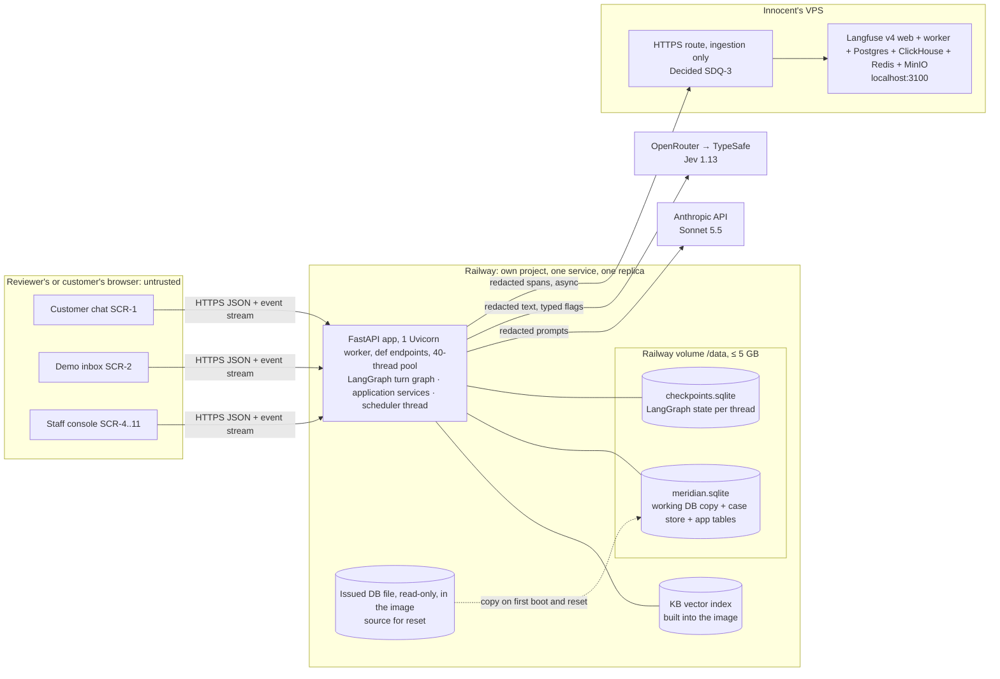
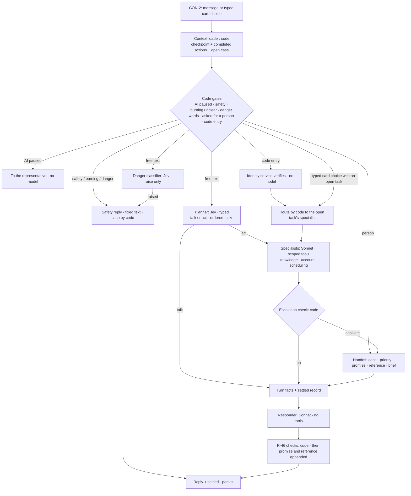

# System design and architecture: Meridian AI service agent (DO-1, DO-2)

**Date:** 2026-10-21, America/Chicago. **Stage:** zero-to-hero §6, System track, light mode. **Writer:** Claude (Opus 5.5).
**Status:** DRAFT for Innocent's review. Nothing here is built. The choices no requirement settled (`SDQ-1`…`SDQ-10`, at
the end) were **decided by Innocent on 2026-10-21**: SDQ-1 changed to a **60 s** deadline; SDQ-2…SDQ-10 as recommended.

**What this file owns:** DO-1 (system design) and DO-2 (architecture, under `## Architecture`).
**What it links to and does not repeat:**

| Topic | Owner |
|---|---|
| Requirements R-1…R-47, NFRs, the two-layer flow | [PRD 0.4](../prd/inno-aea-callcenter-prd.md) §4, §5, §6.1–§6.2 (approved) |
| Foundation answers (load, peak, failure, spend, hardest uncertainty) | PRD §10 item 4 (all answered by Innocent, 2026-10-20) |
| HP-1…HP-4 and the first walk of GP-107…GP-119 | [hard-problems.md](hard-problems.md) |
| Measured latency, cost and correctness of the turn | [SP-1](../analysis/spikes/SP-1-two-layer-turn-latency-cost.md) §3–§4 |
| Vendor and framework facts | [research note](../research/2026-10-20-vendor-and-framework-facts.md) |
| Handoff policies, priorities, the fee rule, the LangGraph needs | [consolidated direction](../analysis/2026-10-20-human-handoff-consolidated-direction.md) §6, §8–§10 |
| UI contracts (draft CON-1…CON-20) and screen needs N-1…N-27 | [USER_FLOWS.md](../ux/01-planning/USER_FLOWS.md) end, [SCREEN_SPECS.md](../ux/03-structure/SCREEN_SPECS.md) (UX track, read-only here) |
| Evaluation plan (DO-5), observability contract (DO-6), key metrics (DO-7), readiness | `evaluation-plan.md`, `observability-contract.md`, `key-metrics-registry.md`, `readiness-report.md` in this folder (written in parallel) |
| Code design (DO-3) and component contracts (DO-4) | `code-design.md` and `contracts/` in this folder (later) |

**Labels on every number:** **[T]** a target Innocent set · **[A]** an assumption, with the measurement that replaces it ·
**[C]** a calculation, arithmetic shown · **[M]** a measurement we took (SP-1 unless stated). Decisions carry their ID
(**[Decided R-21]**). A proposal is marked **Proposal**.

---

## 1. The story so far

Meridian's customers wait on the phone to do routine things: book a repair, ask what a bill is for, ask what the
membership covers. AEA wants most of those calls handled by an AI agent without hurting customers, and asks whether the
containment number is real and whether the business would know if the system broke (brief Part B).

Stages 1–4 fixed what we build. A public chat agent answers membership, billing and warranty questions from the
**current** knowledge base, books visits in a **copy** of the scheduling database, puts the safety instruction first,
and hands everything else to a person with an honest promise from a policy table. A staff console lets a reviewer play
the representative. Innocent set the load: about **100 conversations a day [T]**, a spike of about **20 at once [T]**,
and a written path to **10× [T]** with nothing built for it (PRD §5, §10; interview Q-029).

At Stage 3 Innocent drew the shape of one turn himself (HP-1): code gates first, then a **planner** (talk or act?),
**specialists** with narrow tools, a **code escalation check**, the **turn facts**, and a **responder with no tools**
that writes the words. Stage 5's spike SP-1 built a thin version and ran it. It was **correct**: 0 hard-gate failures in
190 scored conversations [M]. It was **cheap**: $0.016 per conversation on the chosen mix [M], about a twentieth of the
$0.30 allowance. **Latency was the risk.** A turn chains three or four model calls, and at 20 at once the p95 was 10.2 s
[M]. Innocent chose mix **B** (Jev for the planner and the danger classifier, Sonnet 5.5 for specialists, responder and
brief) and set the latency line at **p95 ≤ 12.5 s per turn at 20 at once [T]** (SP-1 §4, PRD §5).

SP-1 also found one real seam bug. In the fee-free reschedule (WP-4F), turn 3 moved the appointment. On the customer's
"Yes, please." in turn 4, the responder saw no write in **that** turn's facts and told the customer the move had **not**
happened. This design's main structural job is to make that impossible (R-45, §A.3), while keeping the Sonnet call
count down and putting a named deadline on every turn (N-26).

---

## 2. Requirements recap

### 2.1 What must always be true (invariants, not percentiles)

Each holds on every turn or it is a bug (GP-110). Each is enforced in **code**, never by a prompt.

| Invariant | Requirement | Enforced by (§A.1) |
|---|---|---|
| The safety instruction is the first thing said when a safety phrase appears, mid-chat and with typos | [Decided R-5, R-7, R-47] | Code gates; safety reply is fixed text, no model |
| A request for a person is honoured on the first ask, even when models are rate-limited or capped | [Decided R-2] | Code gate; CON-4 runs no model |
| Nothing private before a correct one-time code; no code in chat, logs or traces | [Decided R-15, R-16] | Identity service; tool guard |
| Every booking write is valid (zone, service, open or member-reserved slot) and never doubles | [Issued R-18, R-19] | Scheduling service, one SQLite transaction |
| The AI never moves or cancels an appointment inside 24 hours, even on a yes | [Decided R-21, R-22] | 24-hour check on the demo clock inside the scheduling service |
| The promise text and due time come from the policy table, never the model | [Decided R-26] | Handoff node; code appends promise after the model's text |
| No completion claim without a matching write; no invented number, date, ID or amount | [Decided R-46] | Completion and fact checks after the responder |
| No answer from an excluded knowledge-base file | [Decided R-10] | Ingestion manifest; excluded files are never indexed |
| Completed actions are carried across turns | [Decided R-45], SP-1 WP-4F | Actions table read at the start of every turn (§A.3) |

### 2.2 Promises per operation (GP-110)

Where timing starts and stops: **server receipt of the request → last byte of the response**, logged per turn. The
browser's own wait adds network time and is not counted.

| Operation | Latency promise | What may degrade | Recovery |
|---|---|---|---|
| Chat turn (CON-2), model path | **p95 ≤ 12.5 s at 20 at once [T]**; hard per-turn deadline **60 s (Decided, SDQ-1, Innocent 2026-10-21)** | Past the deadline: a code reply with "Try again" and "Talk to a person" | Retry with the same turn ID |
| Safety turn (rules matched) | No model; < 0.2 s server time [A, measure in Stage 9] | Nothing | — |
| Code-entry turn | Verification itself runs no model [A, as built in SP-1] | — | — |
| Talk to a person (CON-4) | No model; < 0.5 s [A] | Never disabled | Idempotent per session |
| Staff, demo and monitoring reads (CON-6…CON-20) | < 1 s [A] | — | — |
| Event stream (CON-3) | Events within ~1 s of the write [A] | Drops on restart | Reconnect with the last event ID, replay (N-2) |
| Freshness: slot availability | Re-read inside the booking transaction; never from a cached list [Decided R-45] | A shown slot may be gone: `SLOT_TAKEN` | Fresh windows offered |
| Freshness: KB answers | The deployed index; every answer carries the file's version date [Decided R-11] | — | Rebuilt on deploy |
| Recovery | Survive a process restart without losing conversations or cases [Decided SD-7.2] | The in-flight reply at the moment of restart | Client retries; state is on the volume |

### 2.3 Load, money and what must be proven (all decided; not reopened)

- **Load:** ~100 conversations/day [T], ~20 at once [T]; written 10× path (~1,000/day, ~200 at once) [T], nothing built
  (PRD §5, §10 SD-3.1, SD-3.4; Q-029 = A).
- **Failure to survive:** a process restart, not a zone outage [Decided SD-7.2].
- **Money:** model spend capped at **$30/day [T]**, about $0.30 per conversation [C]; Railway on the existing plan, own
  project [Decided R-40]; tracing on the Langfuse v4 already on the VPS [Decided Q-062]. The key is on Anthropic's Start
  tier: 1,000 RPM, 2,000,000 input tokens/min, 400,000 output tokens/min, **$500/month** spend cap [M probe, research §2b].
- **Hardest uncertainty:** that every number we report is honest [Decided SD-1.9]. That is why evals, traces and the
  per-operation failure signals below get as much care as the request path.
- **Models:** mix B [Decided after SP-1]: Jev (`typesafe/jev-1.13` via OpenRouter) for planner and danger classifier;
  Sonnet 5.5 for specialists, responder and brief. Jev's unstated retention is an accepted known limit.
- **Stack:** LangGraph [Decided], Python, FastAPI, server-rendered pages with light JavaScript, SQLite working copy plus
  case-store tables, an in-process vector index from `bge-small-en-v1.5` (PRD §6.2).

### 2.4 How deep each design step goes (GUIDELINE "set the depth")

| Step | Depth | Why |
|---|---|---|
| 1 Frame | light | Done at Stages 1–4; recapped above |
| 2 Promises | full | Safety and honesty invariants are the product |
| 3 Workload | light | One request class dominates (the chat turn); background work is tiny (§6) |
| 4 Logical flow | full | The two-layer turn is the partner's uncertainty and SP-1's bug lives here (§5, §A) |
| 5 Resource demand | full for model calls, light for CPU and disk | The model provider is the first breaker (§6.4) |
| 6 Overload and failure | full | Every failure must end in an honest handoff (PRD §5) |
| 7 Deployment | light | One Railway service, decided host; the 10× path is written, not built |
| 8 Validate | full | SD-1.9; owned by `evaluation-plan.md` and the Stage 9 load test |

---

## 3. System map: where each part runs and what crosses each line

### 3.1 The picture

### 3.2 What crosses each boundary, and what never leaves

| Boundary | What crosses | What never crosses |
|---|---|---|
| Browser → app | Customer messages and typed card choices (CON-2), "Talk to a person" (CON-4), follow-up choice (CON-5), demo controls (CON-7…CON-9), staff actions (CON-10…CON-16) | — (every route sits behind the demo login, R-48 / CON-22; the role switch inside it is a label, not a security boundary, so everything from the browser is still treated as untrusted input) |
| App → browser | Reply blocks and the `settled` object; events; the demo inbox **only for that browser's demo session** (N-11) | Codes in the chat; another session's inbox; staff data to a chat session; stack traces or field values in errors (`safe-validation-errors.md`) |
| App → Anthropic (Sonnet) | System prompts, the clean chat window, turn facts, the task's record fields (invoice lines, appointment window, tier, renewal date, install date), retrieved passages. Card-like numbers and codes are masked first | Verification codes; card numbers; full phone, email and street address (masked hints only); staff-only notes such as the $144-vs-$149 note (HP-3) |
| App → OpenRouter → TypeSafe (Jev) | The latest customer message and a short chat window **after redaction** (names, phones, emails, addresses, customer and invoice IDs, codes and card-like numbers replaced by placeholders); the state summary as **typed flags only** (verified yes/no, open task kinds, controller), never values. Each request sends `provider.data_collection: "deny"` | Any account value; any code; any staff note. SP-1's B calls carried that flag and returned with 0 call errors [M], so OpenRouter routed them under it; what TypeSafe retains is still unstated (accepted limit) |
| App → VPS Langfuse | Trace spans after in-process masking (`mask_otel_spans`, research §6): node timings, model inputs and outputs as the model saw them (already redacted), token counts, cost, tool names and record IDs | Codes, card-like numbers, phone, email, address (R-36; a seeded-value test proves absence in the response, the log and the exported trace) |
| App → volume | Everything durable: the working DB copy, case store, lookup log, actions, turns, model-call ledger, identity codes (hashed), events, checkpoints | Plaintext codes |

### 3.3 Trust boundaries

1. **The browser is untrusted.** Every request is validated server-side. Every route sits behind the one demo login
   (R-48, CON-22: cookie `mhc_session`); inside it, the role switch (CON-10) decides which staff views a session sees,
   and chat routes ignore the role. The role switch is a demo convenience, not a security boundary: anyone holding the
   demo login can act as any role, which is acceptable because the data is fictional (stated in the README).
2. **Model output is untrusted.** The model advises; code executes (`agent-tools.md` rule 4). Tool output never enters
   the stored chat (R-45). The responder has no tools. Its text passes R-46's checks before the customer sees it.
3. **Retrieved text and DB text are data, not instructions.** 109 of 159 appointments carry an issue text that doesn't
   match the booked service (audit D-11); KB passages are quoted, never obeyed. Jev's own docs say it does not treat
   state as hostile, so its label may only **raise** a danger level, never lower or route around a code rule (R-47).
4. **Vendors are outside our control.** Anthropic's terms exclude training on inputs (audit L-9). Jev's retention is not
   stated (accepted). Langfuse is Innocent's own server.

---

## 4. Design choices behind the map (one line each, detail in §11)

- **One service, one process, one volume.** `def` endpoints in Uvicorn's 40-thread pool, because the sync `SqliteSaver`
  cannot back async calls (research §3). One replica is forced anyway: Railway volumes forbid replicas (research §5).
- **Two SQLite files.** The working DB copy holds our tables too, so a booking, its action record and its lookup-log row
  commit in **one** transaction. The checkpointer keeps its own file and lock.
- **The KB index ships inside the image**, built from the ingestion manifest at deploy. It is derived, so it does not
  need the volume, and a deploy always serves the index that matches the code.
- **Langfuse is never on the request path.** Spans export on a background thread with a bounded queue; when the VPS is
  unreachable, spans are dropped and counted, and the turn is unaffected. The monitoring page reads our own tables.

---

## 5. One real request traced: WP-4, a reschedule inside 24 hours

**Why this request.** It touches every part that can go wrong: identity, a fixed clock, a rule the model must not break
(never move inside 24 hours), a handoff with a promise and a brief, and a multi-turn conversation where a later turn must
know what an earlier one did. Source: [worked pairs](../data/worked-pairs.md) WP-4, revised at Stage 3.

**The setup.** Demo "today" is Fri 2026-10-16 [Decided R-3]. Customer MHC-57204, Austin (zone `central`), not a member,
has a tune-up today 12:00–4:00 pm, two hours away (WP-4's stated assumption). Nobody is online (the default, R-30).

### 5.1 The conversation, turn by turn

| Turn | Customer | What the system does | Model calls (mix B) |
|---|---|---|---|
| T1 | "I have a tech coming … but something came up. Can I move it?" | Gates clear. Planner: act, scheduling. Scheduling needs a verified customer, so the tool guard refuses; turn facts say "locate needed"; responder asks for name and phone with a locate card | 2 Jev (parallel), 1–2 Sonnet |
| T2 | Fills the locate card (typed card choice) | Identity service matches name + phone, issues a 6-digit code to the demo inbox (hashed), masks the hint "ending in 40" | Card choices route by code (**Proposal**, §A.6); responder 1 Sonnet for the code card text, or fixed text (**Proposal**) |
| T3 | Enters the code (code card) | Code gate verifies in code, no model. The open task resumes: the scheduling specialist reads the appointment, code computes 2 hours before the window, so **fee-bearing**. It may look up open central tune-up slots (Mon Oct 19), marked **shown, not held** | 1–2 Sonnet specialist, 1 Sonnet responder |
| T4 | "Monday morning works" (or picks the Mon 8–12 window on the slot card) | The **decisive turn**, traced step by step below | 2 Jev, 1–2 Sonnet specialist, 1 Sonnet responder, 1 Sonnet brief (parallel) |

### 5.2 The decisive turn, step by step, against the 12.5 s line

Per-step times for the model calls are SP-1's measurements on mix B. Code steps are assumptions, each to be replaced by a
trace span in the Stage 9 load test. **What each step holds** is the GP-112 question: a pool thread for the whole turn,
plus the resource named.

| # | Step | Component (layer) | What it reads and writes | Holds | Alone | At 20 at once |
|---|---|---|---|---|---|---|
| 1 | Receive CON-2 with the turn ID; check it is not a duplicate | Turn endpoint (code) | `turns` row (insert, status running) | pool thread; one short DB write | ~10 ms [A] | ~10 ms [A] |
| 2 | Load context: checkpoint for the thread; **completed actions and open case from the DB** (§A.3) | Context loader (code) | checkpoint read; `actions`, `cases` read | checkpointer lock (read) | ~10–20 ms [A] | ~10–30 ms [A] |
| 3 | Code gates: AI paused? safety words? burning smell? danger words? asked for a person? | Code gates (code) | message text | CPU only | < 5 ms [A] | < 5 ms [A] |
| 4 | Planner and danger classifier, **in parallel** | Planner, classifier (Jev via OpenRouter) | redacted message + typed flags | 2 provider requests | p50 0.2 s, p95 0.4 s [M] | p50 0.2 s, p95 0.4 s [M] (Jev drew no 429s [M]) |
| 5 | Scheduling specialist: `request_change(appointment, wanted window)`. The tool computes hours before the window on the demo clock (2 h), **refuses the move**, and returns `staff_change_request` with the wanted time and the windows shown (not held). The record of the request and a lookup-log row are written | Scheduling specialist (Sonnet, scoped tools) + scheduling service (code) | `appointments`, `appointment_slots` read; `lookup_log` write | 1–2 Sonnet requests; one DB write | 1.2–1.9 s per Sonnet call, p50 [M] | specialist p95 ≈ 4.1 s [M] |
| 6 | Escalation check: the `staff_change_request` flag → handoff, P2 | Escalation check (code) | turn facts | CPU only | < 5 ms [A] | < 5 ms [A] |
| 7 | Handoff: create the case (idempotent on thread + reason), priority **P2**, internal due time **12:00 today** (window start), promise from the policy table (nobody online → "within 1 business day" plus the can't-guarantee line, R-26), reference, supervisor alert, follow-up stub. The `actions` row records "change request sent, original stays" | Handoff node + case store + policy table (code) | `cases`, `case_events`, `promises`, `actions` in **one** transaction | one DB write transaction | ~10–20 ms [A] | ~10–40 ms [A] |
| 8 | Brief extraction (headings 2, 4, 7) starts **in parallel** with step 9; headings 1, 3, 5, 6, 8 come from state | Brief (Sonnet, structured output) | turn facts, lookup log | 1 Sonnet request, off the critical path | ~1.2–1.9 s [M range] | not separately measured; finishes before the responder in most turns [A] |
| 9 | Responder writes the reply from the clean chat window, this turn's facts and the `settled` record (§A.3) | Responder (Sonnet, no tools) | prompt only | 1 Sonnet request | 1.2–1.9 s p50 [M range] | **p95 8.4 s [M]**: the slow tail |
| 10 | R-46 checks: completion check (no "moved", "done", "changed"); fact check of every number, date, ID and amount against facts and the lookup log; strip anything unmatched. Code appends the promise and reference | Checks (code) | reply text, lookup log | CPU only | < 10 ms [A] | < 10 ms [A] |
| 11 | Persist: checkpoint, clean chat (no tool output), `turns` row (reply, latency, outcome), `model_calls` rows (tokens, cost) | Turn endpoint (code) | checkpoint write; DB writes | checkpointer lock (write) | ~10–30 ms [A] | ~10–50 ms [A] |
| 12 | Respond: change-request card, handoff card, `settled` object; event `case_created` on CON-3 | Turn endpoint (code) | — | — | ~10 ms [A] | ~10 ms [A] |

**The budget in one line.** Whole turns on mix B: **alone p50 4.5 s / p95 7.6 s [M] → 4.9 s of headroom at p95; at 20 at
once p50 4.7 s / p95 10.2 s [M] → 2.3 s of headroom under 12.5 s [C].** Code steps add roughly 0.1 s [A] in total; the
time is the four chained model steps (planner, specialist, responder; the brief runs beside the responder).

**Three things the trace tells us.**

1. **Tails don't add, but they can coincide.** The step p95s summed are 0.4 + 4.1 + 8.4 = 12.9 s [C], over the line.
   The measured turn p95 is 10.2 s [M] because a slow specialist and a slow responder rarely land on the same turn. When
   they do, the turn passes 12.5 s. That is why the hard deadline sits above the line (§8.1, SDQ-1), not on it.
2. **SP-1's p95 is pooled over every turn type.** A handoff turn like T4 carries the longest reply and a parallel brief
   call, so it probably sits in the upper part of that distribution [A]. Stage 9 must report p95 **per turn type**
   (talk, act, handoff, safety, code entry), not only pooled.
3. **What a turn holds is one pool thread for its whole life, and two short SQLite locks.** CPU is idle almost the whole
   time. So capacity is a concurrency question (threads and provider slots), not a CPU question (GP-112), as §6 shows.

**What R-45 changes in this turn.** If the customer now writes "So it's moved, right?" in T5, the context loader (step 2)
reads the `actions` row from T4 ("change request sent; original appointment stays until a person confirms"). The
responder's `settled` input carries it, so the answer is "No, it hasn't moved yet…", and the `settled` panel on SCR-1
shows the same thing (N-27). In WP-4F (fee-free), the T3 `moved` action is read the same way in T4, which is exactly the
case SP-1 got wrong.

---

## 6. Load and bottleneck arithmetic

### 6.1 Inputs

| Input | Value | Kind | What replaces it |
|---|---|---|---|
| Conversations per day | 100; at 10×, 1,000 | [T] | — |
| Conversations at once (peak) | 20; at 10×, 200 | [T] | — |
| Turns per conversation | 5 (SP-1's scripted chats averaged 84 ÷ 33 = 2.5 [C from M]; 5 is the research note's planning value) | [A] | Turn count from the first week of traffic, or the R-38 test set's transcripts |
| Customer think time between a reply and the next message | 30 s | [A] (research §3) | Stage 9 load test with timed gaps; real traffic |
| Turn time | p50 4.7 s, p95 10.2 s at 20 at once | [M] | Stage 9 load test |
| Sonnet requests per free-text turn | 1.5–2 (SP-1: option A made 381 calls in 108 turns = 3.5 per turn [C from M]; B moves the planner and classifier to Jev, leaving about 1.5, plus the brief on handoff turns) | [C from M] | `model_calls` ledger |
| Sonnet input tokens per turn | 9,000 (specialist 6,000 + responder 3,000) | [A] (research §2c) | `model_calls` ledger |
| Sonnet output tokens per turn | 700 (specialist 400 + responder 300), thinking excluded | [A] | Ledger |
| Cost per conversation | $0.016 mean, $0.039 max on SP-1's short chats | [M] | Ledger; doubled to $0.032 for 5-turn chats [C] |
| DB writes per turn | ~12 (checkpoints per graph step, lookup log, turn and call records) | [A] | Count in the Stage 9 run |
| Checkpoint size | ~20 KB per checkpoint, ~10 checkpoints per turn | [A] | `checkpoints.sqlite` size after the Stage 9 run |

### 6.2 Today: ~100 a day, 20 at once

| Resource | Arithmetic | Result | Limit | Use |
|---|---|---|---|---|
| Turn arrivals at the peak | 20 conversations × 60 s ÷ (30 s think + 4.7 s turn) | **≈ 35 turns/min** [C] | — | — |
| Turns in flight (Little's Law) | 35/60 per s × 4.7 s | **≈ 2.7 on average** [C]; **20 if all send in the same second** [C] | 40 pool threads | ≤ 50% |
| Sonnet requests/min | 35 × 2 | **≈ 70** [C]; SP-1's no-think-time burst ≈ 160 (half of A's measured 316 [M]) | 1,000 RPM | 7–16% |
| Sonnet input tokens/min | 35 × 9,000 | **≈ 315,000** [C] | 2,000,000 | 16% |
| Sonnet output tokens/min | 35 × 700 | **≈ 24,500** [C] + thinking | 400,000 | 6% |
| Jev requests/min | 35 × 2 | **≈ 70** [C] | OpenRouter/TypeSafe limit not published [A] | unknown |
| Model spend per day | 100 × $0.016 [M]; × 2 for 5-turn chats | **$1.60–3.20/day** [C] | $30/day [T] | 5–11% |
| Model spend per month | × 30 | **$48–96** [C], plus eval runs (~75 cases × ~$0.03 ≈ $2.25 per run [C]) | $500 Start cap | 10–20% |
| SQLite writes | 35 × 12 per min | **≈ 7/s** [C] | thousands/s for small WAL writes on local disk [A] | small |
| Checkpoint disk, unpruned | 100 × 5 turns × 10 × 20 KB | **≈ 100 MB/day** [C] → a 5 GB volume full in ~50 days | 5 GB volume (Hobby) | grows |
| Checkpoint disk, pruned to the last 2 per thread (Decided, SDQ-10, Innocent 2026-10-21) | 100 × 2 × 20 KB | **≈ 4 MB/day** [C] | 5 GB | negligible |
| RAM | app + graph ~0.2 GB, ONNX embedding model ~0.2–0.3 GB | **~0.5 GB** [A] | — | ≈ $5/month at $10/GB-month [C] |

**Today's verdict [C].** One process holds 20 at once with every resource under half its limit. The first thing to watch
is not a limit but the **latency tail** (2.3 s of headroom at p95). The only slow-growing risk is checkpoint disk, which
pruning removes. This matches the scale bucket chosen at Stage 3 (GP-108): one instance, one SQLite file, no queue, no
autoscaling, no hosted vector service.

### 6.3 At 10×: ~1,000 a day, 200 at once

| Resource | Arithmetic | Result | Limit | Breaks? |
|---|---|---|---|---|
| Turn arrivals at the peak | 200 × 60 ÷ 34.7 | **≈ 346 turns/min** [C] | — | — |
| Sonnet input tokens/min | 346 × 9,000 | **≈ 3.1 M** [C]; ≈ 1.6 M if half the input is a prompt-cache read [A] (cache reads don't count toward the limit, research §2b) | 2.0 M (Start) | **Yes, uncached.** It crosses 2 M at 2,000,000 ÷ 9,000 ÷ 1.73 ≈ **130 at once** [C] |
| Sonnet requests/min | 346 × 2 | **≈ 690** [C]; bursts above 1,000 | 1,000 (Start) | **Bursts, yes.** A drew 429s from the acceleration limit at ~316 RPM [M], so the climb from ~70 to ~690 draws them first |
| Sonnet output tokens/min | 346 × 700 | **≈ 242,000** [C] + thinking | 400,000 | Close if thinking grows |
| Model spend | 1,000 × $0.016–0.032 | **$16–32/day; $480–960/month** [C] | $30/day [T]; $500/month (Start) | **Yes.** The monthly cap and, on busy days, the daily cap |
| Turns in flight | 346/60 × 4.7 | **≈ 27 on average** [C]; bursts above 40 | 40 pool threads, one process | **Yes, on bursts:** turns wait for a thread, and the wait adds straight to latency |
| Event streams (CON-3) | one per open chat | **200 open connections** [C] | async: no thread each (SDQ-5); a `def` stream would take a thread each | Only if streams use threads |
| SQLite writes | 346 × 12 per min | **≈ 69/s** [C]; the checkpointer's single lock at ~2–5 ms per write [A] is busy 14–35% of the time | one writer per file | Not first; contention grows |
| One replica | Railway volumes forbid replicas (research §5) | — | 1 process | **Yes:** no way to add a second process while state is on the volume |
| Checkpoint disk, unpruned | × 10 | **≈ 1 GB/day** [C] | 5 GB | Yes, in days, unless pruned |
| Jev via OpenRouter | ≈ 690 requests/min | — | not published [A] | Unknown; watch for 429s |
| Langfuse on the VPS | ~5,000 turns/day of spans | — | VPS disk and ClickHouse [A] | Not first |

### 6.4 What breaks first, in order (GP-113)

1. **Anthropic's Start-tier input-token limit and its acceleration limit**, at about **130 conversations at once** [C],
   with 429s on bursts before that. Close behind: the **$500/month** Start spend cap (crossed at about 520–1,000
   conversations a day [C]), which stops every call until the 1st of the month with no `retry-after` (research §2b).
2. **The single process's 40-thread pool**, on bursts at about **200 at once** [C]. Turns queue for a thread and latency
   grows by the wait.
3. **The one-replica ceiling.** SQLite is not slow at these rates; it is what pins us to one process, because the volume
   cannot be shared. Moving state off the volume is what unlocks a second process.
4. **The $30/day cap [T]**, reached on busy days at 10× [C]. This is a business choice, not a limit: when reached, the
   agent hands off by design (R-41). Raising it is Innocent's call at that time.
5. **Then, in no settled order:** OpenRouter/Jev limits (unpublished), checkpointer lock contention, Langfuse storage on
   the VPS.

---

## 7. The 10× scale path (written, not built)

Each step names the measurement that triggers it, the change, and a rough cost. Steps are ordered by §6.4. Cost figures
use Railway's prices (RAM $10/GB-month, research §5) and are [C] from [A] sizes.

| # | Trigger (measured on the monitoring page or the ledger) | Change | Rough cost |
|---|---|---|---|
| 1 | Sonnet input tokens/min above 50% of the tier limit for 5 minutes, or 429s above 1% of calls | Cache the stable prompt prefix (system prompt, tool list, policy text) on every Sonnet role and set effort `low` for chat-style roles (research §1–§2) | A few hours of work; **lowers** spend (a cache hit costs 5% of input) |
| 2 | 429s still above 1%, or turns in flight above 30 | A client-side token bucket that paces Sonnet requests under the tier's rate, inside the per-turn deadline; the admission limit (SDQ-9) returns a "busy, here's a person" reply beyond it | Half a day; no money |
| 3 | Projected monthly spend above $400, or input tokens/min above 70% of Start after step 1 | Move the key to Anthropic's **Build** tier: 5,000 RPM, 5 M input tokens/min, 1 M output/min, $1,000/month cap (research §2b). Tier placement depends on usage history, so start this early | $480–960/month of model spend at 10× [C]; lead time unknown [A] |
| 4 | $30/day reached on two days in a week | Ask Innocent to raise the daily cap (a decision, not a code change) | His call |
| 5 | p95 above 12.5 s from thread waits (`turn_queue_ms` > 1 s at p95), or a second process needed for any reason | Move durable state to **Postgres** (Railway Postgres, or Neon per the hosting rule): `AsyncPostgresSaver` for checkpoints; the working DB copy, case store and app tables in Postgres; the booking transaction keeps its row lock | 1–2 days [A]; ≈ $5–10/month at 0.5–1 GB [C] |
| 6 | Same trigger, after step 5 | Go async end to end (`AsyncAnthropic`, `graph.ainvoke`, embedding via `asyncio.to_thread`) and run **2–3 replicas** behind Railway's balancer (Hobby allows 6 per service) | 1–2 days [A]; ≈ $10–30/month more RAM [C] |
| 7 | With step 6 | Fan events out across replicas (Postgres LISTEN/NOTIFY or a small Redis) so a representative on one replica reaches a customer on another; make the scheduler job a singleton with a lock in Postgres | Half a day; Redis ≈ $2.50/month at 0.25 GB [C] |
| 8 | VPS disk above 70%, or ClickHouse ingestion lag | Sample traces (keep 100% of handoffs, errors and safety turns; 20% of the rest) and shorten trace retention on the VPS | Configuration |
| 9 | OpenRouter 429s on Jev | Ask OpenRouter/TypeSafe for limits, or call TypeSafe directly; the classifier's rules stand when Jev fails (R-47), and the planner has a fallback (SDQ-6) | Small |

**What is deliberately not on the path:** a second region (request volume never forces one; GP-118), autoscaling
(spikes of chat traffic last minutes, and the fix is headroom plus admission control; GP-115), a hosted vector database
(17 files), multi-tenant support for several portfolio companies (Q-029 option C, rejected).

---

## 8. Overload and failure behaviour, per operation (GP-114, GP-116)

### 8.1 The per-turn deadline (Decided, SDQ-1: 60 s)

**Decided: a hard deadline of 60 s per turn** (Innocent, 2026-10-21: "I would wait up until a minute. That's a good
amount of time, just in case there are some heavy operations"), measured from server receipt. Past it, the customer
gets a code-built reply with the named error **`TURN_TIMEOUT`** (N-26). The recommendation had been 20 s.

**What 60 s means in practice.**
- The target is unchanged: p95 ≤ 12.5 s at 20 at once [T]; measured 10.2 s [M]. The deadline is only the backstop.
- It leaves room for slow tool work and two or more retries inside the turn (each Sonnet call 1.2–1.9 s p50 [M]).
- The UI says "Still working on this…" at about 10 s (SCR-1). Between 10 s and 60 s the customer keeps a usable composer
  and the "Talk to a person" control, so a long wait never traps them.
- **Capacity consequence [C]:** a turn can now hold a worker thread for up to 60 s. The 30-turn admission limit (SDQ-9)
  stays below the 40-thread pool, so slow turns cannot exhaust it; the threadpool trigger in the scale path (§7) is
  checked against the measured share of long turns at Stage 9.
- SP-1 used a 45 s deadline and had 0 unrecovered turns [M].
- **Railway allows it:** the platform's HTTP request limit is 15 minutes, not configurable (S-232, staff answers, read
  2026-10-21), so a 60 s turn and the browser's 65 s give-up fit with room to spare.

**How the deadline works.**
- Each model call gets `timeout = min(role cap, time left)`. Role caps (**Proposal**): Jev 3 s (its p95 is 0.4 s [M]),
  specialist step 8 s, responder 12 s, brief 12 s.
- The SDK's own retries are off (`max_retries=0`), because it honours any `retry-after` with no ceiling (research §4).
  Our loop retries once, only for retryable errors (408, 409, 429 with `retry-after`, 5xx, 529), and only when the wait
  plus a minimum call time fits in the time left. It never waits past the deadline.
- The graph checks the deadline between nodes. A database transaction that has started always finishes; the run stops at
  the next node boundary.
- **The timeout reply is code, not a model:** "This is taking longer than it should." (exact copy owned by the UX track: `docs/design/design.md`, TURN_TIMEOUT card) Then whatever the
  `settled` record holds (so a booking that committed is still reported), then two keys: **Try again** (resends the same
  turn ID) and **Talk to a person** (CON-4).
- **Try again is idempotent.** If the turn's write already committed, the `actions` table carries an idempotency key
  (thread, turn, action), so the write is not repeated; the turn re-runs from the stored checkpoint.
- Two timeouts in one conversation count as a failure signal (OD-6): the next reply offers a person.
- The browser gives up after deadline + 5 s [A] and shows "That didn't send. Your message is still here." (SCR-1 error).

### 8.2 Behaviour per operation

| Operation | When over capacity | When a dependency fails | Retries | Signal that it fired (to DO-6) |
|---|---|---|---|---|
| **Safety turn** (rules match) | Never waits: no model, no queue | DB write of the P0 case fails → the instruction is still sent; the case write is retried once and logged | 1 on the case write | `safety_reply_sent`, `case_write_failed` |
| **Danger classifier** (Jev) | — | Fails or times out → the rules stand (R-47) | 1 within its 3 s cap | `classifier_fallback` |
| **Planner** (Jev) | — | Fails twice → **Decided (SDQ-6, Innocent 2026-10-21):** a Sonnet planner with the same typed output; if that fails too, a handoff reply | 1, then fallback | `planner_fallback` |
| **Specialist** (Sonnet) | Paced by the provider limits | 5xx/529/timeout → 1 retry within the deadline, then the turn ends in a handoff reply with what is settled | 1 | `specialist_failed` |
| **Responder** (Sonnet) | — | Fails → a code reply built from the turn facts' fixed fields (e.g. the booking ticket's date, window and technician) plus a person offer | 1 | `responder_fallback` |
| **Whole turn** | Admission limit: above **30 turns in flight** in the process, the turn is refused at once with a `BUSY` reply and a person offer, no model (**Decided, SDQ-9**); at 20 at once it never fires [C] | Deadline → `TURN_TIMEOUT` (§8.1) | Customer-driven | `turn_timeout`, `turn_rejected_busy` |
| **Spend cap: ours** ($30/day) | Checked before each turn from the `model_calls` ledger; once reached, the chat runs in handoff-only mode (safety and "Talk to a person" still work). A turn in progress may overrun by one turn's cost (≤ $0.039 [M]) | — | — | `spend_cap_reached` (monitoring alert) |
| **Spend cap: Anthropic's** (429 with no `retry-after`, research §2b) | Treated as a hard stop: model calls stop, handoff-only mode, alert | — | 0 | `provider_spend_cap` |
| **Rate limits per session and IP** (R-41) | `RATE_LIMITED` with the person key; "Talk to a person" never limited | — | — | `rate_limited` |
| **Booking write** | Serialized by SQLite's single writer; `busy_timeout` 5 s [A] | Lock timeout → no write, "I couldn't book that just now", same windows offered again | 0 automatic; customer may retry | `booking_failed` |
| **Slot shown, then taken** | Refuses rather than guesses: the slot is re-read inside the transaction | `SLOT_TAKEN` with fresh windows | — | `slot_taken` |
| **Handoff (CON-4 and the handoff node)** | No model; never limited | Case write fails → error with the person key still shown; retried once | 1 | `handoff_failed` |
| **Brief extraction** | Off the critical path | Fails → the case is created with the five state headings; headings 2, 4, 7 marked "not generated"; staff read the chat | 0 | `brief_failed` |
| **Event stream (CON-3)** | Async, no pool thread (SDQ-5) | Disconnect → client reconnects with the last event ID; missed events replayed from the `events` table (N-2) | client-driven | `stream_reconnect` |
| **Retrieval index** | In memory, read-only | Fails to load at boot → readiness fails and the deploy does not go live; if lost later, knowledge answers become "I don't have that information" + person | — | `index_unavailable` |
| **Langfuse on the VPS** | Bounded export queue; spans dropped when full | Unreachable → spans dropped and counted; turns unaffected | exporter's own, bounded | `trace_export_dropped` |
| **Scheduler job** (due-soon, overdue, stuck) | Runs every 60 s [A] | A missed run is caught up by the next one (idempotent) | — | `scheduler_last_run` |
| **Staff actions (CON-13)** | — | Two staff change the same case → `VERSION_CONFLICT` with who changed it (version check, N-18) | — | — |
| **Demo reset (CON-9)** | Takes an exclusive lock; turns in flight wait up to 5 s [A] | All-or-nothing; open chats ended with `SESSION_ENDED`; staff sessions invalidated (N-14) | — | `demo_reset` |
| **Process hang** | — | **Proposal:** an in-process watchdog probes `/healthz` every 15 s [A]; three failures → the process exits, and Railway's restart policy starts it again (decided Q-045 = A). Railway's deploy health check gates new deploys only [A, check Railway's docs at deploy] | — | `watchdog_restart` (shown on the monitoring page, CON-19) |

### 8.3 Refuse or answer, per operation (GP-116)

There is one data node, so the "partition" that matters is between our app and its dependencies.

| Operation | Choice | Why |
|---|---|---|
| Booking, moving, cancelling | **Refuse** without a fresh read inside the transaction | Invariant R-18/R-19; a wrong booking sends a technician to the wrong slot |
| Identity | **Refuse** (`NOT_VERIFIED`, same for every cause) | R-15, R-16 |
| Promise and due time | **Refuse to improvise**: only the policy table | R-26 |
| KB answers | **Answer** from the deployed index, with the version date | Freshness is per deploy; the date is shown |
| Safety instruction | **Answer always**, even with the DB or every model down | R-5 |
| Traces | **Drop** rather than block | The monitoring page and evals read our own tables |

---

## 9. Durability: what survives a restart

**What is on the volume (`/data`, ≤ 5 GB on Hobby):**
- `meridian.sqlite`: the **working copy** of the issued DB (customers, technicians, appointment_slots, appointments,
  invoices; 154 / 8 / 528 / 159 / 81 rows [M, issued file]), plus our tables: `cases`, `case_events`, `promises`,
  `followups`, `lookup_log`, `actions`, `turns`, `model_calls`, `identity_codes`, `demo_inbox`, `events`, `flags`,
  `demo_state` (presence, clock), `staff_sessions`. WAL mode, `busy_timeout` 5 s [A].
- `checkpoints.sqlite`: LangGraph `SqliteSaver`, one thread per conversation, holding the typed state of R-45.

**What is in the image (rebuilt every deploy):** the code, the issued dataset (read-only, the reset source), the
ingestion manifest and the KB vector index.

**First boot and reset.** If `meridian.sqlite` is missing, it is copied from the issued file in the image and our
migrations add our tables; demo seed cases load (R-33). CON-9 does the same under an exclusive lock and also clears
checkpoints, ends open chats and resets the clock and presence (N-14). The issued file is never written (R-19).

**Write order across the two files.** A turn commits its **business transaction first** (booking or change request +
`actions` row + `lookup_log` rows, one transaction in `meridian.sqlite`), then writes the checkpoint. If the process dies
between the two, nothing is lost: the next turn's context loader rebuilds completed actions from `actions` (§A.3), and the
idempotency key stops a repeated write.

**What a restart costs (SD-7.2).**
- Conversations, cases, promises and completed actions survive: they are on the volume [Decided SD-7.2].
- The reply of any turn in flight is lost. The browser shows "That didn't send" and the customer retries with the same
  turn ID; a committed write is reported from `settled`, not repeated.
- Event streams drop and reconnect with replay (N-2).
- A redeploy with a volume attached has "a small amount of downtime" (research §5) [A: seconds to a minute, measure on
  the first deploy].

**What it does not survive (stated, accepted under SD-7.2):** losing the volume itself. Railway volume backups by plan are
not stated (research §5). For the demo the reset path rebuilds everything from the image; cases created by reviewers
would be lost. A nightly copy of `meridian.sqlite` to the VPS is a cheap later step, not in tonight's scope.

**Growth.** Checkpoints are the only table that grows fast (§6.2). **Decided (SDQ-10, Innocent 2026-10-21):** the scheduler prunes each
thread to its last 2 checkpoints once a day; the clean chat lives in our own table, so nothing a person reads is lost.
Retention follows D6: case snapshots and chat history kept for the case's life, deleted 90 days after it closes in the
product; the demo resets instead.

---

## 10. Security and privacy boundaries

| Concern | Design | Requirement |
|---|---|---|
| **Demo login (whole app)** | One username and password from Railway variables gate every route except the login and `/healthz`; a signed session cookie follows. After sign-in, a visible switch moves between the customer view and the staff roles (representative, supervisor, owner) with no second password; demo reset and the staffing toggle sit behind the same login (Innocent, 2026-10-21) | R-48 |
| **Identity code** | Locate (name + phone, customer ID or invoice number) is not proof. A 6-digit code is generated server-side, stored **hashed** with an expiry of 10 minutes, delivered only to the demo inbox scoped to that browser's demo session (N-11), never shown in chat. 3 wrong tries lock the attempt; **at most 3 codes sent per conversation [A]** (UX input). Verification is per session and per customer ID. The code-entry turn is checked by code with **no model call**, and the stored chat keeps "[code entered]", never the digits | R-15, R-16; consolidated §8 |
| **No account fishing** | No match, ambiguous match and no contact all return the same `NOT_VERIFIED` (N-7); rate limits per session and IP | R-16, R-41 |
| **Redaction (R-36)** | One redaction function, applied **before** anything leaves the process: card-like numbers (Luhn-shaped digit runs) and codes always; for Jev, also names, phones, emails, addresses and customer and invoice IDs, replaced by placeholders; for traces, the same set as Jev. Applied again at export (`mask_otel_spans`). A test drives real flows with seeded values and asserts their absence in the HTTP body, the log and the exported trace (`safe-validation-errors.md` rule 5, rule 19 of `verification-evals-observability.md`) | R-36; audit G-9 |
| **What each vendor sees** | Anthropic: the redacted chat window, task fields and passages; never codes, card numbers or full contact details. Jev via OpenRouter: redacted text and typed flags only, `data_collection: deny` on every request. Langfuse: redacted spans on Innocent's own server | §3.2; PRD §6.2 |
| **Cards** | The agent never asks for or accepts a card number; one typed is masked before storage and before any model, and the reply says cards aren't taken in chat | R-13; audit K-17, L-4 |
| **Staff-only text** | `internal/agent_discretion_notes.md` and record-vs-policy mismatches (e.g. INV-204411's $144 vs $149) go to staff-only fields that no customer-facing model sees; they reach the brief and the case view | R-10, R-17; HP-3 |
| **Prompt injection** | Tool output never enters the chat; the responder has no tools; KB and DB text are quoted, not obeyed; the classifier may only raise; the fee rule, identity and promise are code | R-45, R-46, R-47 |
| **Staff console** | Behind the app-wide demo login (R-48, Innocent 2026-10-21; CON-22). Once signed in, a role switch (CON-10: customer, representative, supervisor, owner) with no second password; the role is held per login session and chat routes ignore it, so customer and staff tabs work side by side. Superseded the earlier "role picker, no passcode" design (N-15) | R-31, R-48 |
| **Secrets** | Railway variables (Anthropic, OpenRouter, Langfuse keys, the session secret); never in prompts, logs or the repo | R-40; `agent-tools.md` rule 7 |
| **Errors** | Field name, stable code, constraint; never the value | `safe-validation-errors.md` |
| **The Langfuse route** | Only the ingestion path is reachable from the internet; the Langfuse UI stays on localhost and is reached through an SSH tunnel (**Decided, SDQ-3**). Turning the route on is Innocent's yes at deploy (Q-062) | R-36; Q-062 |

---

## 11. Decisions, each as a decision sentence

Decided items cite their owner; this design only applies them. Proposals name the SDQ that settles them.

1. **One process, `def` endpoints, one Uvicorn worker, 40-thread pool.** Because the sync `SqliteSaver` raises on async
   calls and a sync graph inside `async def` blocks every request (research §3), and 20 at once needs at most 20 threads
   [C], we chose plain `def` turn endpoints in Uvicorn's default 40-thread pool, **over** a fully async stack
   (`AsyncSqliteSaver`, `AsyncAnthropic`), **at the cost of** a hard ceiling of ~40 turns in flight per process and a
   rewrite step on the 10× path. It should hold 20 at once with no thread waits. **Verify by** the Stage 9 20-at-once
   load test with `turn_queue_ms` per turn at p95 < 100 ms. **Revisit when** turns in flight pass 30 (scale path step 5–6).
2. **Two SQLite files on one Railway volume, one replica.** Because SD-7.2 asks only for restart survival and Railway
   volumes forbid replicas, we chose the working DB copy plus our tables in `meridian.sqlite` and checkpoints in their own
   file, **over** Postgres now, **at the cost of** no second process and a short outage on redeploy. It should keep every
   conversation and case across a restart. **Verify by** a kill-and-restart test mid-conversation (state, cases and the
   settled record intact). **Revisit when** a second process is needed (scale path step 5).
3. **Completed actions come from the `actions` table at the start of every turn (R-45 fix).** Because SP-1's WP-4F turn 4
   denied a move done in turn 3, we chose to read every completed write in the conversation from the DB into the turn's
   `settled` input, **over** carrying them only in model-visible chat or in the latest turn's facts, **at the cost of**
   one indexed read per turn (~ms [A]) and a table to keep. It should make "done in turn N, denied in turn N+1"
   impossible. **Verify by** WP-4F and a 20-turn multi-turn case in the dev set. **Revisit when** never, unless state moves
   to Postgres (then the same table moves with it).
4. **A 60 s hard per-turn deadline with a code-built `TURN_TIMEOUT` reply (Decided, SDQ-1, Innocent 2026-10-21).**
   Because the SDK honours `retry-after` without a ceiling and some operations may be heavy, Innocent chose 60 s,
   **over** the recommended 20 s, **at the cost of** a longer worst-case wait and longer thread holds. It keeps every
   turn's wait bounded while rarely cutting off a valid turn. **Verify by** the share of turns passing 20 s and 60 s in
   Stage 9 (target: under 1% pass 20 s [A]).
   **Revisit when** the Stage 9 p99 passes 18 s or more than 1% of turns time out. **If you pick differently:** 15 s
   cuts more slow-but-valid turns; 30 s lets the worst waits double.
5. **Our own retry loop, SDK retries off.** Because of the uncapped `retry-after` and 429s at bursts (research §4,
   SP-1), we chose one bounded retry per call inside the deadline, **over** the SDK's two automatic retries, **at the
   cost of** a small amount of retry code we own. It should mean no turn waits past its deadline on a provider's say-so.
   **Verify by** a fault-injection test returning 429 with `retry-after: 60`. **Revisit when** the provider changes its
   retry headers.
6. **Model mix B [Decided, Innocent after SP-1].** Jev for the planner and classifier, Sonnet for words. Recorded in PRD
   §6.2; this design adds only the redaction before Jev and the fallback (SDQ-6).
7. **Jev sees redacted text and typed flags only.** Because Jev's retention is unstated and its docs say it does not
   treat input as hostile, we chose to redact every identifier before the call and send state as flags, **over** sending
   the raw chat, **at the cost of** a classifier that cannot use a customer's name or address (it never needed them). It
   should keep every account value off an endpoint with unknown retention. **Verify by** the seeded-value test on the
   OpenRouter request bodies. **Revisit when** TypeSafe publishes a retention period or Jev is replaced.
8. **Traces to the VPS Langfuse, redacted in-process, exported off the request path [Decided Q-050/Q-062; mechanism
   Decided SDQ-3].** Because traces must stay on Innocent's own server and a slow VPS must never slow a customer, we
   chose a background exporter with a bounded queue that drops on failure, **over** synchronous trace calls, **at the
   cost of** losing spans while the VPS is unreachable. It should keep turn latency independent of tracing. **Verify by**
   a run with Langfuse stopped (turn p95 unchanged; drops counted). **Revisit when** traces are needed for an audit
   (then buffer to disk).
9. **No streamed replies tonight (Decided, SDQ-2, Innocent 2026-10-21).** Because R-46's completion and fact checks need the whole reply
   before any of it is shown, we chose to send the reply whole, **over** streaming tokens, **at the cost of** no faster
   first word (SP-1 did not measure streaming). It should keep every shown word checked. **Verify by** the R-46 eval gate
   (0 completion claims without a write). **Revisit when** the p95 line is at risk and progress events (SDQ-2 option B)
   are not enough.
10. **The KB index ships in the image.** Because the index is derived from issued files that change only with the code,
    we chose to build it at deploy, **over** storing it on the volume, **at the cost of** a slower build (~1 minute [A]).
    It should make the served index always match the deployed manifest. **Verify by** the manifest's file count (17) and
    the retrieval eval on the deployed app. **Revisit when** the KB changes without a code change.
11. **Admission limit of 30 turns in flight (Decided, SDQ-9, Innocent 2026-10-21).** Because the pool has 40 threads and staff, inbox and
    monitoring calls need some, we chose to refuse turn 31 at once with a person offer, **over** letting it queue for a
    thread, **at the cost of** a refusal that should never happen at 20 at once [C]. It should turn overload into an
    honest handoff, not a silent wait. **Verify by** a 40-at-once burst test. **Revisit when** the 10× path starts.

---

## Architecture

### A.1 The components of one turn (the two-layer graph)

**What it does in practice.** A customer message enters the graph. Code checks run first and can finish the turn alone
(safety, a person, the AI paused). Otherwise a planner says whether to just talk or to act, specialists do the acting
with narrow tools, code decides whether to escalate, the turn's facts are gathered, and a responder with no tools writes
the reply, which code checks before it is sent. Green in Innocent's drawing is code; purple is a model (PRD §6.1).

| Component | Layer | Responsibility (one sentence) | Takes in | Gives back | Requirements |
|---|---|---|---|---|---|
| **Context loader** | code | Assemble what this turn may know before anything decides | Thread ID; checkpoint; `actions`, `cases`, `demo_state` rows | Typed state with `settled` (all completed actions, the open case and its promise), identity status, controller, clock, presence | R-45, N-27 |
| **Code gates** | code | Decide the turns that must never reach a model | The message (or typed card choice) and state | One of: paused, safety, burning-unclear, danger, person, code entry, typed choice, free text | R-2, R-5–R-8, R-15, R-31, R-47 (rule half) |
| **Danger classifier** | model (Jev) | Say whether a message the rules passed is really burning-unclear or someone in danger; it can only raise | Redacted message; typed flags | A label from a fixed set; failure leaves the rules' verdict | R-47 |
| **Planner** | model (Jev) | Decide "just talk" or "act", and which specialists in what order | Redacted recent chat; typed flags | A typed plan: talk, or an ordered list of up to 3 tasks [A], each naming a specialist | HP-1; WP-1 |
| **Knowledge specialist** | model (Sonnet) + code | Find the current KB passages that answer the task | Task text; retrieval tool over the in-image index (excluded files never indexed) | Passages with file, section and version date; or "no current source" | R-9–R-13 |
| **Account specialist** | model (Sonnet) + code | Read the verified customer's invoice, membership or warranty fields | Task text; verified customer ID; read tools that refuse until verified | Typed records as billed; staff-only notes kept apart | R-14–R-17 |
| **Scheduling specialist** | model (Sonnet) + code | Find windows, book, move or cancel fee-free, or record a fee-bearing change request | Task text; verified customer ID; scheduling tools | Typed result: windows shown (not held), a write result with its idempotency key, or `staff_change_request` | R-18–R-23 |
| **Escalation check** | code | Decide whether the turn becomes a handoff | Specialist results; failure counters; D4 flags; spend and brakes | Escalate (reason, priority) or not | R-24; OD-6; D4 |
| **Handoff** | code (+ brief model) | Create the case and the customer's promise | Reason and priority; presence; clock; follow-up preference | Case (P0–P4), due time, promise text from the policy table, reference, alert; the brief (5 headings from state, 3 by extraction) | R-25–R-28, R-30 |
| **Brief extraction** | model (Sonnet, structured output) | Write "what the customer needs", the claims and the open decision | Clean chat; lookup log | Three typed headings; fact-checked like the reply | R-28, R-46 |
| **Turn facts** | code | Hold this turn's results for the responder | Specialist results, handoff result, missing info | Typed facts (reset every turn) beside the cumulative `settled` | R-45 |
| **Responder** | model (Sonnet, no tools) | Write the reply in plain words from the facts | Clean chat window (~10 turns [A], R-45), turn facts, `settled` | Reply text and the card choices to show | R-4, R-45 |
| **R-46 checks** | code | Make sure the words claim nothing that didn't happen and invent no number | Reply and brief text; turn facts; `settled`; lookup log | Checked text, with unmatched items removed and flagged; then the promise and reference appended by code | R-46 (scope: SDQ-8) |
| **Safety reply** | code | Say Meridian's instruction first, word for word, and open the case | The gate's label | Fixed text block (DANGER, WARNING or emergency line), P0/P1 case by code | R-5–R-8 |

Specialists run **one task each** and return a typed result, never their transcript (`agent-architecture.md` rule 14).
Independent reads in one turn may run in parallel; writes go through the scheduling service only (rule 16). Brakes
(**Proposal**): up to 3 tasks per turn, 2 tool rounds per specialist, 6 Sonnet calls per turn, explicit
`recursion_limit`; a fired brake ends in a handoff reply and is logged (rules 5, 15).

### A.2 The model-call budget per turn

| Turn type | Jev calls | Sonnet calls on the critical path | Sonnet calls beside it | Example |
|---|---|---|---|---|
| Safety (rules match) | 0 | 0 | 0 | WP-5 "co alarm keeps going off" |
| Danger raised by the classifier | 2 (planner and classifier run together) | 0 | 0 | "my mother is 88 and it's 95 degrees in here" |
| "Talk to a person" (button or words) | 0 (button) / 0–2 (words, if the rules miss) | 0 | 0 | CON-4 |
| Code entry, no open task | 0 | 0 (fixed confirmation text, **Proposal**) | 0 | T3 without a pending request |
| Just talk | 2 | 1 (responder) | 0 | "thanks" |
| Act, one task | 2 | 2–3 (specialist 1–2, responder 1) | 0 | WP-2 invoice read |
| Act, ending in a handoff | 2 | 2–3 | 1 (brief) | WP-4 T4 |
| Act, three tasks | 2 | up to 6 (brake) | 0–1 | WP-1 three questions |

**Average [C from M]:** about 1.5–2 Sonnet calls per free-text turn on mix B (SP-1). **How the count stays down:** code
handles every turn it can (safety, person, code entry, typed card choices); Jev takes the two classification steps; the
brief runs beside the responder; prompt caching and `low`/`medium` effort on chat-style roles (research §1). Whether to go
further, by dropping the knowledge specialist's own model call, is **SDQ-7**.

### A.3 Conversation state, and how R-45 carries completed actions

**The rule in practice.** Before this design, the responder learned what happened only from **this turn's** facts. In
WP-4F, turn 3 moved the visit; turn 4 ("Yes, please.") had no write, so the responder said the move had not happened.
Now there are two separate inputs:

- **Turn facts:** what this turn did. Reset every turn.
- **`settled`:** everything the conversation has done, read **from the `actions` and `cases` tables** at the start of
  every turn. Each row: action kind (`booked`, `moved`, `cancelled`, `change_request_sent`, `case_opened`,
  `followup_saved`, `verified`), record IDs, before and after values, the turn ID, the time and the idempotency key.

The responder gets both, labelled. The R-46 completion check compares claims against `settled` (scope: **SDQ-8**). The
CON-2 `settled` object that drives SCR-1's "What's settled" panel is built from the **same rows** (N-4, N-27), so the
words and the panel can't disagree. The DB rows are the authority; the checkpoint holds a copy for the graph.

**The typed state per thread (checkpointer).** Identity (status, customer ID, expiry, attempts, codes sent); open tasks
(kind, details collected, what's missing); record and passage IDs from the latest lookups; the pending change request;
the open case with its promise; failure counters; `controller` (`ai` or `human`); the clean chat (customer text with
codes redacted, final replies, staff messages; **never tool output**); a typed summary of turns beyond the window,
copied from state, never from model memory (R-45). Stale facts are re-read before use: slot availability inside the
booking transaction, code expiry at entry.

**Each model sees only its slice.** Planner and classifier: redacted recent chat and flags. Specialist: its task and the
state fields it needs, not the chat. Responder: the clean window, the turn facts and `settled`. Brief: the clean chat and
the lookup log.

### A.4 Application services around the graph

| Service | Responsibility | Reads and writes | Used by |
|---|---|---|---|
| **Session service** | Open a conversation: thread, greeting (fixed text), clock and presence at start | `turns`, checkpoint | CON-1 |
| **Turn endpoint** | Run one turn under the deadline and admission limit; idempotent per turn ID | `turns`, `model_calls`; the graph | CON-2 |
| **Case store** | Cases, lifecycle, priority, due time, promise record, follow-up, activities, flags; version checks | `cases`, `case_events`, `promises`, `followups`, `flags` | Handoff node; CON-4, CON-5, CON-11…CON-18 |
| **Policy table** | Promise text and due time from reason, presence and the demo clock; priority rules | Static config in code | Handoff node, safety reply |
| **Identity service** | Locate, issue, hash, deliver, verify and expire codes; caps (3 tries, 3 codes [A]) | `identity_codes`, `demo_inbox` | Code gates, account and scheduling tools; CON-6 |
| **Demo inbox** | Show this browser session's simulated code messages | `demo_inbox` | CON-6 |
| **Presence state** | Nobody online (default) or simulated on shift; converts live-queued cases when the shift ends | `demo_state`, `cases` | Handoff node; CON-7 |
| **Clock** | One demo clock for chat and staff: starts Fri 2026-10-16, moves only forward and only when advanced; advancing it also moves the chat's "today" (Innocent, 2026-10-21: "yes"; UX input N-13); never the server clock | `demo_state` | Every node and job; CON-8, CON-3 `clock_changed` |
| **Scheduler job** | Every 60 s [A]: due-soon, overdue, stuck-waiting and unowned alerts on the demo clock; daily checkpoint pruning (SDQ-10) | `cases`, `case_events`, checkpoints | CON-17, CON-19 |
| **Lookup log** | One wrapper around every tool: tool, record or passage ID, time, result seen, message ID; snapshot vs current for staff | `lookup_log` | R-46 fact check; CON-12 |
| **Retrieval index** | In-memory vectors over current KB chunks (the parked index has 61 chunks [M], to be rebuilt from the manifest) | read-only | Knowledge specialist |
| **Event log** | Chat and demo events are written to the `events` table in the same transaction as the change; the SSE endpoint polls it and replays by last event ID (DO-3 review, 2026-10-21; within SDQ-5) | `events` | CON-3 |
| **Ledger and monitoring** | Record every model call's tokens, cost, latency and status; enforce the $30/day cap; serve health measures | `model_calls`, `turns` | Spend check; CON-19 |
| **Reset service** | All-or-nothing restore of the working copy, our tables, seeds, clock and presence | everything on the volume | CON-9 |

### A.5 Data stores and who owns each

| Store | Where | Authority for | Sole writer | Readers |
|---|---|---|---|---|
| Issued DB file | Image, read-only | The reviewer's reference; the reset source | nobody | Reset service |
| Working DB copy (5 issued tables) | `meridian.sqlite` | Customers, slots, appointments, invoices as the agent sees them | Scheduling service (slots, appointments only) | Account and scheduling tools; staff views (current values) |
| Case store tables | `meridian.sqlite` | Cases, promises, follow-ups, flags | Case store service | Staff console, scheduler, monitoring |
| `actions` | `meridian.sqlite` | Every completed write in a conversation | Scheduling service and handoff node, in the same transaction as the write | Context loader, CON-2 `settled`, R-46 check |
| `lookup_log` | `meridian.sqlite` | What each tool returned, when | Tool wrapper | R-46 fact check, case view, brief |
| `turns`, `model_calls` | `meridian.sqlite` | Latency, outcome, tokens, cost per turn and call | Turn endpoint, model client | Monitoring, owner metrics, spend cap |
| `identity_codes`, `demo_inbox` | `meridian.sqlite` | Code hashes, expiry, attempts; simulated deliveries | Identity service | Identity service; CON-6 |
| `events`, `demo_state` | `meridian.sqlite` | Event replay; presence and clock | Event log (writers: cases, live chat, clock); presence and clock services | CON-3; every node |
| Checkpoints | `checkpoints.sqlite` | The graph's typed state per thread (a copy of `settled`, not its authority) | LangGraph runtime | Context loader |
| KB index and manifest | Image | Nothing: derived from the issued KB | Build step | Knowledge specialist |
| Traces | VPS Langfuse | Nothing: for debugging and error analysis | Exporter | Innocent |
| Eval results | `eval/` output written by the harness (owned by `evaluation-plan.md`). **Note (Stage 7, 2026-10-21, DAT-14, CAS-27):** both: committed `eval/reports/<run_id>.json` files, upserted into `eval_runs` / `eval_case_results` in `meridian.sqlite` by a start-up loader; CON-20 reads the tables | Reported numbers, per split | Eval harness | CON-20, README |

### A.6 Every place a model chooses (`design-doc-defense.md` rule 2)

| Decision | Model | Rung | Why one rung lower would not work | What code still decides |
|---|---|---|---|---|
| Is a message the rules passed actually dangerous? | Jev | single classification call | Rules alone miss paraphrase and combinations ("88 and 95 degrees"); 0 of 420 calls give a word list (HP-2) | The rules decide alone when they match; the label only picks a fixed path |
| Talk or act; which specialists in what order | Jev | single classification call (router) | A keyword router breaks on mixed messages (WP-1's three questions; HP-1 option C rejected) | Typed card choices with an open task route by code (**Proposal**); person, safety, paused and code entry never reach it |
| Which tool, with what arguments, inside a task | Sonnet | call with tools, at most 2 rounds | Fixed flows per request type break on variations ("actually Tuesday instead"; HP-1) | Every rule inside the tool: identity, zone, slot status, the 24-hour fee check, no waiver tool |
| The words of the reply | Sonnet | single call, no tools | Templates can't answer from passages or handle mixed replies | Promise, reference, safety text; completion and fact checks |
| Brief headings 2, 4, 7 | Sonnet | single structured-output call | A transcript-only brief makes staff re-read the chat (HP-4 option C rejected) | Headings 1, 3, 5, 6, 8 from state; fact check |
| Which passages are similar to the question | `bge-small` embeddings | similarity, not a decision | — | Which files may be indexed at all (manifest) |

Sonnet decisions use `output_config.format` or `auto` + strict tools, never forced `tool_choice`, which 400s on Sonnet
5.5 (research §1). Every response's `stop_reason` is checked (`refusal`, `max_tokens`) before its content is used.

### A.7 Which component serves which CON card

| CON | Operation (draft) | Served by | Notes from this design |
|---|---|---|---|
| CON-1 | Start a conversation | Session service | Greeting is fixed text (no model) |
| CON-2 | One turn | Turn endpoint → graph | Carries a client turn ID (idempotency); returns blocks and `settled` (from `actions`/`cases`); named errors include `TURN_TIMEOUT`, `BUSY`, `SPEND_CAP`, `RATE_LIMITED` and N-7's list |
| CON-3 | Event stream | Event log, polled | Async, no pool thread; replay by last event ID (SDQ-5); events include `clock_changed`, `staffing_changed`, `case_created` |
| CON-4 | Talk to a person | Case store + policy table | No model; idempotent per session; works under every cap (N-9) |
| CON-5 | Follow-up choice | Case store | On-record flag; general-only when unverified (R-27) |
| CON-6 | Demo inbox | Identity service | Scoped to the browser's demo session (N-11) |
| CON-7 | Staffing | Presence state | Shift end converts live-queued cases (N-12) |
| CON-8 | Demo clock | Clock | One clock, forward only |
| CON-9 | Reset | Reset service | Exclusive lock; all-or-nothing |
| CON-10 | Role switch for the signed-in session (R-48, CON-22) | Staff session | Demo label, not security (N-15) |
| CON-11 | Queue | Case store | P0/P1 first, then due time |
| CON-12 | Case view | Case store + lookup log | Snapshot vs current per source (N-17) |
| CON-13 | Case actions | Case store | Version check, `VERSION_CONFLICT` |
| CON-14 | Live chat | Turn endpoint (staff side) + event log | Writes the representative's message into the same thread; sets `controller` |
| CON-15 | Activities | Case store | "Demo: recorded, not sent" (R-34) |
| CON-16 | Flags | Case store | Review list (R-37) |
| CON-17 | Oversight | Case store + scheduler alerts | — |
| CON-18 | Owner metrics | `cases`, `turns` | Formulas owned by `key-metrics-registry.md` |
| CON-19 | Monitoring | Ledger and monitoring | Includes the last watchdog restart and spend vs the $30 cap |
| CON-20 | Latest eval | Eval results | Per split (dev, sealed held-out) |

### A.8 What runs where

| Where | What runs | Who operates it |
|---|---|---|
| **Railway**, own project, one service, one replica | The FastAPI app (all CONs), the LangGraph turn graph, the application services, the scheduler thread, the watchdog; the volume with both SQLite files; the image with the issued data and the KB index | Innocent (alone) |
| **Innocent's VPS** | Langfuse v4 (six services, already running); spike runs; Stage 9 eval and load runs (SDQ-4) | Innocent |
| **Mac** | Development; recording the demo | Innocent |
| **Anthropic** | Sonnet 5.5: specialists, responder, brief; eval judge where `evaluation-plan.md` uses one | vendor |
| **OpenRouter → TypeSafe** | Jev 1.13: planner, danger classifier | vendor |
| **Browser** | Server-rendered pages with light JavaScript: chat, demo inbox, demo guide, staff console | reviewer |

### A.9 Where evaluation, observability and metrics are designed

The eval set, gates and splits are in `evaluation-plan.md` (DO-5). The trace fields, workflows and signals are in
`observability-contract.md` (DO-6); the failure signals named in §8.2 are its inputs. Metric formulas and populations are
in `key-metrics-registry.md` (DO-7). Stage 9 must report turn latency **per turn type** (§5.2) and the share of turns past
the deadline (§8.1).

---

## Conflicts found between sources (reported, not edited)

**Resolved 2026-10-21 (Mac orchestrator, after Innocent's answers):**
- #1: the framing health list now says 12.5 s.
- #2: SDQ-8 is decided, so the completion check covers the whole conversation.
- #3: "No fee has been charged" is removed from WP-4 and consolidated §9.3.
- #4: the chat's "today" moves with the demo clock (Innocent: "yes"). R-3 still holds in its real meaning: the clock is configured, never the server's, and starts at Fri 2026-10-16.
- #6: the register locations and the S7 row are updated.

The rest stay as written below.

1. **The latency alert still says 8 s.** The framing's health list alerts at "p95 above 8 s" ([framing](../delivery/2026-10-20-angle-and-demo-framing.md)
   health table), while Innocent set the line at 12.5 s (SP-1 §4; PRD §5, updated 2026-10-21 to mix B). The framing's
   owner needs to update that row. SP-1's own 8 s pass line is correctly left as written.
2. **R-46's wording versus R-45's fix.** R-46 blocks a completion claim "unless a write tool succeeded in that turn". In
   WP-4F's turn 4 a correct reply ("it's moved to Monday") refers to turn 3's write and would be blocked by that
   literal wording. This design checks claims against the conversation's `settled` record; that is a reading of a decided
   requirement, so it is **SDQ-8**, not a silent change.
3. **"No fee has been charged."** WP-4's required output (item 6) and consolidated §9.3's wording include it; R-21 says
   never "charged", and SCREEN_SPECS bans the word in any form (its note 2). The worked pair and the consolidated wording
   need their owner's decision; this design does not set reply wording.
4. **One moving clock versus R-3.** R-3 says "today" is fixed at Fri 2026-10-16 and relative dates resolve from it. The
   UX track's single demo clock (CON-8, `clock_changed`) moves the chat's "today" forward when the supervisor advances
   it (SCREEN_SPECS note 6). R-3's acceptance check holds only until the first advance.
5. **Resend cap versus FLOW-3.** The UX input caps codes at 3 per conversation [A]; signed FLOW-3 sends an expired code
   straight to a person with no resend (SCREEN_SPECS note 7). The identity service supports the cap; whether the screen
   offers a resend is the UX track's call.
6. **Where DO-5, DO-6 and DO-7 live.** The interview's design-outputs table points DO-5/6/7 at sections of this file;
   they are being written as separate files (`evaluation-plan.md`, `observability-contract.md`,
   `key-metrics-registry.md`). The interview's S7 coverage row also still says Q-050 = C (Langfuse inside Railway),
   superseded by Q-062. The interview's owner should update both rows.
7. **History window.** R-45 says about 10 turns [A]; SP-1's build used a 6-line window. Token counts in §6 assume the
   research note's per-role sizes, not either window; the Stage 9 ledger replaces them.

---

## Sources

PRD 0.4 §4, §5, §6.1–§6.2, §10 · hard-problems HP-1…HP-4 and the GP walk · SP-1 §1–§4 and the build plan
`docs/plans/fanout/2026-10-20-sp1/build.md` (deadline 45 s, retry loop, role caps) · research note §1–§6 (S-187…S-226) ·
consolidated direction §6, §8, §9.3–§9.6, §10 · interview Q-029, Q-045, Q-050, Q-054, Q-061, Q-062 · USER_FLOWS
CON-1…CON-20 · SCREEN_SPECS SCR-1, N-1…N-27, notes 1–9 · IA.md · issued `README.md` and `SCHEMA.md` (row counts read
from the issued SQLite file) · worked pairs WP-1…WP-8 · principles GP-107…GP-119 · project rules
`agent-architecture.md`, `agent-tools.md`, `safe-validation-errors.md`, `verification-evals-observability.md`.

---

## Open questions (SDQ)

None of these reopens a foundation answer (load, peak, failure to survive, spend, hardest uncertainty: PRD §10). Each is
a choice the design reached that no requirement settles. **Decided by Innocent, 2026-10-21:** SDQ-1 = **60 s** (he raised
it from the recommended 20 s); SDQ-2…SDQ-10 = the recommended option in each card below ("Other than that, I like
everything that you said"). The cards are kept as the record of the options.

### SDQ-1 · The per-turn deadline

**The story.** SP-1 measured mix B at p95 10.2 s per turn at 20 at once, and you set the line at 12.5 s. The Anthropic
SDK will wait as long as a server's `retry-after` says, with no ceiling, so without our own deadline a single slow
response could hold a customer for a minute. The screen already says "Still working on this…" at about 10 s and needs to
know when to stop waiting (N-26). The step p95s summed are 12.9 s, so a deadline on the 12.5 s line would cut off turns
the line itself allows.

- **A. 20 s, then `TURN_TIMEOUT` with "Try again" and "Talk to a person". Recommended.** About 2× the measured p95;
  room for one retry of one call. Cost: the rare turn that would finish at 21–30 s is cut off.
- **B. 15 s.** Faster honesty for the customer. Cuts more slow-but-valid turns (anything in the 15–20 s tail) and
  leaves almost no room for a retry.
- **C. 30 s.** Almost never cuts a turn. The worst wait doubles, well past what a chat customer tolerates.

*Recommended: A.* Before signing, count SP-1 turns above 15, 20 and 30 s in `var/sp1-runs/*.json` on the VPS (not reported
in the record). **If you pick B or C:** the role caps in §8.1 and the browser's give-up time change with it; nothing else.

**Decision needed:** Should the hard per-turn deadline be 20 s (A), 15 s (B) or 30 s (C)?

### SDQ-2 · Streaming replies

**The story.** Streaming would show the first words sooner, which feels faster. But R-46 checks the **whole** reply for
false completion claims and invented numbers before the customer sees it. A streamed reply would show words before they
are checked. SP-1 did not measure streaming, and the UX already handles waiting with "replying…" and "still working…".

- **A. No streaming; the reply arrives whole. Recommended.** Every shown word is checked. Cost: no faster first word.
- **B. No text streaming, but progress lines over CON-3** ("Checking your appointment…", "Looking up the policy…"), sent
  by code as each node starts. Cheap perceived speed with nothing unchecked. Cost: an extra event type and about an hour.
- **C. Stream the responder's text and run the checks afterwards, retracting if they fail.** Fastest first word. A
  retraction in front of the customer is worse than a wait, and it breaks R-46's intent.

*Recommended: A tonight; B is the first thing to add if Stage 9 shows the p95 near the line.* **If you pick B:** CON-3
gains a `progress` event and SCR-1's loading state uses it. **If C:** R-46 needs a new reading from you first.

**Decision needed:** Should replies arrive whole (A), whole with code progress lines (B), or streamed (C)?

### SDQ-3 · How the deployed app reaches the VPS Langfuse

**The story.** You chose the Langfuse v4 already running on the VPS (Q-062). It listens only on `localhost:3100`. Local
runs reach it directly or through an SSH tunnel, but the Railway app needs a public HTTPS route, and you said that route
is your yes at deploy time. The question is what kind of route, since whatever is public can be probed.

- **A. A reverse proxy with automatic TLS (for example Caddy) on a VPS hostname, exposing only Langfuse's ingestion
  paths; the UI stays localhost-only behind your SSH tunnel. Recommended.** Smallest public surface: only authenticated
  trace writes. Cost: a hostname and DNS record, about 30 minutes.
- **B. A Cloudflare Tunnel with the same path restriction.** No open inbound port on the VPS. Cost: the hostname must be
  on Cloudflare; a little more setup if it isn't.
- **C. No traces from Railway.** Deployed runs rely on our own tables (monitoring page, ledger); traces come only from
  VPS eval runs. Nothing public. Cost: a reviewer's live session can't be traced, which weakens "would the business know".

*Recommended: A (B if your domain is already on Cloudflare).* **If you pick C:** DO-6 marks deployed traces as absent and
the monitoring page carries the whole "did it run" story.

**Decision needed:** Which route should carry traces from Railway to the VPS Langfuse: an ingestion-only proxy (A), a
Cloudflare Tunnel (B), or none (C)?

### SDQ-4 · Running the same image on the VPS for eval and load runs

**The story.** The deployed app is one Docker image on Railway. Stage 9 runs the sealed held-out eval and the 20-at-once
load test. If those run against a differently built copy (a `uv run` on the Mac), a number could come from code that
isn't what's deployed, which undercuts "every number is honest" (SD-1.9). The VPS has the CPU and already hosts Langfuse.

- **A. Run the same image on the VPS for eval and load runs, with its own volume and a local Langfuse connection.
  Recommended.** The reported numbers come from the deployed build. Cost: Docker on the VPS and about 30 minutes; mind
  ports beside the other projects' servers there.
- **B. Run eval and load tests against the Railway deployment itself.** Exactly the deployed system. Cost: reviewer
  traffic and test traffic share one process and one spend cap during the run.
- **C. Run on the Mac with `uv run`.** Quickest. The build can drift from the image, and the Mac copy lags (resume note).

*Recommended: A for the held-out eval and the load test, B once more as a smoke check after deploy.* **If you pick B:** run
it outside review hours and watch the $30/day cap. **If C:** the README must say which build produced the numbers.

**Decision needed:** Where should the reported eval and load numbers be run: the same image on the VPS (A), the Railway
deployment (B), or the Mac (C)?

### SDQ-5 · How the event stream (CON-3) is delivered

**The story.** Every open chat needs live updates: a representative joining, the shift ending, the clock moving (N-1). The
app runs its endpoints in a 40-thread pool. If each open stream held a thread, 20 open chats plus 20 turns in flight would
use all 40 threads.

- **A. Server-sent events from an `async` endpoint fed by an in-process event bus (as first drafted; the design now polls the `events` table instead, per the DO-3 review), with an `events` table for replay by
  last event ID. Recommended.** Streams take no pool threads. Cost: the one async endpoint must never touch SQLite on the
  event loop (replay reads go to a thread).
- **B. Short polling every 2 s on a `def` endpoint.** Simplest. Updates lag up to 2 s, and 20 chats make about 600
  requests a minute [C] to the same process.
- **C. WebSockets.** Two-way, but nothing here needs the browser to push over the stream; more moving parts.

*Recommended: A.* **If you pick B:** the threadpool sizing in §6 changes little (each poll is short), but the "replying"
banner and joins lag by up to 2 s.

**Decision needed:** Should CON-3 be async server-sent events with replay (A), polling (B), or WebSockets (C)?

### SDQ-6 · What the planner falls back to when Jev fails

**The story.** Jev is in early access, reached through OpenRouter. If the classifier fails, R-47 already says the rules
stand. Nothing says what happens when the **planner** fails, and without a plan the turn can't act.

- **A. One retry on Jev, then a Sonnet planner with the same typed output. Recommended.** Turns keep working during a Jev
  outage. Cost: about 1.2–1.9 s more on those turns and one more Sonnet call.
- **B. One retry, then a handoff reply.** No extra model. During a Jev outage every free-text turn becomes a handoff.
- **C. One retry, then run all three specialists.** Keeps acting without a plan. Triples the Sonnet calls on those turns
  and risks unwanted actions.

*Recommended: A.* **If you pick B:** containment drops to near zero during any Jev outage; the monitoring page would show
it as a handoff spike.

**Decision needed:** When the Jev planner fails, should the turn fall back to a Sonnet planner (A), a handoff (B), or all
specialists (C)?

### SDQ-7 · How far to go in keeping the Sonnet call count down

**The story.** SP-1 asked Stage 6 to keep Sonnet calls down: they are the latency tail and the source of the 429s. This
design already routes every code-decidable turn without a model, uses Jev for the two classifications, and runs the brief
beside the responder. One structural cut remains: a knowledge question currently costs a knowledge-specialist call
(choose the query, read passages) **and** a responder call.

- **A. Keep SP-1's measured shape; add prompt caching and `low`/`medium` effort on chat roles. Recommended for tonight.**
  No change to what SP-1 proved correct. Cost: the knowledge path keeps two sequential Sonnet calls.
- **B. Also drop the knowledge specialist's model call:** retrieval runs in code on the customer's words, and the
  responder answers from the passages. Saves 1.2–1.9 s and one call on knowledge turns. Cost: untested; needs a re-run of
  the knowledge worked pairs and the retrieval eval before it ships.
- **C. Merge specialist and responder into one call for single-task turns.** Saves a call on most act turns. It undoes
  the two-layer design you chose (the responder would have tools).

*Recommended: A now; B as a Stage 9 experiment, kept only if the eval holds.* **If you pick B now:** WP-1 and the
retrieval eval must re-run before deploy.

**Decision needed:** Should we keep SP-1's call shape with caching (A), also cut the knowledge specialist call (B), or
merge specialist and responder (C)?

### SDQ-8 · Does R-46's completion check look at this turn only, or the whole conversation?

**The story.** R-46 says a reply may claim an action only if "a write tool succeeded in that turn". That was written to
stop "Done, auto-renew is off" when nothing happened. But in SP-1's WP-4F, turn 3 moved the visit and turn 4's correct
reply ("it's moved to Monday") refers to a write from the turn before. Under the literal wording, that correct reply is
blocked; the responder then avoids the claim and can end up denying the move, which is the bug SP-1 found.

- **A. Check each claim against the conversation's completed actions (the `settled` record), matched by action kind and
  record. Recommended.** A claim about turn 3's move passes in turn 4; a claim about something never done is still
  blocked. Cost: the check needs the action kind behind each claim word, a little more code.
- **B. Keep "this turn only", and have code (not the model) write any sentence about an earlier action.** Literal R-46.
  Cost: more fixed sentences, stiffer replies.
- **C. Keep "this turn only" as written.** The WP-4F failure stays possible.

*Recommended: A.* **If you pick B:** the responder is told never to mention past actions, and code adds a "Already done"
line from `settled`. **If C:** WP-4F stays a known failing case.

**Decision needed:** Should R-46's completion check accept claims backed by any completed action in the conversation (A),
leave past actions to code-written sentences (B), or stay this-turn-only (C)?

### SDQ-9 · Admission limit when the process is full

**The story.** One process has 40 threads. At 20 at once we use at most 20, so nothing queues today. But if more turns
arrive than threads, they wait silently for a thread, and that wait adds straight to latency, with the customer seeing
only "replying…".

- **A. A limit of 30 turns in flight; turn 31 gets an immediate `BUSY` reply with "Talk to a person", no model.
  Recommended.** Overload becomes an honest handoff, and staff and demo pages keep their threads. Cost: a refusal that
  should never fire at today's load.
- **B. No limit; turns wait for a thread.** Simplest. Under a burst, waits are invisible and unbounded until the deadline.
- **C. A limit of 40 (the whole pool).** Fewer refusals. Staff, inbox and monitoring pages can starve during a burst.

*Recommended: A.* **If you pick B:** the 60 s deadline still bounds the wait, but staff pages can stall during a burst.

**Decision needed:** Should turns beyond 30 in flight get an immediate person offer (A), wait (B), or be limited at 40 (C)?

### SDQ-10 · Pruning old checkpoints

**The story.** LangGraph saves a checkpoint after every step of every turn and keeps them all. At ~20 KB each [A] that is
about 100 MB a day at today's load [C], which fills the 5 GB Hobby volume in about 50 days, and in days at 10×. People
never read old checkpoints; the clean chat and every completed action are in our own tables.

- **A. Once a day, keep each thread's last 2 checkpoints; delete the rest. Recommended.** Disk stays flat (~4 MB a day
  [C]). Cost: the graph can't "time-travel" to an old step, which nothing uses.
- **B. Keep everything; alert at 70% of the volume.** Nothing deleted. A full volume stops every write, including cases.
- **C. Keep the last checkpoint per thread only.** Smallest. A crash during a checkpoint write has no older copy to fall
  back to.

*Recommended: A.* Retention of the chat and case data (D6, 90 days after close) is unchanged by any option. **If you pick
B:** the monitoring page gains a volume-usage alert.

**Decision needed:** Should a daily job keep only each conversation's last 2 checkpoints (A), keep everything with an
alert (B), or keep only the last one (C)?

### Smaller proposals listed for your review (no question unless you object)

| Proposal | Where | If you object |
|---|---|---|
| Typed card choices (slot pick, locate card, code card) route by code to the open task, skipping the planner | §A.1, §A.6 | The planner runs on every turn (+0.2 s, 2 Jev calls) |
| Code-entry and greeting texts are fixed, no model | §A.2 | One more Sonnet call on those turns |
| Brakes: 3 tasks per turn, 2 tool rounds per specialist, 6 Sonnet calls per turn | §A.1 | Different numbers in config |
| Role timeouts: Jev 3 s, specialist step 8 s, responder 12 s, brief 12 s | §8.1 | Different numbers in config |
| In-process watchdog that exits the process after 3 failed `/healthz` probes, so Railway restarts it (Q-045 = A) | §8.2 | Rely on Railway's own checks only (check its docs at deploy) |
| The demo clock moves only when advanced, never with real time | §A.4 | A ticking clock changes due-time behaviour in demos |
| Scheduler job every 60 s on the demo clock | §A.4 | Different interval |
| Business write first, checkpoint second, with an idempotency key per action | §9 | — (needed for SD-7.2) |
