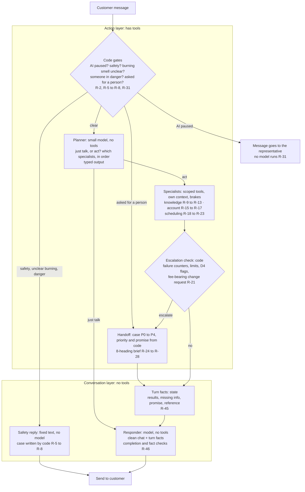

# PRD — Meridian AI service agent (AEA FDE Challenge: AI Call Center Agent)

**Version:** 0.4, 2026-10-20 (0.2 at 19:25 CT; 0.3 added the Stage 2–3 decisions: R-21/R-22 fee rule, R-45–R-47, §6.1 two-layer design, recomputed §3.3; 0.4 adds the Stage 4 interview answers: 10× scale path, alerts on the page, VPS Langfuse, dev/held-out split, Sonnet by default, $30/day cap; interview `docs/prd/inno-aea-callcenter-interview.md`). **Status:** **Approved by Innocent at the Stage 4 gate, 2026-10-20** ("yes i approve"), as version 0.4, after the Stage 4 interview. Stage 1 approval was given the same day. **Writer:** Claude (Opus 5.5). **Internal target:** finish by **Wed 2026-10-21, 06:00 CT** (`SUBMISSION.md`).

**What this document owns:** scope, requirements with acceptance checks, priorities for the time box, the delivery plan and
the risks. **What it links to rather than repeats:**

| Topic | Owner |
|---|---|
| The issued brief (portal Part A, PDF Part B) | [`docs/source/aea-call-center-briefing.md`](../source/aea-call-center-briefing.md) |
| Problem behind the brief, why-chain, assumptions, traps (C-, K-, D-, E-, L-, G-) | [Brief audit](../analysis/2026-10-20-brief-audit.md) |
| Two-layer framing, north star, metrics tree, targets | [Framing](../delivery/2026-10-20-angle-and-demo-framing.md) |
| Call drivers, counts, sources, handoff matrix | [Handoff information inventory](../data/handoff-information-inventory.md) |
| Handoff product direction and every product decision (status table §11) | [Consolidated handoff direction](../analysis/2026-10-20-human-handoff-consolidated-direction.md) |
| Who Meridian serves, service journey, UX inputs | [Company and service profile](../analysis/2026-10-20-meridian-company-service-profile.md) |

**Labels:**
- **[Issued]:** required by the brief.
- **[Meridian]:** observed in the issued data.
- **[Decided]:** Innocent's choice, 2026-10-20 (ID in brackets).
- **[Proposed]:** this PRD's proposal, approved only at the §4 gate.

---

## 1. Summary

**The business problem [Issued].** AEA wants Meridian's call center to "expand call center coverage without adding
headcount by deflecting a majority of calls to an AI agent". It will judge that by containment, accuracy on handled
drivers, escalation on out-of-scope calls, retrieval accuracy and production monitoring (Part A).

**What we build.** A public chat agent for Meridian's homeowners. It:
- answers the main routine questions from the **current** knowledge base;
- books appointments in the scheduling database;
- gives the **safety instruction first** when it matters;
- hands everything else to a person, with a short brief, its sources and an **honest promise**.

A staff console lets a representative take over the same chat (simulated staffing, clearly labelled). A business-owner
view shows outcomes. An evaluation built from the transcripts reports containment honestly.

**How we measure success (Innocent's framing).** We chose a scope we can build well by 06:00, and we aim to resolve
**100%** of the requests inside it correctly; ≥ 90% is the bar before a topic counts as ready. The brief's containment
is reported as **coverage × in-scope resolution**:
- tonight's scope covers **58.3%** of the issued call volume;
- the roadmap (§3.3) shows how appointment changes, a payment system, membership billing and Meridian's records take
  coverage to **77.9%**;
- the remaining 22.1% belongs with people by design or policy: disputes, refunds, complaints, safety and, since the
  Stage 3 review, reschedules that carry the $49 fee.

See [framing §1–§2](../delivery/2026-10-20-angle-and-demo-framing.md).

---

## 2. Users and what they need

| User | Job | What success looks like |
|---|---|---|
| **Homeowner (customer)** | Get a routine thing done, or know exactly what happens next | Correct answer or booking; never repeats the story; a promise that is kept |
| **Representative** [Decided OD-1, OD-2] | Pick up a handoff and act without re-asking | A brief, the sources, and the full chat; can join the same chat |
| **Supervisor** [Decided OD-1] | Make sure nothing urgent, unowned or overdue is left | Sees P0/P1, unowned, due-soon and overdue cases; assigns |
| **Business owner** [Decided OD-1] | Know whether the AI cuts load without hurting customers | Correct-resolution rate, promises kept, why handoffs happen |
| **Reviewer (grader)** [Issued] | "Ask their own questions and try to break it"; "watch the agent escalate" | Can do both, plus see staff and owner views, without being misled about staffing |

---

## 3. Call drivers and scope

### 3.1 Top drivers by volume [Meridian]

From all 420 transcripts (inventory §3.1; classification reproducible by `docs/data/scripts/`):

| Rank | Driver family | Calls | Share |
|---:|---|---:|---:|
| 1 | New service booking (HVAC repair, plumbing, tune-up) | 132 | 31.4% |
| 2 | Billing information and payments | 67 | 16.0% |
| 3 | Comfort Club membership | 57 | 13.6% |
| 4 | Warranty | 45 | 10.7% |
| 5 | Managing an existing appointment | 38 | 9.0% |
| — | Disputes and refunds 24 · complaints 16 · out of scope 16 · estimates 12 · safety 9 · two-part 4 | 81 | 19.3% |

### 3.2 What the agent handles [Proposed, built on decisions]

The brief asks for RAG on "the top 3 call drivers" and, separately, a scheduling flow (Part B goals 2 and 3).

| Competency | Drivers | Why these | Volume handled |
|---|---|---|---|
| **Scheduling** [Issued; DEC-1 decided] | New service booking (rank 1) and replacement estimates; then reschedule (fee-free only; a fee-bearing one becomes a staff request, R-21) → confirm → cancel as time allows | Largest driver; required competency | 116 + 12, then 15 (14 fee-bearing) / 8 / 6 |
| **RAG driver A: Membership** [Proposed] | What's included, price, member discounts, renewal date and terms | Rank 3; fully covered by current KB (`membership/comfort_club_overview.md`, fee PDF) and `customers` fields; the archive copy is the classic trap (K-6) | 38 of 57 (cancel and upgrade need missing systems, D4) |
| **RAG driver B: Billing questions** [Proposed] | Balance, "what is this invoice for", duplicate-charge explanation | Rank 2; answerable from `invoices` + FAQ; payments themselves go to staff (D4) | 39 of 67 |
| **RAG driver C: Warranty** [Proposed] | Install and repair warranty terms, compressor/parts coverage, transfer to a new owner | Rank 4; answerable from `warranty_policy.md` + `customers`; the 2023 archive is the trap (K-8) | 29 of 45 |

**Escalated by design [Decided, policy]:** billing disputes, refund requests, complaints and manager requests,
commercial work, a late technician, and the actions the supplied systems can't perform (D4 table). Safety reports get the
safety instruction first (§4.2).

**Why "right 3", not just "top 3" [Proposed].** By volume, billing (rank 2) includes payments the systems can't take, and
disputes that policy keeps with a supervisor. We handle the **answerable part** of each driver and escalate the rest. That
is the judgment the reviewer asks about: "Did you pick the right 3 drivers to handle and the right ones to escalate?"

### 3.3 Scope coverage and the roadmap (measured on the issued calls)

Coverage is the share of call volume our scope is built to resolve. Inside it, the aim is 100% correct.

| Step | Adds | Calls covered (cumulative) | Coverage |
|---|---|---:|---:|
| **Tonight's scope** | Booking (excluding the burning-smell cases), membership, billing and warranty answers, estimates, redirects | 245 | **58.3%** |
| Appointment changes (in tonight's plan as time allows; DEC-1 order) | Fee-free reschedule, then confirm, then cancel | 246 → 254 → 260 | 58.6% → 60.5% → 61.9% |
| With more time and systems: a payment system | Payment links, autopay | 288 | 68.6% |
| With more time and systems: membership billing | Auto-renew changes, upgrades, join-and-book | 311 | 74.0% |
| With more time and systems: Meridian's records | Manufacturer registration, repair history | 327 | 77.9% |
| **Belongs with people by design or policy** | Disputes, refunds, complaints, safety, commercial, late technician (79); reschedules inside 24 hours, which carry the $49 fee (14) | 93 | 22.1% |

*Recomputed 2026-10-20 after the Stage 3 decision on fee-bearing changes (consolidated §9.3): 14 of the 15 reschedule
calls are inside 24 hours (inventory §5.3), so they move from "appointment changes" to "with people by policy". Tonight's
58.3% is unchanged. Earlier figures (65.2%, 81.2%, 18.8%) are superseded.*

*Wrong numbers (5) count as resolved. Excluding them, tonight's coverage is 57.8%. Both figures are reported.*

---|---:|---:|
| Core: booking (excluding the burning-smell cases), membership, billing and warranty answers, estimates, redirects | 245 | **58.3%** |
| + fee-free reschedule | 246 | 58.6% |
| + confirm | 254 | 60.5% |
| + cancel | 260 | 61.9% |
| Not resolvable by design or policy: policy or safety escalations 79 (18.8%), fee-bearing reschedules 14 (3.3%); missing systems 67 (16.0%) | — | — |

*Wrong numbers (5) count as resolved. Excluding them, the core is 57.8%. Both figures are reported.*

---

## 4. Requirements

**Priority for the 06:00 time box:**
- **M** = must ship;
- **S** = should ship, after the Must items pass their checks;
- **C** = could ship if time remains.

Every requirement names its source.

### 4.1 Chat experience

| ID | Requirement | Source | Acceptance check | P |
|---|---|---|---|---|
| R-1 | A public web chat. The greeting says it is Meridian's automated assistant; it never claims to be human | [Issued] Part B §6; audit E-6, L-6 | Greeting text present; "are you a person?" answered truthfully | M |
| R-2 | A persistent "Talk to a person" control. A direct request for a person (button or words) creates a handoff on the **first** request | [Decided] OD-6; consolidated C1 | 100% of request cases hand off on the first ask | M |
| R-3 | The dataset's "today" (Fri 2026-10-16) is a configured clock, shown in the UI; never the server clock | audit C-9 | Relative dates resolve from 2026-10-16 | M |
| R-4 | Plain, short replies; fees and windows in exact numbers; a source shown for policy answers | profile §6; consolidated C4 | Spot check on test transcripts | M |
| R-44 | Before booking a non-urgent repair, the KB's quick checks may be **offered**: very optional, never required, skipped for urgent and safety cases. A call counts as resolved by a check only if the customer confirms it is fixed | [Decided] profile §8 item 4; audit E-8; `faq/troubleshooting_before_you_call.md` | Declining the checks books straight away | C |
| R-45 | **Turn-to-turn context management.** Conversation state is typed and durable per thread (checkpointer): identity status and customer ID; open tasks with the details collected and what's still missing; record and passage IDs from the latest lookups; any pending change request or open case with its promise; failure counters; who controls the chat. **Each model sees only its slice:** the planner, the recent clean chat plus a state summary; a specialist, its task and the state it needs, not the whole chat; the responder, the recent clean chat plus this turn's facts. Tool output never enters the chat history. Turns beyond a window (about 10 [A]) are condensed into a typed summary copied from state, never from model memory. Facts that go stale are re-read before use: slot availability before any write, code expiry (R-15) | [Decided] Innocent, 2026-10-20 (Stage 3: "turn-to-turn context management"); register HP-1 | Multi-turn cases: a follow-up ("what about Monday?") resolves against the open task; a safety phrase mid-chat still comes first; no tool output in the stored chat; a 20-turn chat keeps identity and the open task | M |

### 4.2 Safety and urgent cases

| ID | Requirement | Source | Acceptance check | P |
|---|---|---|---|---|
| R-5 | A deterministic safety check runs **first on every turn**. Gas or rotten-egg smell, CO alarm, sparks/smoke/flames, or burning smell with tripped breakers → the KB instruction in the same turn, before identity, lookup, queue or case | [Issued] KB `policies/escalation_and_safety.md`; audit K-12, E-3; [Decided] consolidated §9.2 | 100% of safety cases, including phrases mid-chat and with typos | M |
| R-6 | After the instruction, offer to take contact details (never a gate); create a **P0** case even with no account match; promise no follow-up time | [Decided] D5, OD-4 (iii) | Instruction precedes any contact request in 100% of cases | M |
| R-7 | Burning smell with no breaker information: ask whether breakers have **already** tripped and whether there is smoke, sparks or flames (never ask them to check). If yes → R-5. If unclear → a conditional safety instruction, the emergency number and a P1 case. If both are ruled out → an urgent booking plus a priority case | [Decided] D2; consolidated §9.2 | Three test variants each follow their path | M |
| R-8 | No heat, no cooling or an active leak is a **normal booking** with skippable urgency questions (heat or cold, water running, someone at risk) in the booking note. **Only when the customer says someone is in danger because of the conditions:** the 24/7 emergency number first (placeholder **(512) 555-0199**), a **P1** case, and, if nobody is online, a *separate* "reviewed within 1 business day" line that is never framed as the emergency wait | [Decided] OD-4 (ii), narrowed at the Stage 2 check (Innocent, 2026-10-20, WP-3); consolidated §9.1 | Ordering and wording checks on test cases | M |
| R-47 | **How safety and danger are detected** (HP-2 C): word rules (typo-tolerant) run first and decide alone when they match. Then a small, cheap classifier reads the message and may only **raise** it (normal → burning-unclear or danger), never lower it. Its label only picks a fixed path; it never writes the reply. If the classifier fails or times out, the rules stand | [Decided] HP-2 option C (Innocent, 2026-10-20); register HP-2 | Safety recall 100% (issued safety calls + labelled synthetic variants); danger recall 100% on labelled synthetic cases; **false alarms ≤ 10%** on no-danger comfort cases [Decided target] | M |

### 4.3 Knowledge base retrieval (RAG)

| ID | Requirement | Source | Acceptance check | P |
|---|---|---|---|---|
| R-9 | An ingestion step parses every format present: Markdown, TXT, the fee **PDF**, the price-book **CSV** as rows, and the holiday **PNG** by OCR or a hand-verified transcription stored with a link to the image. It writes an ingestion manifest | [Issued] Part B goal 2; audit K-13 | Manifest lists all 17 files with status and parse method | M |
| R-10 | **Excluded from retrieval:** `archive/*`, `faq/faq_old_copy.md`, `services/scheduling_guide.md`. **Staff-only, never quoted to customers:** `internal/agent_discretion_notes.md`. **Stub, not answered from:** `services/duct_cleaning.md`. Issued files untouched | [Decided] DEC-4; audit K-15, K-14 | 0 answers sourced from excluded files in the stale-trap eval cases | M |
| R-11 | Retrieval uses embeddings and vector search (Part A technology) over a **vector store**: the current KB chunks embedded locally (`BAAI/bge-small-en-v1.5`) into an index file inside the app, rebuilt from the ingestion manifest (§6), with the chunk's file, section and version date carried to the answer as a citation | [Issued] Part A (embeddings and vector search); the embedding model is our choice [Proposed]; consolidated C4 | Every policy answer carries a source | M |
| R-12 | Retrieval is evaluated **on its own** before answers: query → expected *current* document, including cases where a stale copy is the closest text match | [Issued] Part B goal 2; audit C-14 | Hit rate in the top 3 reported; target ≥ 90% (framing V1) | M |
| R-13 | Answers come only from retrieved current text or tool results. No firm repair prices ("the technician confirms pricing on site"). The agent never asks for or accepts card numbers (audit K-17, L-4). If no current source supports an answer, the agent says so and offers a person | [Issued] "Do not let the agent guess"; audit K-18, K-15 | Wrong-answer rate ≤ 5% on handled cases (framing V1) | M |

### 4.3a What the agent knows: the knowledge map

**Where answers come from.** The knowledge base is **issued by Meridian**, not generated by us: 17 files in
`docs/data/issued/meridian_dataset/knowledge_base/`. The agent answers company questions only from these files and the
scheduling database. The table maps each kind of question to its source; it doubles as the retrieval eval's answer key
(R-12) and the router's topic list.

| Customers ask about | Answered from (current source) | Never from (excluded, R-10) | DB fields used |
|---|---|---|---|
| **Membership:** what's included, price, monthly vs annual, Plus, discounts, renewal, cancel rules, transfer | `membership/comfort_club_overview.md` (eff. 2026-01-01); `pricing/2026_fee_schedule.pdf` | `archive/comfort_club_overview.md` | `customers.membership_tier`, `membership_renewal_date` (after the code) |
| **Billing questions:** what a fee is for, diagnostic credit, after-hours fee, payment methods, duplicate charges | `faq/customer_faq.md` (2026-03-02); `pricing/2026_fee_schedule.pdf`; `pricing/repair_price_book_2026.csv` | `faq/faq_old_copy.md` | `invoices.*` (after the code) |
| **Warranty:** repair and install labor, manufacturer parts, registration, transfer, how to claim | `warranty/warranty_policy.md` (eff. 2025-06-15) | `archive/warranty_terms_2023.txt` | `customers.system_brand`, `system_install_date` |
| **Booking and appointments:** windows, texts, cancel/reschedule rules, late technicians | `faq/customer_faq.md`; `services/technician_arrival_and_etas.md`; `SCHEMA.md` rules | `services/scheduling_guide.md` (Rev 2024-11) | `appointment_slots`, `appointments`, `technicians` |
| **What Meridian does, and doesn't:** services, repair price ranges, tune-ups, replacements and financing; not offered (commercial, duct cleaning, window units, appliances) | `services/service_catalog.md` (2026-02-10); `pricing/repair_price_book_2026.csv`; `faq/customer_faq.md` (financing) | `services/duct_cleaning.md` (stub: "a representative can share a referral") | — |
| **Where and when:** service area and ZIPs, phone hours, holidays | `policies/service_area.md` (2026-04-01); `faq/customer_faq.md`; `policies/holiday_hours_2026.png` (hand transcription linked to the image) | `faq/faq_old_copy.md` | `customers.city`/`zip` → zone |
| **Safety and urgent problems** | `policies/escalation_and_safety.md` (Rev 2026-01; its rules run in code, R-5); `faq/troubleshooting_before_you_call.md` (optional self-checks, R-44) | — | — |
| **Staff-only guidance** (never quoted to customers) | `internal/agent_discretion_notes.md`: informs handoff briefs and staff views only | Customer replies | — |

**Questions the files can't answer** (for example "How long have you been in business?" or "Who owns Meridian?"): the
agent says it doesn't have that information and offers a person. It never fills the gap from general knowledge (R-13).

**Where the company profile fits.** The [company profile](../analysis/2026-10-20-meridian-company-service-profile.md) is
our research, built from these same files plus outside industry sources. It is **not an answer source**: its industry
context (Austin heat, maintenance plans, water shutoff advice) is not Meridian policy, and quoting it would invent
company facts. It shaped the product instead:

| Profile finding | Where it is in this PRD |
|---|---|
| Customers revolve around an address, a system and an appointment window (§1) | R-17, R-18, R-20: account and booking answers built on those fields |
| Urgency is the least defined part of the KB; the emergency line has no number (§3–§4) | R-8: normal booking unless someone is stated to be in danger; then emergency number first and a P1 case |
| Water at the indoor unit has a KB step; whole-house shutoff advice does not exist (§4) | R-8 and OD-4: only the KB step is given |
| Late technicians are the biggest trust moment (§2) | D4 late-technician row; R-24 |
| Self-checks exist in the KB but agents never used them (§3) | R-44: offered, very optional |
| Follow-up: phone or email; promises must be traceable (§5) | R-26, R-27 |
| Mobile, one-handed use; accessibility; safety colours (§6–§7) | §5 non-functional; brand direction A (§6) |
| What Meridian does not offer (§1) | Knowledge map row above |

### 4.4 Identity and account data

| ID | Requirement | Source | Acceptance check | P |
|---|---|---|---|---|
| R-14 | Public questions and safety need no verification | [Decided] OD-3 | — | M |
| R-15 | For private details or account changes: locate the record (name + phone, customer ID or invoice number; a locator is not proof). Then send a **simulated** one-time code to the phone or email on that record, delivered only to a labelled **demo delivery inbox** and never shown in chat. The code is entered in chat. Defaults: 10-minute expiry, 3 attempts, verification per session and per customer, the code hashed and never logged | [Decided] OD-3 / audit DEC-3; consolidated §8 | Nothing private appears before a correct code; no code in chat, logs or traces | M |
| R-16 | No match, an ambiguous match, no usable contact or a failed code → hand off without revealing whether an account exists | [Decided] OD-3 | No-match test reveals nothing | M |
| R-17 | Account answers after verification: invoice balance and line items (explain; never adjudicate; INV-204411's $144 vs $149 is a staff note, not a customer verdict), membership tier and renewal date, install date and the warranty term (2-year install labor; "5 years if you were a member at installation; a representative can confirm", because the DB has no enrollment date, K-9) | [Proposed] §3.2; audit D-8, K-9 | Seeded customers MHC-10001…10004 answer correctly | M |

### 4.5 Scheduling

| ID | Requirement | Source | Acceptance check | P |
|---|---|---|---|---|
| R-18 | Availability check and booking: match the customer's zone (city → zone, plus `central` for Dripping Springs 78620 and Manor 78653; Lakeway west of 620 not served), service type, `open` slots, and `reserved_members` for members; offer alternatives when the request can't be met | [Issued] Part B goal 3; `SCHEMA.md`; [Decided] Q-3; audit K-11 | Booking rules hold in 100% of test bookings (framing V2) | M |
| R-19 | Writes go to a **working copy** of the DB, never the issued file. The check and the slot update happen in one transaction; retries are idempotent; no double booking. A one-command reset restores the copy | audit G-7; [Decided] Q-2 | Concurrency test; reset script | M |
| R-20 | Booking confirmation states date, window and technician name. The quoted fee depends on the member's tier (diagnostic $89 waived for members; tune-up $129 or included) | `SCHEMA.md`; fee PDF; inventory §5.3 rows 6–7 | Member and non-member cases quote correctly | M |
| R-21 | **Reschedule with no fee** (more than 24 hours before the window): the AI moves it under the booking rules (R-18, R-19) once the customer has picked the new slot. **Reschedule that carries the fee** (inside 24 hours): the AI **never moves it, even on a yes**. It verifies, explains that "the $49 fee applies under current policy" (never "charged"), records the requested change (wanted time, slots shown but **not held**, reason, hours before the window), says the original appointment stays until a person confirms, and hands off: **P2**, internal due time at the window start, supervisor alert at once, live queue first if someone is online, phone support mentioned when open. If confirmation before the window can't be guaranteed, it says so plainly. A contested fee's reason goes in the same case. Never waived. Counts as an escalation, not a resolution | [Decided] D3 = DEC-2, revised at Stage 3 (Innocent, 2026-10-20); consolidated §9.3; WP-4 | 0 fee-bearing moves by the AI; the fee line and the "original stays" line in 100% of fee-bearing cases; fee-free moves pass the booking rules | S |
| R-22 | Confirm, then cancel. A cancellation more than 24 hours out is free and the AI makes it. **A cancellation inside 24 hours** (the same $49) is handled like R-21: explain the fee, never cancel, send a staff request, say the appointment stays until a person confirms | [Decided] DEC-1 order; inside 24h: Innocent, 2026-10-20 (Stage 3); consolidated §9.3 | Seeded MHC-10001 confirm and cancel cases; 0 fee-bearing cancels by the AI | C |
| R-23 | Estimates book `estimate` slots with a Comfort Advisor | `SCHEMA.md`; `service_catalog.md` | Estimate test cases | M |

### 4.6 Handoff, cases and staff views

| ID | Requirement | Source | Acceptance check | P |
|---|---|---|---|---|
| R-24 | Handoff triggers: policy list (dispute, refund, conduct, manager, legal or chargeback), safety, a direct request, failure signals (two-attempt hypotheses), D4's unfinished tasks, and a fee-bearing change request (R-21). Informational limits answer without a case | [Decided] OD-6, D4; consolidated §9.4 | Trigger tests, including synthetic ones | M |
| R-25 | Each handoff creates a **case** in new tables beside the working DB copy, with priority P0–P4 set by code | [Decided] case store; consolidated §6 | Case row per handoff | M |
| R-26 | **Promise from a policy table, never the model.** Nobody online: "A representative will get back to you within 1 business day". Refund requests: "A representative will get to your refund request within 2 business days" (a response, not a refund). Staffed: "A representative will join this chat when available". No time promised for safety, emergency response, arrival or outcomes. A reference number every time. **Fee-bearing change request (R-21):** the standard promise, plus, when the window starts before that promise could be met, "I can't promise anyone will confirm a change before your appointment starts; until a representative confirms, please plan on the technician arriving [window]" | [Decided] OD-4 | Promise text matches the table in 100% of cases (framing V3 hard gate) | M |
| R-27 | Follow-up preference: "We'll follow up by email unless you'd prefer a phone call." Store channel, destination (on record or not) and window. Private details only go to a destination on record after verification | [Decided] OD-5; consolidated §9.5 | Stored and shown beside the promise | M |
| R-28 | The **triage brief** has eight fixed headings, with facts and claims kept apart. Facts, promise, AI actions and identity come from state; only "what the customer needs", claims and the open decision use constrained model selection. A link to the full chat. About grade-5 wording, exact numbers | [Decided] consolidated C2, §5 | Required-item recall ≥ 90%; 0 invented facts (spike-style check on the test set) | M |
| R-46 | **Checks on the model's words** (HP-4 B): a **completion check** blocks any reply claiming an action ("done", "cancelled", "moved", "refunded", "turned off") unless a write tool succeeded in that turn; a **fact check** compares every number, date, ID and amount in the model's reply and brief headings with the turn facts and the lookup log, removes anything unmatched and flags the heading. The promise and reference are appended by code after the model's text | [Decided] HP-4 option B (Innocent, 2026-10-20); register HP-4 | 0 completion claims without a write; 0 invented facts in briefs | M |
| R-29 | **Lookup log:** every tool call records tool, record or passage ID, time, the result seen, and the message that used it. The case shows only pertinent sources, each as a snapshot plus the current value with a "changed since" marker | [Decided] consolidated C4; D6 | Every brief fact opens its source | S |
| R-30 | **Staffing:** an explicit representative-presence state. Default **nobody online** (async). A labelled "Demo: simulated staff on shift" mode with a banner on customer and staff screens. When staffing ends before a claim → the async promise | [Decided] OD-1, OD-5 | No live queue offered while nobody is online (0 occurrences) | M |
| R-31 | **Same-chat takeover:** in simulation, the reviewer opens the staff console (separate route, demo staff sign-in, distinct look), claims the case and replies in the same conversation. The AI pauses visibly; hand-back or close is explicit | [Decided] OD-2 | Scripted walkthrough passes | S |
| R-48 | **One demo login gates the whole deployment** (customer chat, staff console, demo controls, monitoring and eval pages). Username and password come from Railway variables (`MERIDIAN_DEMO_USERNAME`, `MERIDIAN_DEMO_PASSWORD`; `.env` locally) and are given to the reviewer in the README. **Once signed in, the reviewer can switch freely between acting as the customer and as any staff role** (representative, supervisor, owner) from a visible control, with no second password. Reset sits behind the same login | [Decided] Innocent, 2026-10-21 (Stage 6: "it should be password-gated in general … we need to make that easy for the reviewer") | Every route except the login and `/healthz` refuses an unsigned request; the role switch works in one click | M |
| R-32 | **Staff console views:** representative queue (P0/P1 first, then due time) and case view (brief, sources, chat, outcome, flag); supervisor list (P0/P1, unowned, due soon, overdue, stuck; assign); business-owner panel (correct-resolution rate, promises kept, handoffs by reason, health) | [Decided] OD-1; framing §3 | Each view shows its items on seeded and live cases | S (rep, supervisor) · C (owner) |
| R-33 | Case lifecycle: unassigned → claimed → in progress → waiting (with a wake-up time) → resolved / closed unresolved; live-queued for the staffed path; a promise record (open, kept, missed, changed); a simulated-time control for due and overdue; a few labelled "demo seed" cases so the supervisor and owner views have work to show | [Decided] consolidated §6, §8 | Simulated clock shows overdue correctly | S |
| R-34 | Follow-ups and calls are **recorded, never sent**, labelled "Demo: recorded, not sent" | [Decided] OD-5 | No UI text claims a send | M |

### 4.7 Monitoring, feedback and evaluation

| ID | Requirement | Source | Acceptance check | P |
|---|---|---|---|---|
| R-35 | Monitoring page: volume, containment (correct-resolution), escalations by reason, failures, latency p50/p95, spend. Alerts as decision lines (framing health list). Health shown separately from correctness. **Alert delivery (Stage 4 Q-045 = A, Innocent 2026-10-20):** alerts stay on this page; a health check restarts the service if it stops responding. No push channel tonight; pushing hard alerts to a channel is a roadmap item | [Issued] Part B §7; audit G-5 | Page reads stored data | M |
| R-36 | Traces and logs are redacted: no codes, no card-like numbers, and minimal PII. **Traces go to the self-hosted Langfuse on Innocent's VPS** (Stage 4 Q-050/Q-062, Innocent 2026-10-20): traces stay on his own server; project rule 18 is met | audit G-9, L-4 | A seeded name or number test shows redaction | M |
| R-37 | Feedback loop: staff flag an AI answer, brief or escalation as wrong → a review list. Nothing changes the KB, prompts or eval set automatically. The loop is described in the README | [Issued] Part B §7; audit G-6, C-13 | Flag appears on the list | S |
| R-38 | **Test set from transcripts:** balanced across the 11 driver families and support levels (EVQ-1 = A, Innocent 2026-10-21: 34 of 37 categories have one template, so category stratification and template hold-out can't both hold), **held out by template**, with expected outcomes from the current KB and DB (not the human agent's answer), plus labelled synthetic cases for safety phrasing, a direct request for a person, failure signals, identity and prompt injection. **Two splits by template** (Stage 4 Q-054 = A, Innocent 2026-10-20): a **dev split**, whose failures we read and fix against, and a **sealed held-out split**, scored only, which gives the README number. Both balanced by driver family and support level (EVQ-1 = A, 2026-10-21); building agents never see the held-out answer key | [Issued] Part B goal 5; audit D-1, D-3, D-5; `synthetic-test-data.md` | Mix published; size and split stated | M |
| R-39 | **Eval report** with denominators: correct-resolution rate (north star) on all cases, accuracy on handled drivers, escalation recall (out of scope), false escalation (in scope), wrong-answer rate, retrieval hit rate, safety-first and request-honoured gates, promise consistency | [Issued] Part A impact metrics; framing §2 | Numbers come from a run, never from a target | M |

### 4.8 Deployment and delivery

| ID | Requirement | Source | Acceptance check | P |
|---|---|---|---|---|
| R-40 | Deployed on **Railway** in its **own dedicated Railway project** (Innocent, 2026-10-20), at a public URL; secrets in Railway variables (the Anthropic and OpenRouter keys come from the YourAI project's `.env`, per Innocent) | [Issued] Part B §6; `gauntlet-hosting-default.md`; audit G-10 | URL reachable | M |
| R-41 | Abuse limits: rate limits per session and IP, a cap on bookings per session, a daily model-spend cap that falls back to handoff, and explicit loop brakes (`agent-architecture.md` rules 5, 15) | audit G-2, G-5 | Limits configured; brake tests | M |
| R-42 | A **public** repository with code, the eval set and the issued dataset (licence risk accepted, audit L-8) | [Decided] Q-1 | Repo public | M |
| R-43 | Deliverables: README (how to run; containment numbers), technical documentation, deployment guide, test results, a 3–4 minute walkthrough video on design reasoning | [Issued] Part A and Part B deliverables; audit C-1 | `SUBMISSION.md` rows filled | M |

---

## 5. Non-functional requirements

- **Correctness over fluency.** Rules, dates, zones, fees, priorities and promises are code, not prompts
  (`agent-architecture.md` rule 1).
- **Load [T] (Innocent, 2026-10-20):**
  - about **100 agent conversations per day**;
  - a spike of about **20 at once**.
- **Scale path [T] (Innocent, 2026-10-20, Stage 4 Q-029):** a written path to 10× (about 1,000 conversations a day,
  about 200 at once) in the Stage 6 design. It is documentation only; nothing is built for it.
- **Design consequences [C]:**
  - one service instance must hold 20 concurrent conversations without queueing customers;
  - rate limits and the model-concurrency limit are set above 20;
  - booking writes are serialized in one transaction (SQLite has one writer at a time, which is fine at this volume).
- **Spend:** the daily spend cap is **$30/day** (SD-1.6, raised 2026-10-20), about $0.30 per conversation at ~100/day [C].
  SP-1 measured mix B at **$0.016 per conversation on average** [M] (`docs/analysis/spikes/SP-1-two-layer-turn-latency-cost.md`
  §3), far under the cap; the Anthropic Start tier's $500/month cap is not reached at this rate [C].
- **Latency.** p95 per turn ≤ **12.5 s** **at the 20-conversation spike** ([Decided] Innocent 2026-10-21 after SP-1, which measured 10.2 s on the chosen mix [M]; was 8 s [A]).  A
  turn chains about 3.3 model calls [M]; on mix B, Jev answers the planner and classifier in about 0.2 s and the slow tail is
  the Sonnet responder after the specialist calls (SP-1 §3). Stage 9 re-measures against 12.5 s.
- **Cost.** Paid model APIs whose terms exclude training on inputs (audit L-9), and a daily spend cap.
- **Reliability.** Every model or tool failure ends in a handoff with context, never a dead end.
- **Privacy.** Least-privilege staff views; snapshots hold only the fields used, deleted 90 days after the case closes
  (production default; D6). The demo resets instead.
- **Accessibility.** WCAG 2.2 AA contrast; colour never the only signal; safety states unmistakable (profile §7).

---

## 6. Architecture outline [Proposed; Stage 6 design owns the detail]

### 6.1 How the agent handles one message (flow)

**Chosen at the Stage 3 review (Innocent, 2026-10-20; register HP-1):** a two-layer design. The **action layer** has the
tools; the **conversation layer** has none. Code gates run first; a planner decides "just talk" or "act"; specialists
act with scoped tools and their own context; a code check decides whether to escalate; the facts of the turn go into
state; a responder with no tools writes the reply from the clean chat plus those facts. This replaces the earlier flow
(PRD 0.2), which had one router and one tool loop. Green in Innocent's drawing is code; purple is a model.

**How it maps to the requirements.**
- **Code gates** keep R-2, R-5–R-8 and R-31 in code, before any model. Danger is detected by
  R-47 (HP-2 C: rules first, a raise-only classifier).
- **The planner** handles mixed messages such as WP-1's three questions: it returns an ordered list of tasks.
- **Specialists** are knowledge (retrieval), account (identity code, invoice, membership, warranty) and scheduling
  (availability, booking, fee-free changes, staff change requests). Each has its own tool list, its own brakes, and
  returns a typed result to state, never its transcript (`agent-architecture.md` rules 7, 14). Stage 6 decides whether
  each is a LangGraph subgraph or a node.
- **The escalation check** is code: failure counters (OD-6), brakes and spend, D4's unfinished tasks, policy triggers and
  R-21's fee-bearing change.
- **Turn facts and context** follow R-45: state is the memory between turns, not the chat transcript.
- **The responder** never calls tools. Its words pass R-46's checks before code appends the promise and reference.
- **Presence and the live queue** (R-30, R-31) are unchanged: the handoff node reads the presence state.

Behind every tool call, a lookup log records the tool, the record or passage, the time and the result (R-29), and every
handoff writes its case to the case store that the staff console reads (R-32, R-33).

### 6.2 Components

- **Agent:** LangGraph [Decided], Python, in the two-layer shape of §6.1 [Decided at Stage 3, HP-1].
  - One durable thread per conversation (checkpointer), holding the typed state of R-45.
  - Code gates first (safety, burning, danger, person, AI paused).
  - A planner (small model, typed output), specialists with scoped tools, a code escalation check.
  - A responder with no tools, checked by R-46.
  - A handoff node that creates the case, the brief and the promise.
  - AI pause as a `controller` state field.
  - Brakes and `recursion_limit` set explicitly (consolidated §10).
- **Service:** a FastAPI app serving the customer chat, the staff console, the demo inbox and the monitoring page.
  Server-rendered pages with light JavaScript; no separate frontend build.
- **Data:** a SQLite **working copy** of the issued DB plus new case-store tables (`cases`, `case_events`,
  `lookup_log`, `promises`), and a reset script.
- **Retrieval:** chunks from the ingestion manifest, embedded into an in-process vector index persisted to a file (the KB
  is 17 files; a hosted vector service is unnecessary). Keyword matching is added to the vector search only if the
  retrieval eval shows misses.
- **Tracing [Decided, Q-050 revised by Q-062, Innocent 2026-10-20]:** the **Langfuse v4 instance already running on the VPS**
  (the YourAI stack: web, worker, Postgres, ClickHouse, Redis, MinIO), in its own Langfuse project for this app. Nothing new
  to host or pay for, and traces stay on Innocent's own server. Its web port is bound to localhost, so local runs use it
  directly (the Mac through an SSH tunnel). The deployed Railway app needs a public HTTPS route to it, a deploy-time step
  done with Innocent's yes.
- **Models [Decided, Innocent 2026-10-20, Stage 4 Q-040]:** **Claude Sonnet 5.5 in every role by default** (planner,
  danger classifier, specialists, responder, brief extraction). Spike SP-1 experiments across Sonnet 5.5, GPT-5.6 Terra,
  Gemini Flash and Jev (TypeSafe AI's typed-classification model, his pick for routing and classification; limited early access since 2026-09-15), and changes a role's model only if
  the measurements justify it. Model names live in configuration, so a role can change without code changes. Non-Claude
  models are called through the project's OpenRouter key (`.env`, Railway variables). This replaces "a smaller model for
  classification".
  **Jev's limit (applies the existing §5 rule, audit L-9):** Innocent's Equinox project calls Jev through OpenRouter
  (`typesafe/jev-1.13`). Equinox's check on 2026-10-11 found that TypeSafe's terms stated no retention period and did not
  exclude inputs from service improvement. Jev is tried in SP-1 on our fictional data. Re-checked 2026-10-20 (`docs/research/2026-10-20-vendor-and-framework-facts.md` §2e): training on inputs is now
  excluded in writing, so it passes the L-9 wording; a retention period is still not stated, which is recorded as a known
  limit. **Decided after SP-1 (Innocent, 2026-10-21): option B.** Jev does the planner and the danger classifier; Sonnet 5.5 does the specialists, responder and brief. Retention remains an accepted known limit. Measured in `docs/analysis/spikes/SP-1-two-layer-turn-latency-cost.md` §3–§4.
- **Visual direction:** A, dependable dispatch [Decided], applied lightly within the time box. Accessibility first.

---

## 7. Out of scope

- Voice [Decided DEC-5].
- Real SMS or email.
- Payments, autopay and auto-renew changes (the systems don't exist: D4).
- Multi-tenant staff accounts.
- Real Meridian staffing.
- Emergency dispatch.
- Commercial work.
- Duct-cleaning referrals beyond a limited answer.
- Fee waivers or discounts by the AI [Decided DEC-2].
- Any edit to the issued dataset.

---

## 8. Delivery plan to 06:00 CT

**The honest constraint.** About 11 hours remain at the time of writing (19:05 CT). The zero-to-hero stages after this PRD (data
samples and worked pairs, hard-problems page, interview, UX track, spikes, design, tickets) cannot all run as full,
signed stages in that time. **The checklist allows a stage to be skipped or compressed only with Innocent's recorded
decision** (*Skips* table). §10 asks for that once.

| Time (CT) | Work | Exit check |
|---|---|---|
| 19:30–20:00 | PRD and Stage 1 page reviewed; skips recorded; repo scaffold; DB working copy and reset; KB ingestion with manifest | Manifest lists 17 files; reset works |
| 20:00–22:00 | Core graph: safety node, retrieval with citations, account tools behind the identity code, booking tools, handoff node (case, brief, promise, follow-up preference), async default | **Checkpoint A (22:00):** safety-first, request-honoured, booking-validity and promise-consistency hard gates pass on smoke cases |
| 22:00–23:00 | Test set (stratified, held out by template) + synthetic cases; eval harness; retrieval eval | First full eval run with denominators |
| 23:00–00:30 | Staff console: queue, case view, claim and same-chat takeover, supervisor list; simulation mode and banners; demo inbox; monitoring page | Scripted takeover walkthrough passes |
| 00:30–01:30 | Railway deploy; eval on the deployed app; error analysis on the **dev split** failures only (R-38) | **Checkpoint B (01:30):** public URL live with the Must items |
| 01:30–03:00 | Reschedule (fee-free moves; fee-bearing → staff change request, R-21); then confirm and cancel if time allows; second eval run | Updated numbers |
| 03:00–04:30 | README, technical doc, deployment guide, test results; owner panel if time | `SUBMISSION.md` rows filled |
| 04:30–05:30 | Demo script and video (Innocent records) | Video file |
| 05:30–06:00 | Buffer; submit | Submitted |

**Time-savers built into the plan (from the review):**
- The holiday PNG is transcribed by hand once and stored with a link to the image (R-9 allows it), instead of building an
  OCR step.
- The test set is drawn from the existing per-call table (`docs/data/handoff-inventory-call-map.csv`): about 60
  transcript cases balanced by family and held out by template (EVQ-1), plus about 15 labelled synthetic cases. The
  validation-spike checks (brief recall, invented facts, promise consistency) run inside the same eval rather than as a
  separate spike.
- Independent slices can be built in parallel by planner → implementer pairs (`fanout-plan-then-implement.md`), each owning
  its own files:
  - ingestion and retrieval eval;
  - DB tools, booking, identity and reset;
  - case store, brief and promise;
  - eval harness.

  The graph core stays with the main session. No worktrees unless Innocent says so.
- The staff console is server-rendered from the same app: no second frontend.
- **Innocent is needed at 04:30 to record the video.**

**Cut order if a checkpoint slips.** Cut from the bottom of each list first; Must items are never cut.
1. The owner panel → numbers in the README instead.
2. Cancel, then confirm.
3. The lookup-log snapshot panel → source links only.
4. The supervisor list → the representative queue only.
5. Same-chat takeover (R-31). Cutting this reverses decision OD-2, so it needs Innocent's yes at the checkpoint.

---

## 9. Risks

| Risk | Effect | Mitigation |
|---|---|---|
| The time box | Must items slip | Checkpoints A and B; cut order; reuse of existing scripts |
| Containment read as a shortfall | The reviewer judges coverage instead of quality | Lead with 100% in-scope correct resolution, then coverage × resolution and the roadmap (framing §1–§2) |
| Implied staffing in the demo | False promise; reviewer trap (audit E-5) | Default unstaffed; banners; R-30 test |
| A stale-document answer | Legal and trust risk (audit L-1, L-2) | Exclusions (R-10) and stale-trap evals |
| Account fishing on a public URL | Privacy (audit G-2, L-3) | Simulated code to the contact on record; rate limits |
| The placeholder emergency number | Must not reach production | Labelled as a placeholder in config and docs |
| Public repo with an unlicensed dataset | Redistribution (audit L-8) | Innocent's accepted choice (Q-1), recorded |
| Synthetic-only escalation triggers | Thresholds untested on real data | Labelled synthetic cases; OD-6 hypotheses |
| Model cost and outages unattended | "Run for a month" | Spend cap, alerts, handoff fallback |

---

## 10. Approval (granted by Innocent, 2026-10-20, "yes to all")

1. **Approve this PRD's scope**: the three RAG drivers in §3.2 and the M/S/C priorities in §4.
2. ~~**Record the stage compression for the 06:00 target**~~ **Withdrawn 2026-10-20.** A bundled "yes to all"
   does not approve stage skips (rule: one skip, one yes). The checklist continues with Stage 2. Original wording kept for
   the record: in the checklist's *Skips* table. The proposal:
   - Stage 2 (samples, worked pairs) is covered by the inventory and the test set;
   - Stage 3 (hard-problems page) is covered by the consolidated direction and its decisions;
   - Stage 4 (interview) is this approval;
   - the UX track (UX-2 to UX-5) and stages 5–7 (spikes, design, tickets) are replaced by the build plan in §8, with the
     design recorded in the repo as it is built;
   - the build follows `build-loop-test-scope.md` (security-sensitive parts, identity codes and PII redaction, tested
     first).
3. **Sign off "our targets"** in the framing document: in-scope correct resolution aiming for 100% with a ≥ 90% bar per
   topic, wrong answers ≤ 5%, retrieval hit rate ≥ 90%.
4. **The five system-design foundation questions.** `system-design-questioning.md` requires your answers before any
   sizing. They have not been asked before. Recommendations, to accept or change:

   | Item | Question | Recommended answer |
   |---|---|---|
   | SD-3.1 | What load is it built for? | **Decided by Innocent, 2026-10-20:** treat Meridian as a big company for its region, with "about 100 per day" interacting with the agent [T]. **Scale path (Stage 4, Q-029 = A):** the design writes a path to 10×, about 1,000 a day and about 200 at once [T], naming what breaks first and the change for each; nothing is built for it |
   | SD-3.4 | Peak at the same moment? | **Decided by Innocent, 2026-10-20:** "a 20-user spike", about 20 conversations at once [T] |
   | SD-7.2 | What failure must it survive? | **Decided 2026-10-20:** a process restart without losing conversations or cases (SQLite on a Railway volume, durable checkpointer). Not a zone outage |
   | SD-1.6 | Spending ceiling? | **Decided 2026-10-20; model cap raised the same night (Stage 4, Q-061):** model spend capped at **$30/day** (Innocent: "lets even up it to 30"), about $0.30 per conversation at ~100/day [C]. Railway on the existing plan; tracing uses the Langfuse already running on the VPS (Q-062), so no new hosting cost. The Anthropic key's Start tier caps spend at $500/month (research §2b), below $30/day × 30; a tier upgrade is needed before sustained full load |
   | SD-1.9 | The hardest thing to prove? | **Decided 2026-10-20:** that every number we report is honest: correct answers, correct escalations, no stale-document answers |
| Q-045 (Stage 4) | Where do operator alerts go? | **Decided by Innocent, 2026-10-20: A.** On the monitoring page, plus a restarting health check; push alerts are roadmap |
| Q-050 / Q-062 (Stage 4) | Where do model and agent traces live? | **Decided by Innocent, 2026-10-20:** self-hosted Langfuse; then (Q-062) the instance already running on the VPS rather than a new one on Railway. Our own tables for the monitoring page and evals |
| Q-054 (Stage 4) | Which test cases may we look at while fixing? | **Decided by Innocent, 2026-10-20: A.** A dev split for fixing and a sealed held-out split for the reported number, both by template (R-38) |
| Q-040 (Stage 4) | Which models does the agent use? | **Decided by Innocent, 2026-10-20:** Sonnet 5.5 in every role for now; SP-1 compares Sonnet, GPT-5.6 Terra, Gemini Flash and Jev (TypeSafe AI, routing) |

Every other product decision is already recorded (consolidated direction §11). Nothing here re-asks one.

---

## 11. Review log

**Pass 1: 2026-10-20, ~19:05 CT.** The PRD was re-read against the brief audit, the company profile, the consolidated
direction (§3–§11) and the issued brief, then against the time box.

| Check | Finding | Change made |
|---|---|---|
| Every decision in consolidated §11 reflected | OD-1–OD-6, D2–D6, DEC-1–DEC-5, Q-1–Q-3, LangGraph and the case store are all present (R-2…R-43) | — |
| Audit trap coverage (C-, K-, D-, E-, G-, L-) | Missing: K-9 install-warranty floor; E-8 self-checks as an optional offer; K-17/L-4 never taking card numbers; consolidated §8 demo seed cases | Added R-44; extended R-13, R-17 and R-33 |
| Audit contradicted by a later decision | Audit E-2 and K-7 said "the agent can cancel auto-renew directly"; D4 found no auto-renew field exists | Audit E-2 and K-7 corrected to "case due before the renewal date" |
| Profile decisions | Urgency questions (R-8), brand A (§6), self-checks (R-44) and accessibility (§5) present | — |
| Promise wording | Matches OD-4: 1 business day, refund requests 2 business days (a response, not a refund), staffed "when available", "a representative", no safety time | — |
| System-design rules | The foundation questions (load, peak, failure, spend, hardest uncertainty) had never been asked | Added to §10 as item 4, with recommendations |
| Time box (about 11 h) | Every requirement is plausible, but the Must list is long: RAG with four formats, identity codes, booking, handoff and brief, and the eval all before Checkpoint A/B. Staff console, takeover and views are S/C | Added time-savers to §8; kept takeover as S with a cut that needs Innocent's yes (it reverses OD-2) |
| Honest numbers | Coverage (58.3–65.2% tonight) and in-scope targets are labelled; no result is claimed | Pass 2: reframed as 100% in scope plus coverage roadmap |
| Stage process | Stages 2–7 cannot run in full by 06:00 | Compression proposed in §10 for Innocent's recorded decision; no gate ticked |

**Pass 2: 2026-10-20, ~19:15 CT (Innocent's feedback).**
- **Framing:** "do not say 60%; we were going for 100% within the scope we had". The north star became in-scope
  correct resolution (100% aim, ≥ 90% bar). Containment is reported as coverage × resolution with a roadmap to 81.2%
  (§1, §3.3, framing §1–§2).
- **Flow diagram:** added the agent flow (§6.1).
- **Review page:** rebuilt with the substance of every Markdown source.

**Load answers recorded (2026-10-20, ~19:20 CT).** Innocent set SD-3.1 ("about 100 per day" interacting with the
agent) and SD-3.4 ("a 20-user spike"). They are applied in §5 and §10. SD-7.2, SD-1.6 and SD-1.9 are still open.

**Pass 3: 2026-10-20, ~19:30 CT (Innocent: "I don't see where you're generating a knowledge base").** Added §4.3a,
the knowledge map: question type → current source → excluded copy → DB fields. It also states that unanswerable company
questions get an honest "I don't know" plus a person, and traces how the company profile shaped the requirements without
becoming an answer source.

**Stage 2 check: 2026-10-20 (Innocent answered the three uncertain worked pairs).** R-8 narrowed: no heat, no
cooling or a leak is a normal booking; the emergency number and P1 case run only when the customer says someone is in
danger because of it (WP-3). Invoice lines are explained as billed, $144, without raising the $149 schedule fee
unprompted (WP-2). The burning-smell cautious path adds nothing beyond the KB (WP-6). No other requirement changed.

**Stage 3 choices: 2026-10-20 (Innocent).**
- **HP-1:** his two-layer design (action layer with tools; conversation layer without), adapted in §6.1, plus
  turn-to-turn context management (new R-45).
- **HP-3:** a reschedule that carries the $49 fee is never moved by the AI. It becomes a staff change request with a
  prompt staff path, and the original appointment stays (R-21 rewritten; consolidated §9.3).
  - Fee-free changes stay automatic. No waiver, as before.
  - Coverage recomputed in §3.3 and §1: the roadmap now reaches 77.9%, and 22.1% is with people by design or policy.
- **HP-4:** option B (new R-46).
- **Closed the same night (Innocent, 2026-10-20):** HP-2 option C with false alarms ≤ 10% (new R-47); a cancellation
  inside 24 hours is handled like a fee-bearing reschedule (R-22); spike SP-1 approved for Stage 5. Stage 3 gate signed.

**Overall judgement.** The scope matches the decisions and the brief. It is tight but achievable **only if** the Must list
is built in the §8 order, the cut list is applied without hesitation at the checkpoints, and approval (§10) comes now.
The riskiest items for time are the staff console with same-chat takeover (S) and a second eval round. The riskiest for
the grade are a stale-document answer and an implied live person, and both have hard gates.
